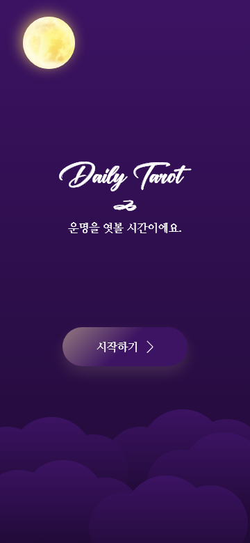

# 03. 배경 · 달 · 구름

## 목표
모든 화면에서 같이 쓰는 **보라색 그라데이션 배경 + 달 + 구름 + "Daily Tarot" 제목**을 만듭니다.

## 화면 분석


| 요소 | 만드는 방법 |
|---|---|
| 보라색 배경 (위는 밝고 아래는 어둡게) | `Brush.verticalGradient` |
| 왼쪽 위 노란 달 + 빛 | `Canvas`에 원(`drawCircle`) 여러 개 |
| 아래쪽 구름 | `Canvas`에 큰 원 여러 개를 겹쳐 그리기 |
| "Daily Tarot" 필기체 | `FontFamily.Cursive` |

> 💡 대회 제공 파일에 달, 구름, 로고 **이미지**가 있다면 이미지를 써도 됩니다.
> 여기서는 이미지가 없어도 되도록 **코드로 직접 그립니다.**

## 따라하기

### 1) 새 파일 `Common.kt` 만들기
1. 왼쪽 프로젝트 창: `app` → `kotlin+java` → `com.example.dailytarot`
2. 패키지에 **오른쪽 클릭 → New → Kotlin Class/File**
3. 목록에서 **File** 선택, 이름에 `Common` 입력 → Enter
4. 아래 코드를 **전부** 입력합니다.

```kotlin
package com.example.dailytarot

import androidx.compose.foundation.Canvas
import androidx.compose.foundation.background
import androidx.compose.foundation.layout.*
import androidx.compose.material3.Text
import androidx.compose.runtime.Composable
import androidx.compose.ui.Alignment
import androidx.compose.ui.Modifier
import androidx.compose.ui.draw.rotate
import androidx.compose.ui.geometry.Offset
import androidx.compose.ui.geometry.Size
import androidx.compose.ui.graphics.Brush
import androidx.compose.ui.graphics.Color
import androidx.compose.ui.text.font.FontFamily
import androidx.compose.ui.text.font.FontStyle
import androidx.compose.ui.text.font.FontWeight
import androidx.compose.ui.unit.Dp
import androidx.compose.ui.unit.dp
import androidx.compose.ui.unit.sp

// ───────── 색상 ─────────
val BgTop = Color(0xFF3E1566)      // 배경 위쪽 보라
val BgBottom = Color(0xFF1C0A30)   // 배경 아래쪽 진보라
val CloudBack = Color(0xFF3A1762)  // 뒤쪽 구름
val CloudFront = Color(0xFF2A0F4A) // 앞쪽 구름
val Gold = Color(0xFFFFD54F)       // 강조 글씨(노랑)
val Dim = Color(0x99FFFFFF)        // 흐린 흰색(안내 문구)

// ───────── 모든 화면이 같이 쓰는 배경 ─────────
@Composable
fun TarotBackground(
    showMoon: Boolean = true,
    showTopClouds: Boolean = false,
    content: @Composable BoxScope.() -> Unit
) {
    Box(
        Modifier
            .fillMaxSize()
            .background(Brush.verticalGradient(listOf(BgTop, BgBottom)))
    ) {
        if (showTopClouds) {
            // 아래 구름을 180도 뒤집어서 위에 붙인다
            Clouds(
                Modifier
                    .align(Alignment.TopCenter)
                    .fillMaxWidth()
                    .height(140.dp)
                    .rotate(180f)
            )
        }
        if (showMoon) {
            Moon(Modifier.padding(start = 32.dp, top = 24.dp).size(76.dp))
        }
        Clouds(
            Modifier
                .align(Alignment.BottomCenter)
                .fillMaxWidth()
                .height(190.dp)
        )
        // 실제 화면 내용 (상태바/내비게이션바에 가리지 않게 여백)
        Box(Modifier.fillMaxSize().systemBarsPadding(), content = content)
    }
}

// ───────── 달 ─────────
@Composable
fun Moon(modifier: Modifier = Modifier) {
    Canvas(modifier) {
        val r = size.minDimension / 2
        // 1) 바깥으로 퍼지는 빛
        drawCircle(
            brush = Brush.radialGradient(
                listOf(Color(0x88FFF59D), Color.Transparent),
                center = center,
                radius = r * 1.35f
            ),
            radius = r * 1.35f
        )
        // 2) 달 본체
        drawCircle(
            brush = Brush.radialGradient(
                listOf(Color(0xFFFFFDE7), Color(0xFFFFE082), Color(0xFFF6C453)),
                center = center,
                radius = r
            ),
            radius = r
        )
        // 3) 달 표면 무늬
        drawCircle(Color(0x33E0A030), radius = r * 0.22f, center = center + Offset(-r * 0.3f, -r * 0.2f))
        drawCircle(Color(0x33E0A030), radius = r * 0.15f, center = center + Offset(r * 0.35f, r * 0.25f))
        drawCircle(Color(0x22E0A030), radius = r * 0.12f, center = center + Offset(r * 0.1f, -r * 0.45f))
    }
}

// ───────── 구름 ─────────
@Composable
fun Clouds(modifier: Modifier = Modifier) {
    Canvas(modifier) {
        val w = size.width
        val h = size.height
        // 뒤쪽 구름: 원 여러 개를 겹치고, 아래는 사각형으로 채운다
        drawCircle(CloudBack, radius = w * 0.20f, center = Offset(w * 0.08f, h * 0.45f))
        drawCircle(CloudBack, radius = w * 0.22f, center = Offset(w * 0.30f, h * 0.35f))
        drawCircle(CloudBack, radius = w * 0.20f, center = Offset(w * 0.55f, h * 0.42f))
        drawCircle(CloudBack, radius = w * 0.24f, center = Offset(w * 0.80f, h * 0.30f))
        drawCircle(CloudBack, radius = w * 0.18f, center = Offset(w * 1.00f, h * 0.40f))
        drawRect(CloudBack, topLeft = Offset(0f, h * 0.5f), size = Size(w, h * 0.5f))
        // 앞쪽 구름 (조금 더 어둡게)
        drawCircle(CloudFront, radius = w * 0.22f, center = Offset(w * 0.12f, h * 0.80f))
        drawCircle(CloudFront, radius = w * 0.22f, center = Offset(w * 0.42f, h * 0.75f))
        drawCircle(CloudFront, radius = w * 0.26f, center = Offset(w * 0.75f, h * 0.70f))
        drawRect(CloudFront, topLeft = Offset(0f, h * 0.85f), size = Size(w, h * 0.15f))
    }
}

// ───────── 로고 아래 작은 무늬 ─────────
@Composable
fun LogoMark(modifier: Modifier = Modifier) {
    Text("∞", color = Color.White, fontSize = 22.sp, modifier = modifier)
}

// ───────── "Daily Tarot" 제목 + 안내 문구 ─────────
@Composable
fun TarotTitle(subtitle: String, modifier: Modifier = Modifier) {
    Column(modifier, horizontalAlignment = Alignment.CenterHorizontally) {
        Text(
            "Daily Tarot",
            color = Color.White,
            fontSize = 44.sp,
            fontFamily = FontFamily.Cursive,
            fontStyle = FontStyle.Italic,
            fontWeight = FontWeight.Bold
        )
        LogoMark()
        Spacer(Modifier.height(4.dp))
        Text(
            subtitle,
            color = Color.White,
            fontSize = 16.sp,
            fontFamily = FontFamily.Serif,
            fontWeight = FontWeight.Bold
        )
    }
}

// ───────── 애니메이션용: a에서 b까지 t(0~1)만큼 이동한 값 ─────────
fun lerpDp(a: Dp, b: Dp, t: Float): Dp = a + (b - a) * t
```

### 코드 설명

**① `TarotBackground`**
- 맨 아래에 그라데이션 `Box`를 깔고, 그 위에 달 → 구름 → 내용(`content`) 순서로 겹칩니다.
- `Box`는 **나중에 쓴 것이 위에** 그려집니다.
- `showMoon`, `showTopClouds`로 화면마다 달과 위쪽 구름을 켜고 끌 수 있습니다. 소울카드 소개 화면은 달이 없고 위에도 구름이 있어서 이렇게 만들었습니다.
- `content: @Composable BoxScope.() -> Unit`은 "이 배경 **안에** 들어갈 화면 내용"을 받는 자리입니다.

**② `Moon`**: 같은 중심에 원 3종류를 그립니다.
1. 크고 투명하게 퍼지는 원 → 빛
2. 노란 그라데이션 원 → 달 본체
3. 작고 흐린 원 → 무늬

**③ `Clouds`**: 큰 원 여러 개를 겹치면 뭉게구름처럼 보입니다. 아래는 사각형으로 채워 빈틈을 없앱니다.
- `w * 0.30f`처럼 **화면 너비의 비율**로 위치를 정해서 폰 크기가 달라도 모양이 유지됩니다.

**④ `TarotTitle`**: 제목, 무늬, 안내 문구를 세로로 쌓습니다. 입력 화면 4개가 모두 이걸 씁니다.

**⑤ `lerpDp`**: 11단계 애니메이션에서 씁니다. 지금은 입력만 해 두세요.

### 2) `MainActivity.kt`로 확인하기
`MainActivity.kt`를 열고 **내용을 모두 지운 뒤** 아래 코드로 바꿉니다.

```kotlin
package com.example.dailytarot

import android.os.Bundle
import androidx.activity.ComponentActivity
import androidx.activity.SystemBarStyle
import androidx.activity.compose.setContent
import androidx.activity.enableEdgeToEdge
import androidx.compose.foundation.layout.*
import androidx.compose.runtime.Composable
import androidx.compose.ui.Alignment
import androidx.compose.ui.Modifier
import com.example.dailytarot.ui.theme.DailyTarotTheme

class MainActivity : ComponentActivity() {
    override fun onCreate(savedInstanceState: Bundle?) {
        super.onCreate(savedInstanceState)
        // 상태바/내비게이션바 아이콘을 흰색으로 (배경이 어두우니까)
        enableEdgeToEdge(
            statusBarStyle = SystemBarStyle.dark(android.graphics.Color.TRANSPARENT),
            navigationBarStyle = SystemBarStyle.dark(android.graphics.Color.TRANSPARENT)
        )
        setContent {
            DailyTarotTheme {
                TarotApp()
            }
        }
    }
}

@Composable
fun TarotApp() {
    TarotBackground {
        TarotTitle("배경 테스트 중이에요.", Modifier.align(Alignment.Center))
    }
}
```

> 💡 `enableEdgeToEdge(... SystemBarStyle.dark ...)`는 상태바(시계, 배터리) 아이콘을 **흰색**으로 바꿉니다. 배경이 어두워서 필요합니다.

## ✅ 실행해서 확인
- [ ] 보라색 그라데이션 배경이 보인다
- [ ] 왼쪽 위에 빛나는 노란 달이 있다
- [ ] 아래쪽에 구름이 있다
- [ ] 가운데에 "Daily Tarot" 필기체와 "배경 테스트 중이에요."가 보인다
- [ ] 상태바 아이콘이 흰색이다

## 자주 하는 실수
- `Unresolved reference: DailyTarotTheme` → 프로젝트 이름이 다르면 테마 이름도 다릅니다. `ui/theme/Theme.kt`를 열어 `fun ○○Theme`의 이름을 확인하세요.
- 구름이 이상하게 잘린다 → `Clouds`의 `.height(190.dp)` 값을 바꿔 보세요.

👉 다음: [04. 시작 화면](04_시작화면.md)
