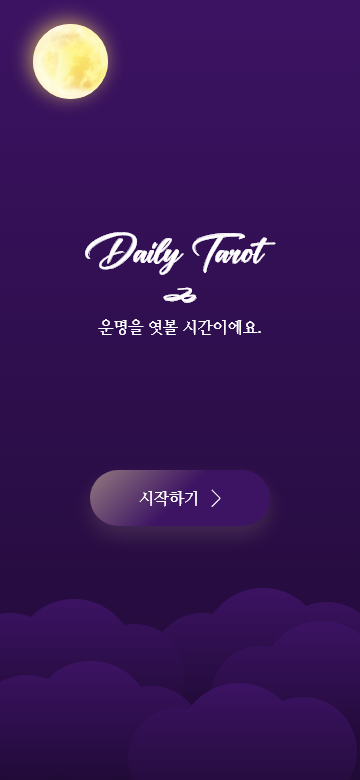

# 04. 시작 화면

## 목표


제목과 빛나는 **"시작하기 >"** 버튼이 있는 첫 화면을 만듭니다.

## 화면 분석
- 제목은 화면 높이의 약 **40%** 위치, 버튼은 약 **65%** 위치에 있습니다.
- 폰마다 화면 높이가 다르므로, 고정 `dp` 대신 **`Spacer(Modifier.weight(...))`** 로 빈 공간을 **비율**로 나눕니다.

```
┌────────────┐
│  빈 공간 1.7 │
│ Daily Tarot │
│  빈 공간 1.0 │
│ [시작하기 >] │
│  빈 공간 1.9 │
└────────────┘
```

## 따라하기

### 1) 새 파일 `StartScreen.kt` 만들기
패키지에 오른쪽 클릭 → **New → Kotlin Class/File → File** → `StartScreen`

```kotlin
package com.example.dailytarot

import androidx.compose.foundation.background
import androidx.compose.foundation.clickable
import androidx.compose.foundation.layout.*
import androidx.compose.foundation.shape.CircleShape
import androidx.compose.material3.Icon
import androidx.compose.material3.Text
import androidx.compose.runtime.Composable
import androidx.compose.ui.Alignment
import androidx.compose.ui.Modifier
import androidx.compose.ui.draw.clip
import androidx.compose.ui.draw.rotate
import androidx.compose.ui.draw.shadow
import androidx.compose.ui.graphics.Brush
import androidx.compose.ui.graphics.Color
import androidx.compose.ui.res.painterResource
import androidx.compose.ui.text.font.FontFamily
import androidx.compose.ui.unit.dp
import androidx.compose.ui.unit.sp

@Composable
fun StartScreen(onStart: () -> Unit) {
    TarotBackground {
        Column(
            Modifier.fillMaxSize(),
            horizontalAlignment = Alignment.CenterHorizontally
        ) {
            Spacer(Modifier.weight(1.7f))          // 위쪽 빈 공간
            TarotTitle("운명을 엿볼 시간이에요.")
            Spacer(Modifier.weight(1f))            // 제목과 버튼 사이
            GlowButton("시작하기", onClick = onStart)
            Spacer(Modifier.weight(1.9f))          // 아래쪽 빈 공간
        }
    }
}

// 빛나는 둥근 버튼 (시작하기)
@Composable
fun GlowButton(text: String, onClick: () -> Unit, modifier: Modifier = Modifier) {
    Row(
        modifier
            .shadow(20.dp, CircleShape, ambientColor = Color(0xFFE1BEE7), spotColor = Color(0xFFE1BEE7))
            .clip(CircleShape)
            .background(Brush.horizontalGradient(listOf(Color(0xFF8E6A9E), Color(0xFF4B1C78))))
            .clickable(onClick = onClick)
            .padding(horizontal = 48.dp, vertical = 16.dp),
        verticalAlignment = Alignment.CenterVertically
    ) {
        Text(text, color = Color.White, fontSize = 16.sp, fontFamily = FontFamily.Serif)
        Spacer(Modifier.width(12.dp))
        // 뒤로가기 화살표를 180도 돌리면 앞으로 가기 화살표가 된다
        Icon(
            painterResource(R.drawable.ic_back),
            contentDescription = null,
            tint = Color.White,
            modifier = Modifier.size(20.dp).rotate(180f)
        )
    }
}
```

### 코드 설명
- `Spacer(Modifier.weight(1.7f))`: `Column` 안에서 **남는 높이**를 1.7 : 1 : 1.9 비율로 나눕니다.
- `GlowButton`의 Modifier 순서
  1. `.shadow(...)`: 바깥 빛 (그림자 색을 연보라로)
  2. `.clip(CircleShape)`: 알약 모양으로 자르기
  3. `.background(...)`: 왼쪽은 밝고 오른쪽은 진한 그라데이션
  4. `.clickable(...)`: 누를 수 있게
  5. `.padding(...)`: 글자 주위 여백 (**clickable 뒤**에 둬야 여백까지 눌립니다)
- `Icon(... .rotate(180f))`: 뒤로가기 화살표를 돌려서 `>` 모양으로 씁니다.

### 2) `MainActivity.kt`에서 시작 화면 보여주기
`TarotApp()` 함수 안의 내용만 바꿉니다.

**바꾸기 전**
```kotlin
@Composable
fun TarotApp() {
    TarotBackground {
        TarotTitle("배경 테스트 중이에요.", Modifier.align(Alignment.Center))
    }
}
```

**바꾼 후**
```kotlin
@Composable
fun TarotApp() {
    StartScreen(onStart = { })
}
```

> 💡 회색으로 바뀐(사용하지 않는) import는 지워도 되고 그냥 둬도 됩니다.

## ✅ 실행해서 확인
- [ ] 첫 화면이 캡처 이미지와 비슷하다
- [ ] "시작하기 >" 버튼이 알약 모양이고 주변이 은은하게 빛난다
- [ ] 버튼을 눌렀을 때 물결 효과가 나온다 (아직 화면 이동은 안 됨)

👉 다음: [05. 화면 전환 뼈대](05_화면전환_뼈대.md)
