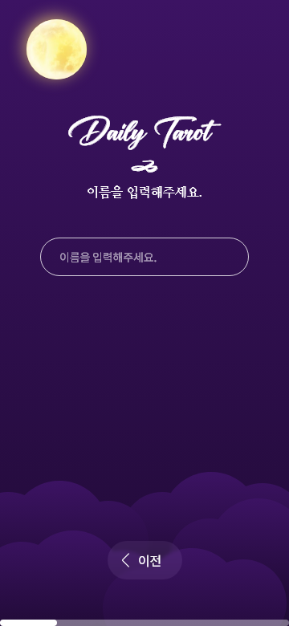
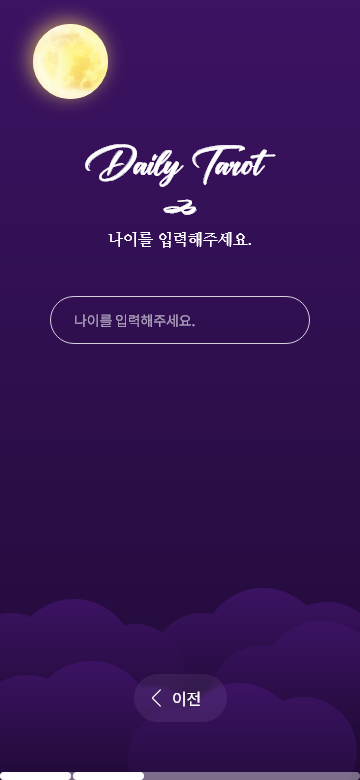

# 06. 이름 · 나이 입력

## 목표
| 이름 | 나이 |
|---|---|
|  |  |

입력 화면의 공통 틀(제목, **이전** 버튼, 아래 **진행바**)과 이름·나이 입력칸을 만듭니다.
성별과 달력은 다음 단계에서 만들고, 지금은 **임시 글씨**를 넣어 둡니다.

## 화면 분석
| 요소 | 만드는 방법 |
|---|---|
| 둥근 테두리 입력칸, 흐린 안내 글씨 | `BasicTextField` + `decorationBox` |
| "< 이전" 반투명 알약 버튼 | `Row` + `clip(CircleShape)` + 반투명 배경 |
| 맨 아래 5칸 진행바 (이름=1칸, 나이=2칸...) | `Row` 안에 `Box` 5개, `weight(1f)` |
| 다음 버튼이 없음 | 키보드의 **완료(Done)** 를 누르면 다음으로 |

## 따라하기

### 1) 새 파일 `InputScreen.kt`
패키지에 오른쪽 클릭 → **New → Kotlin Class/File → File** → `InputScreen`

```kotlin
package com.example.dailytarot

import android.widget.Toast
import androidx.compose.foundation.background
import androidx.compose.foundation.border
import androidx.compose.foundation.clickable
import androidx.compose.foundation.layout.*
import androidx.compose.foundation.shape.CircleShape
import androidx.compose.foundation.shape.RoundedCornerShape
import androidx.compose.foundation.text.BasicTextField
import androidx.compose.foundation.text.KeyboardActions
import androidx.compose.foundation.text.KeyboardOptions
import androidx.compose.material3.Icon
import androidx.compose.material3.Text
import androidx.compose.runtime.Composable
import androidx.compose.ui.Alignment
import androidx.compose.ui.Modifier
import androidx.compose.ui.draw.clip
import androidx.compose.ui.graphics.Color
import androidx.compose.ui.graphics.SolidColor
import androidx.compose.ui.platform.LocalContext
import androidx.compose.ui.res.painterResource
import androidx.compose.ui.text.TextStyle
import androidx.compose.ui.text.font.FontWeight
import androidx.compose.ui.text.input.ImeAction
import androidx.compose.ui.text.input.KeyboardType
import androidx.compose.ui.unit.dp
import androidx.compose.ui.unit.sp

// step: 0=이름, 1=나이, 2=성별, 3=생년월일
@Composable
fun InputScreen(
    step: Int,
    user: UserInfo,
    onUserChange: (UserInfo) -> Unit,
    onNext: () -> Unit,
    onBack: () -> Unit
) {
    val context = LocalContext.current
    fun toast(msg: String) = Toast.makeText(context, msg, Toast.LENGTH_SHORT).show()

    val subtitle = when (step) {
        0 -> "이름을 입력해주세요."
        1 -> "나이를 입력해주세요."
        2 -> "성별을 선택해주세요."
        else -> "태어난 날짜를 입력해주세요."
    }

    TarotBackground {
        Column(
            Modifier.fillMaxSize(),
            horizontalAlignment = Alignment.CenterHorizontally
        ) {
            Spacer(Modifier.height(110.dp))
            TarotTitle(subtitle)
            Spacer(Modifier.height(48.dp))

            when (step) {
                0 -> TarotTextField(
                    value = user.name,
                    onValueChange = { onUserChange(user.copy(name = it)) },
                    placeholder = "이름을 입력해주세요.",
                    onDone = {
                        if (user.name.isBlank()) toast("이름을 입력해주세요.") else onNext()
                    },
                    modifier = Modifier.padding(horizontal = 50.dp)
                )

                1 -> TarotTextField(
                    value = user.age,
                    // 숫자만, 최대 3자리
                    onValueChange = { onUserChange(user.copy(age = it.filter { c -> c.isDigit() }.take(3))) },
                    placeholder = "나이를 입력해주세요.",
                    keyboardType = KeyboardType.Number,
                    onDone = {
                        val age = user.age.toIntOrNull()
                        if (age == null || age !in 1..120) toast("나이를 올바르게 입력해주세요.") else onNext()
                    },
                    modifier = Modifier.padding(horizontal = 50.dp)
                )

                2 -> Text(
                    "성별 선택 (7단계에서 만들어요)\n여기를 누르면 다음",
                    color = Color.White,
                    modifier = Modifier.padding(top = 60.dp).clickable { onNext() }
                )

                3 -> Text(
                    "달력 (8단계에서 만들어요)\n여기를 누르면 다음",
                    color = Color.White,
                    modifier = Modifier.padding(top = 60.dp).clickable { onNext() }
                )
            }
        }

        BackPillButton(
            onClick = onBack,
            modifier = Modifier.align(Alignment.BottomCenter).padding(bottom = 50.dp)
        )
        StepProgressBar(
            filled = step + 1,
            modifier = Modifier.align(Alignment.BottomCenter)
        )
    }
}

// 둥근 테두리 입력칸
@Composable
fun TarotTextField(
    value: String,
    onValueChange: (String) -> Unit,
    placeholder: String,
    onDone: () -> Unit,
    modifier: Modifier = Modifier,
    keyboardType: KeyboardType = KeyboardType.Text
) {
    BasicTextField(
        value = value,
        onValueChange = onValueChange,
        singleLine = true,
        textStyle = TextStyle(color = Color.White, fontSize = 15.sp),
        cursorBrush = SolidColor(Color.White),
        keyboardOptions = KeyboardOptions(keyboardType = keyboardType, imeAction = ImeAction.Done),
        keyboardActions = KeyboardActions(onDone = { onDone() }),
        modifier = modifier.fillMaxWidth(),
        decorationBox = { innerTextField ->
            Box(
                Modifier
                    .fillMaxWidth()
                    .height(48.dp)
                    .border(1.dp, Color(0xB3FFFFFF), CircleShape)
                    .padding(horizontal = 24.dp),
                contentAlignment = Alignment.CenterStart
            ) {
                if (value.isEmpty()) {
                    Text(placeholder, color = Dim, fontSize = 15.sp)
                }
                innerTextField()   // 실제 글자가 그려지는 자리
            }
        }
    )
}

// 아래쪽 "< 이전" 버튼
@Composable
fun BackPillButton(onClick: () -> Unit, modifier: Modifier = Modifier) {
    Row(
        modifier
            .clip(CircleShape)
            .background(Color(0x22FFFFFF))
            .clickable(onClick = onClick)
            .padding(horizontal = 20.dp, vertical = 12.dp),
        verticalAlignment = Alignment.CenterVertically
    ) {
        Icon(
            painterResource(R.drawable.ic_back),
            contentDescription = null,
            tint = Color.White,
            modifier = Modifier.size(20.dp)
        )
        Spacer(Modifier.width(6.dp))
        Text("이전", color = Color.White, fontSize = 16.sp, fontWeight = FontWeight.Bold)
    }
}

// 맨 아래 진행바 (5칸)
@Composable
fun StepProgressBar(filled: Int, modifier: Modifier = Modifier, total: Int = 5) {
    Row(
        modifier
            .fillMaxWidth()
            .height(6.dp),
        horizontalArrangement = Arrangement.spacedBy(3.dp)
    ) {
        repeat(total) { i ->
            Box(
                Modifier
                    .weight(1f)
                    .fillMaxHeight()
                    .clip(RoundedCornerShape(3.dp))
                    .background(if (i < filled) Color.White else Color(0x66FFFFFF))
            )
        }
    }
}
```

### 코드 설명

**① `InputScreen`의 매개변수**
- `step`, `user`: 지금 단계와 지금까지 입력한 값 (MainActivity가 가지고 있음)
- `onUserChange`: 값이 바뀌면 MainActivity에 새 `UserInfo`를 알려 줌
- `onNext`, `onBack`: 다음 / 이전

> 💡 화면 함수는 값을 **직접 가지지 않고**, 받아서 그리기만 합니다.
> 그래서 이전으로 갔다가 돌아와도 입력한 이름이 그대로 남아 있습니다.

**② 입력값 검사**
- 이름: `isBlank()`면 (빈칸이나 공백만 있으면) 토스트로 알려 주고 넘어가지 않음
- 나이:
  - 입력할 때 `filter { c -> c.isDigit() }.take(3)` → **숫자만, 3자리까지**
  - 완료할 때 `toIntOrNull()`로 숫자로 바꾸고 `1..120` 범위인지 검사

**③ `TarotTextField`**
- `BasicTextField`는 테두리가 없는 아주 기본 입력칸입니다.
- `decorationBox`에서 테두리와 안내 글씨(placeholder)를 직접 그리고, `innerTextField()` 자리에 실제 글자가 들어갑니다.
- `imeAction = ImeAction.Done` → 키보드 오른쪽 아래 버튼이 "완료"가 됩니다.
- `keyboardActions = KeyboardActions(onDone = { onDone() })` → 완료를 누르면 실행됩니다.

**④ `StepProgressBar(filled = step + 1)`**: 5칸 중 `filled`칸을 흰색으로 칠합니다.

### 2) `MainActivity.kt`에서 임시 화면을 진짜 화면으로 바꾸기

`when (screen)` 안의 `Screen.INPUT` 줄만 바꿉니다.

**바꾸기 전**
```kotlin
        Screen.INPUT -> TempScreen("입력 화면 (6단계에서 만들어요)", onClick = { screen = Screen.SOUL_INTRO })
```

**바꾼 후**
```kotlin
        Screen.INPUT -> InputScreen(
            step = step,
            user = user,
            onUserChange = { user = it },
            onNext = {
                if (step < 3) {
                    step++
                } else {
                    screen = Screen.SOUL_INTRO
                }
            },
            onBack = { goBack() }
        )
```

## ✅ 실행해서 확인
- [ ] 시작하기 → "이름을 입력해주세요." 화면, 진행바 1칸
- [ ] 아무것도 안 쓰고 키보드 **완료** → "이름을 입력해주세요." 토스트
- [ ] 이름 입력 후 완료 → 나이 화면, 진행바 2칸
- [ ] 나이 칸에 글자가 안 써지고 숫자만, 3자리까지 써진다
- [ ] 나이 0이나 200 → 토스트, 25 → 성별 임시 화면
- [ ] "이전"을 누르면 이름 화면으로 가고, **입력했던 이름이 남아 있다**

## 자주 하는 실수
- 키보드 완료를 눌러도 반응이 없다 → `keyboardActions`를 빠뜨렸는지 확인하세요.
- 입력칸에 글자가 안 보인다 → `textStyle`의 `color = Color.White`를 확인하세요. 기본은 검은 글씨라 배경에 묻힙니다.

👉 다음: [07. 성별 선택](07_성별_선택.md)
