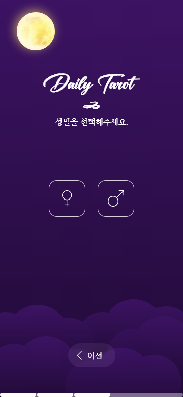

# 07. 성별 선택

## 목표


♀ ♂ 버튼 두 개를 만들고, **누르면 바로 다음 단계**로 넘어가게 합니다.

## 따라하기

### 1) `InputScreen.kt` 맨 아래에 `GenderButton` 함수 추가

```kotlin
// 성별 버튼
@Composable
fun GenderButton(iconRes: Int, selected: Boolean, onClick: () -> Unit) {
    val shape = RoundedCornerShape(16.dp)
    Box(
        Modifier
            .size(72.dp)
            .clip(shape)
            .background(if (selected) Color(0x33FFFFFF) else Color.Transparent)
            .border(1.dp, Color(0xB3FFFFFF), shape)
            .clickable(onClick = onClick),
        contentAlignment = Alignment.Center
    ) {
        Icon(
            painterResource(iconRes),
            contentDescription = null,
            tint = Color.White,
            modifier = Modifier.size(40.dp)
        )
    }
}
```

- 둥근 사각형(`RoundedCornerShape(16.dp)`) 테두리 안에 아이콘을 가운데에 둡니다.
- 이미 선택한 쪽은 배경을 살짝 밝게(`0x33FFFFFF`) 칠합니다. 이전으로 돌아왔을 때 무엇을 골랐는지 보입니다.

### 2) `InputScreen`의 `when (step)` 안에서 `2 ->` 부분 바꾸기

**바꾸기 전**
```kotlin
                2 -> Text(
                    "성별 선택 (7단계에서 만들어요)\n여기를 누르면 다음",
                    color = Color.White,
                    modifier = Modifier.padding(top = 60.dp).clickable { onNext() }
                )
```

**바꾼 후**
```kotlin
                2 -> Row(
                    Modifier.padding(top = 60.dp),
                    horizontalArrangement = Arrangement.spacedBy(24.dp)
                ) {
                    GenderButton(R.drawable.ic_female, selected = user.gender == "여") {
                        onUserChange(user.copy(gender = "여"))
                        onNext()
                    }
                    GenderButton(R.drawable.ic_male, selected = user.gender == "남") {
                        onUserChange(user.copy(gender = "남"))
                        onNext()
                    }
                }
```

> 💡 `GenderButton(...) { ... }`: 함수의 **마지막 매개변수가 함수(onClick)** 이면 이렇게 괄호 밖에 `{ }`로 쓸 수 있습니다.

## ✅ 실행해서 확인
- [ ] 성별 화면에 ♀ ♂ 버튼이 나란히 있다, 진행바 3칸
- [ ] 아무거나 누르면 달력 임시 화면으로 넘어간다
- [ ] 이전을 누르면 성별 화면으로 돌아오고, 고른 버튼이 밝게 표시된다

## 자주 하는 실수
- `Unresolved reference: ic_female` → 02단계에서 Vector Asset 이름을 다르게 지었는지 확인하세요.
- 아이콘이 검은색이다 → `Icon`의 `tint = Color.White`를 확인하세요.

👉 다음: [08. 달력](08_달력.md)
