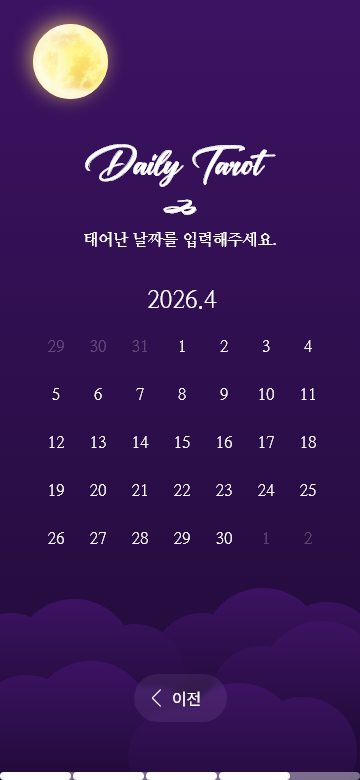

# 08. 달력

## 목표


라이브러리 없이 **직접 만든 달력**으로 생년월일을 고르게 합니다.

## 화면 분석
- 위에 `2026.4`처럼 **연도.월**
- 일요일부터 시작, 한 줄에 7칸
- 1일 앞의 빈칸에는 **지난달 날짜**(29, 30, 31), 끝 칸에는 **다음 달 날짜**(1, 2)를 **흐리게** 표시
- 요일 글씨(일 월 화...)와 이동 화살표는 없음

## 달력 계산 원리 (가장 중요)

2026년 4월로 예를 들어 봅니다.

1. **4월 1일의 요일**을 구합니다. → 수요일
2. 1일 앞에 **빈칸이 몇 개**인지 구합니다.
   - `dayOfWeek.value`는 월=1, 화=2, 수=3, 목=4, 금=5, 토=6, **일=7**
   - 우리 달력은 일요일부터 시작하니까 `% 7`을 하면 일=0, 월=1, ... 수=3 → **빈칸 3개**
3. 달력 **첫 칸의 날짜** = 4월 1일 - 3일 = **3월 29일**
4. **필요한 줄 수** = (빈칸 3 + 30일 + 6) ÷ 7 = 39 ÷ 7 = **5줄** (정수 나눗셈)
5. 첫 칸부터 하루씩 더하면서 `5줄 × 7칸`을 채웁니다.
   - 4월이 아닌 날짜(3/29~31, 5/1~2)는 흐리게, 누를 수 없게

```
29 30 31  1  2  3  4
 5  6  7  8  9 10 11
...
26 27 28 29 30  1  2
```

## 다른 달로 이동
화면에 화살표가 없으므로 **밀어서(스와이프)** 이동하게 만듭니다.
- 좌우로 밀기: 한 달씩
- 위아래로 밀기: **1년씩** (생일은 몇십 년 전이라 한 달씩 넘기면 너무 오래 걸립니다)

> ⚠️ 실제 대회 문제지에 이동 방법이 정해져 있으면 **문제지대로** 바꾸세요.

## 따라하기

### 1) 새 파일 `Calendar.kt`

```kotlin
package com.example.dailytarot

import androidx.compose.foundation.border
import androidx.compose.foundation.clickable
import androidx.compose.foundation.gestures.detectDragGestures
import androidx.compose.foundation.layout.*
import androidx.compose.foundation.shape.CircleShape
import androidx.compose.material3.Text
import androidx.compose.runtime.*
import androidx.compose.ui.Alignment
import androidx.compose.ui.Modifier
import androidx.compose.ui.graphics.Color
import androidx.compose.ui.input.pointer.pointerInput
import androidx.compose.ui.text.font.FontFamily
import androidx.compose.ui.unit.dp
import androidx.compose.ui.unit.sp
import java.time.LocalDate
import java.time.YearMonth
import kotlin.math.abs

@Composable
fun MonthCalendar(
    selected: LocalDate?,
    onPick: (LocalDate) -> Unit,
    modifier: Modifier = Modifier
) {
    // 지금 보여주는 달 (선택한 날짜가 있으면 그 달, 없으면 이번 달)
    var month by remember { mutableStateOf(YearMonth.from(selected ?: LocalDate.now())) }
    val today = LocalDate.now()

    Column(
        modifier
            .fillMaxWidth()
            // 좌우로 밀면 한 달씩, 위아래로 밀면 1년씩 이동
            .pointerInput(Unit) {
                var dx = 0f
                var dy = 0f
                detectDragGestures(
                    onDragStart = { dx = 0f; dy = 0f },
                    onDragEnd = {
                        if (abs(dx) > abs(dy)) {
                            if (dx < -80) month = month.plusMonths(1)   // 왼쪽으로 밀기 → 다음 달
                            if (dx > 80) month = month.minusMonths(1)   // 오른쪽으로 밀기 → 이전 달
                        } else {
                            if (dy < -80) month = month.plusYears(1)    // 위로 밀기 → 다음 해
                            if (dy > 80) month = month.minusYears(1)    // 아래로 밀기 → 이전 해
                        }
                    },
                    onDrag = { change, amount ->
                        change.consume()
                        dx += amount.x
                        dy += amount.y
                    }
                )
            },
        horizontalAlignment = Alignment.CenterHorizontally
    ) {
        // 2026.4
        Text(
            "${month.year}.${month.monthValue}",
            color = Color.White,
            fontSize = 22.sp,
            fontFamily = FontFamily.Serif
        )
        Spacer(Modifier.height(16.dp))

        val first = month.atDay(1)                         // 이번 달 1일
        val lead = first.dayOfWeek.value % 7               // 1일 앞에 비는 칸 수 (일요일=0 ... 토요일=6)
        val start = first.minusDays(lead.toLong())         // 달력 첫 칸의 날짜 (지난달 날짜일 수 있음)
        val rows = (lead + month.lengthOfMonth() + 6) / 7  // 필요한 줄 수 (5줄 또는 6줄)

        for (r in 0 until rows) {
            Row(Modifier.fillMaxWidth()) {
                for (c in 0 until 7) {
                    val date = start.plusDays((r * 7 + c).toLong())
                    val inMonth = date.monthValue == month.monthValue
                    val enabled = inMonth && !date.isAfter(today)   // 이번 달 + 미래가 아닌 날만 선택 가능

                    Box(
                        Modifier
                            .weight(1f)
                            .height(48.dp)
                            .clickable(enabled = enabled) { onPick(date) },
                        contentAlignment = Alignment.Center
                    ) {
                        if (date == selected) {
                            Box(Modifier.size(36.dp).border(1.dp, Color.White, CircleShape))
                        }
                        Text(
                            "${date.dayOfMonth}",
                            color = when {
                                !inMonth -> Color(0x40FFFFFF)   // 지난달/다음달: 아주 흐리게
                                !enabled -> Color(0x80FFFFFF)   // 미래 날짜: 조금 흐리게
                                else -> Color.White
                            },
                            fontSize = 18.sp,
                            fontFamily = FontFamily.Serif
                        )
                    }
                }
            }
        }
    }
}
```

### 코드 설명
- `YearMonth`: "2026년 4월"처럼 **연도+월**을 나타내는 클래스입니다. `plusMonths(1)`, `minusYears(1)`로 쉽게 이동합니다.
- `pointerInput` + `detectDragGestures`: 손가락으로 끄는 동작을 감지합니다.
  - 끄는 동안 이동한 거리를 `dx`, `dy`에 더해 두었다가, 손을 떼면(`onDragEnd`) 가로/세로 중 더 많이 움직인 쪽으로 판단합니다.
- `Modifier.weight(1f)`: 한 줄의 7칸이 **똑같은 너비**를 나눠 갖습니다.
- 선택한 날짜에는 흰 원 테두리를 그립니다. 이전 화면에서 돌아왔을 때 보입니다.
- 미래 날짜는 고를 수 없습니다 (`date.isAfter(today)`).

### 2) `InputScreen.kt`의 `when (step)` 안에서 `3 ->` 부분 바꾸기

**바꾸기 전**
```kotlin
                3 -> Text(
                    "달력 (8단계에서 만들어요)\n여기를 누르면 다음",
                    color = Color.White,
                    modifier = Modifier.padding(top = 60.dp).clickable { onNext() }
                )
```

**바꾼 후**
```kotlin
                3 -> MonthCalendar(
                    selected = user.birth,
                    onPick = {
                        onUserChange(user.copy(birth = it))
                        onNext()
                    },
                    modifier = Modifier.padding(horizontal = 24.dp)
                )
```

## ✅ 실행해서 확인
- [ ] 생년월일 화면에 이번 달 달력이 나오고 진행바가 4칸이다
- [ ] 지난달·다음 달 날짜가 흐리다
- [ ] 좌우로 밀면 한 달씩, 위아래로 밀면 1년씩 바뀐다
- [ ] 연말을 넘어가면 연도가 바뀐다 (12월 → 다음 해 1월)
- [ ] 날짜를 누르면 "소울카드 소개" 임시 화면으로 간다
- [ ] 이전으로 돌아오면 고른 날짜에 원이 있다

## 직접 확인해 볼 날짜
| 달 | 1일 요일 | 첫 줄 시작 | 줄 수 |
|---|---|---|---|
| 2026.4 | 수 | 3/29 | 5 |
| 2026.2 | 일 | 2/1 | 4 |
| 2026.8 | 토 | 7/26 | 6 |

👉 다음: [09. 카드 데이터 · 소울 넘버](09_카드데이터_소울넘버.md)
