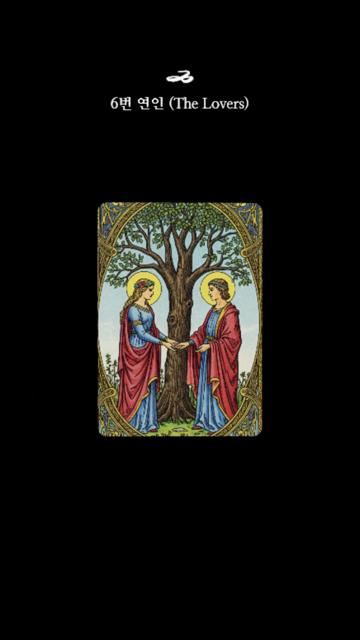
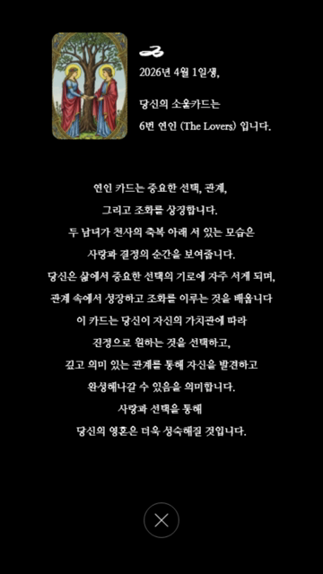

# 11. 결과 화면 · 애니메이션

## 목표
| ① 카드 등장 | ② 이동 후 결과 |
|---|---|
|  |  |

영상 순서대로 연출합니다.
1. 검은 화면에 제목 "6번 연인 (The Lovers)"과 카드가 **가운데 크게** 나타난다 (0.6초)
2. 잠깐 멈춘다 (0.9초)
3. 카드가 **왼쪽 위로 작아지면서 이동**하고, 제목은 사라진다 (0.8초)
4. 이동하는 도중에 오른쪽 안내 글, 아래 설명, X 버튼이 **서서히 나타난다**

## 애니메이션 원리: 0에서 1로 변하는 숫자 하나

`move`라는 숫자가 0 → 1로 변한다고 생각합니다.

| | move = 0 | move = 0.5 | move = 1 |
|---|---|---|---|
| 카드 너비 | 160dp | 122dp | 84dp |
| 카드 x | 가운데 | 중간 | 56dp |
| 카드 y | 화면 높이의 30% | 중간 | 36dp |
| 제목 투명도 | 1 (보임) | 0.5 | 0 (안 보임) |

이걸 계산하는 함수가 03단계에서 만든 `lerpDp`입니다.
```kotlin
fun lerpDp(a: Dp, b: Dp, t: Float): Dp = a + (b - a) * t
// lerpDp(160.dp, 84.dp, 0.5f) = 160 + (84 - 160) × 0.5 = 122.dp
```
`Animatable(0f)`의 `animateTo(1f, tween(800))`를 부르면 0.8초 동안 값이 0 → 1로 변하고, 값이 바뀔 때마다 화면이 다시 그려집니다.

## 따라하기

### 1) 새 파일 `ResultScreen.kt`

```kotlin
package com.example.dailytarot

import androidx.compose.animation.core.Animatable
import androidx.compose.animation.core.FastOutSlowInEasing
import androidx.compose.animation.core.tween
import androidx.compose.foundation.Canvas
import androidx.compose.foundation.Image
import androidx.compose.foundation.background
import androidx.compose.foundation.clickable
import androidx.compose.foundation.layout.*
import androidx.compose.foundation.shape.RoundedCornerShape
import androidx.compose.material3.Text
import androidx.compose.runtime.Composable
import androidx.compose.runtime.LaunchedEffect
import androidx.compose.runtime.remember
import androidx.compose.ui.Alignment
import androidx.compose.ui.Modifier
import androidx.compose.ui.draw.alpha
import androidx.compose.ui.draw.clip
import androidx.compose.ui.geometry.Offset
import androidx.compose.ui.graphics.Color
import androidx.compose.ui.graphics.drawscope.Stroke
import androidx.compose.ui.layout.ContentScale
import androidx.compose.ui.text.font.FontFamily
import androidx.compose.ui.text.style.TextAlign
import androidx.compose.ui.unit.dp
import androidx.compose.ui.unit.sp
import kotlinx.coroutines.delay
import kotlinx.coroutines.launch
import java.time.LocalDate

@Composable
fun ResultScreen(card: SoulCard, birth: LocalDate, onClose: () -> Unit) {
    val image = rememberAssetImage(card.image)

    // 애니메이션 값 3개 (모두 0에서 1로 변한다)
    val appear = remember { Animatable(0f) }     // 카드가 나타나기
    val move = remember { Animatable(0f) }       // 0: 가운데 큰 카드 → 1: 왼쪽 위 작은 카드
    val textAlpha = remember { Animatable(0f) }  // 설명 글 나타나기

    LaunchedEffect(Unit) {
        appear.animateTo(1f, tween(600))                                       // 0.6초 동안 카드 등장
        delay(900)                                                             // 잠깐 보여주고
        launch { move.animateTo(1f, tween(800, easing = FastOutSlowInEasing)) } // 카드 이동 시작
        delay(300)                                                             // 이동 도중에
        textAlpha.animateTo(1f, tween(800))                                    // 글씨 나타나기
    }

    val serif = FontFamily.Serif
    BoxWithConstraints(
        Modifier
            .fillMaxSize()
            .background(Color.Black)
            .systemBarsPadding()
    ) {
        val t = move.value

        // 큰 카드(160x228, 가운데) → 작은 카드(84x120, 왼쪽 위)
        val cardW = lerpDp(160.dp, 84.dp, t)
        val cardH = lerpDp(228.dp, 120.dp, t)
        val cardX = lerpDp((maxWidth - 160.dp) / 2, 56.dp, t)
        val cardY = lerpDp(maxHeight * 0.3f, 36.dp, t)

        // ① 처음 제목 "6번 연인 (The Lovers)" — 카드가 움직이면 사라진다
        Column(
            Modifier
                .fillMaxWidth()
                .padding(top = 40.dp)
                .alpha(appear.value * (1f - t)),
            horizontalAlignment = Alignment.CenterHorizontally
        ) {
            LogoMark()
            Text("${card.number}번 ${card.name}", color = Color.White, fontSize = 16.sp, fontFamily = serif)
        }

        // ② 카드 이미지
        Box(
            Modifier
                .offset(cardX, cardY)
                .size(cardW, cardH)
                .alpha(appear.value)
                .clip(RoundedCornerShape(6.dp))
        ) {
            if (image != null) {
                Image(image, contentDescription = card.name, modifier = Modifier.fillMaxSize(), contentScale = ContentScale.Crop)
            } else {
                // 이미지 파일이 없을 때 회색 박스로 대신 표시
                Box(Modifier.fillMaxSize().background(Color.DarkGray))
            }
        }

        // ③ 카드 오른쪽 안내 글
        Column(
            Modifier
                .padding(start = 156.dp, top = 44.dp, end = 16.dp)
                .alpha(textAlpha.value)
        ) {
            LogoMark()
            Text("${koreanDate(birth)}생,", color = Color.White, fontSize = 13.sp, fontFamily = serif)
            Spacer(Modifier.height(14.dp))
            Text("당신의 소울카드는", color = Color.White, fontSize = 13.sp, fontFamily = serif)
            Spacer(Modifier.height(4.dp))
            Text("${card.number}번 ${card.name} 입니다.", color = Color.White, fontSize = 13.sp, fontFamily = serif)
        }

        // ④ 카드 설명 (문장마다 줄바꿈)
        Text(
            card.story.replace(". ", ".\n"),
            color = Color.White,
            fontSize = 13.sp,
            lineHeight = 25.sp,
            fontFamily = serif,
            textAlign = TextAlign.Center,
            modifier = Modifier
                .fillMaxWidth()
                .padding(top = 196.dp, start = 24.dp, end = 24.dp)
                .alpha(textAlpha.value)
        )

        // ⑤ 닫기(X) 버튼
        Canvas(
            Modifier
                .align(Alignment.BottomCenter)
                .padding(bottom = 48.dp)
                .size(40.dp)
                .alpha(textAlpha.value)
                .clickable(onClick = onClose)
        ) {
            drawCircle(Color(0x99FFFFFF), style = Stroke(width = 1.dp.toPx()))
            val p = size.width * 0.32f
            drawLine(Color.White, Offset(p, p), Offset(size.width - p, size.height - p), strokeWidth = 1.5.dp.toPx())
            drawLine(Color.White, Offset(size.width - p, p), Offset(p, size.height - p), strokeWidth = 1.5.dp.toPx())
        }
    }
}
```

### 코드 설명

**① `LaunchedEffect(Unit)`**: 화면이 처음 나타날 때 **한 번** 실행됩니다. 이 안에서는 `delay`(기다리기)를 쓸 수 있습니다.

**② `launch { ... }`**: 카드 이동을 **따로 시작해 두고** 기다리지 않고 바로 다음 줄로 갑니다. 그래서 카드가 움직이는 **도중에** 글씨가 나타납니다.
- `launch`가 없으면 카드 이동이 끝난 뒤에야 글씨가 나옵니다. 직접 지워 보고 차이를 보세요.

**③ `BoxWithConstraints`**: 안에서 `maxWidth`, `maxHeight`(화면 크기)를 쓸 수 있습니다. 카드를 가운데에 두려면 `(화면 너비 - 카드 너비) / 2`가 필요해서 씁니다.

**④ `Modifier.offset(x, y)`**: 왼쪽 위 기준으로 x, y만큼 옮겨서 그립니다.

**⑤ `.alpha(appear.value * (1f - t))`**: 처음엔 나타나면서(appear 0 → 1), 카드가 움직이면 사라지게(1 - t) 두 값을 곱했습니다.

**⑥ X 버튼**: 아이콘 파일이 없어서 `Canvas`에 원 하나와 대각선 두 개를 그렸습니다.

**⑦ 설명 글 줄바꿈**: `story.replace(". ", ".\n")` → 문장이 끝날 때마다 줄을 바꿉니다. 원본 영상과 줄바꿈 위치가 조금 다를 수 있으니, 문제지에 정해져 있으면 맞춰 주세요.

### 2) `MainActivity.kt` 완성하기
`MainActivity.kt`의 내용을 **모두 지우고** 아래 최종 코드로 바꿉니다.
(`Screen.RESULT` 부분을 진짜 결과 화면으로 바꾸고, 이제 안 쓰는 `TempScreen`을 지운 버전입니다.)

```kotlin
package com.example.dailytarot

import android.os.Bundle
import android.widget.Toast
import androidx.activity.ComponentActivity
import androidx.activity.SystemBarStyle
import androidx.activity.compose.BackHandler
import androidx.activity.compose.setContent
import androidx.activity.enableEdgeToEdge
import androidx.compose.runtime.*
import androidx.compose.ui.platform.LocalContext
import com.example.dailytarot.ui.theme.DailyTarotTheme
import java.time.LocalDate

// 앱에 있는 화면 종류
enum class Screen { START, INPUT, SOUL_INTRO, RESULT }

// 사용자가 입력한 정보
data class UserInfo(
    val name: String = "",
    val age: String = "",
    val gender: String = "",
    val birth: LocalDate? = null
)

class MainActivity : ComponentActivity() {
    override fun onCreate(savedInstanceState: Bundle?) {
        super.onCreate(savedInstanceState)
        // 상태바/내비게이션바 아이콘을 흰색으로 (배경이 어두우니까)
        enableEdgeToEdge(
            statusBarStyle = SystemBarStyle.dark(android.graphics.Color.TRANSPARENT),
            navigationBarStyle = SystemBarStyle.dark(android.graphics.Color.TRANSPARENT)
        )
        setContent {
            DailyTarotTheme {
                TarotApp()
            }
        }
    }
}

@Composable
fun TarotApp() {
    val context = LocalContext.current
    val cards = remember { loadSoulCards(context) }

    var screen by remember { mutableStateOf(Screen.START) }   // 지금 화면
    var step by remember { mutableIntStateOf(0) }              // 입력 단계 (0~3)
    var user by remember { mutableStateOf(UserInfo()) }        // 입력한 정보
    var moons by remember { mutableIntStateOf(30) }            // 가진 달 개수

    // 뒤로가기 (화면의 "이전" 버튼, 휴대폰 뒤로가기 버튼 둘 다 이걸 쓴다)
    fun goBack() {
        when (screen) {
            Screen.START -> {}
            Screen.INPUT -> {
                if (step > 0) {
                    step--
                } else {
                    screen = Screen.START
                }
            }
            Screen.SOUL_INTRO -> {
                step = 3
                screen = Screen.INPUT
            }
            Screen.RESULT -> screen = Screen.SOUL_INTRO
        }
    }
    BackHandler(enabled = screen != Screen.START) { goBack() }

    when (screen) {
        Screen.START -> StartScreen(onStart = {
            step = 0
            screen = Screen.INPUT
        })

        Screen.INPUT -> InputScreen(
            step = step,
            user = user,
            onUserChange = { user = it },
            onNext = {
                if (step < 3) {
                    step++
                } else {
                    screen = Screen.SOUL_INTRO
                }
            },
            onBack = { goBack() }
        )

        Screen.SOUL_INTRO -> SoulIntroScreen(
            birth = user.birth!!,
            onBack = { goBack() },
            onDateClick = { goBack() },
            onFind = {
                if (moons >= 10) {
                    moons -= 10
                    screen = Screen.RESULT
                } else {
                    Toast.makeText(context, "달이 부족해요.", Toast.LENGTH_SHORT).show()
                }
            }
        )

        Screen.RESULT -> {
            val number = soulNumber(user.birth!!)
            val card = cards.first { it.number == number }
            ResultScreen(card = card, birth = user.birth!!, onClose = { goBack() })
        }
    }
}
```

**`Screen.RESULT` 부분 설명**
```kotlin
val number = soulNumber(user.birth!!)                // 생일 → 소울 넘버(1~9)
val card = cards.first { it.number == number }       // 카드 목록에서 번호가 같은 카드 찾기
```

## ✅ 실행해서 확인
- [ ] 2026년 4월 1일을 고르고 찾기 → "6번 연인 (The Lovers)"
- [ ] 카드가 가운데 크게 나왔다가 왼쪽 위로 **부드럽게** 작아지며 이동한다
- [ ] 이동하면서 위쪽 제목은 사라지고 오른쪽 글, 설명, X 버튼이 나타난다
- [ ] X나 휴대폰 뒤로가기 → 소개 화면으로 돌아간다
- [ ] 다른 날짜(예: 2008년 3월 15일) → "1번 마법사"
- [ ] 카드 이미지가 없으면 회색 상자가 나오고 **앱이 죽지 않는다**

## 자주 하는 실수
- 카드가 순간이동한다 → `tween(800)`의 시간을 확인하세요. `val t = move.value` 대신 `1f`를 직접 넣지 않았는지도 확인하세요.
- `NoSuchElementException` → JSON에 그 번호의 카드가 없습니다. 소울 넘버 계산이 0이나 10 이상을 내놓는지 확인하세요.
- 앱을 다시 켜야만 애니메이션이 나온다 → `LaunchedEffect(Unit)`은 결과 화면이 새로 나타날 때마다 실행됩니다. `remember { Animatable(0f) }`를 `ResultScreen` **안**에 썼는지 확인하세요.

👉 다음: [12. 마무리 점검](12_마무리_점검.md)
