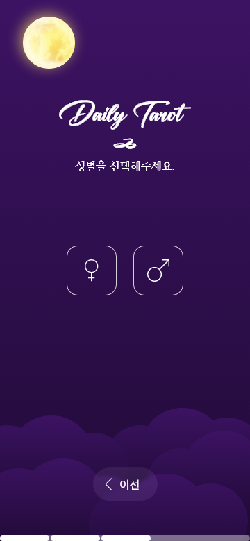
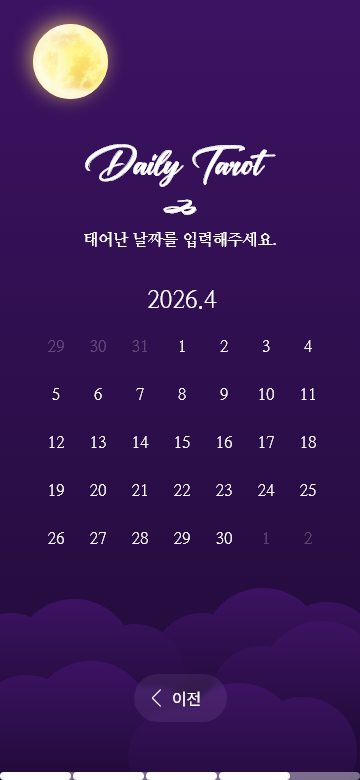
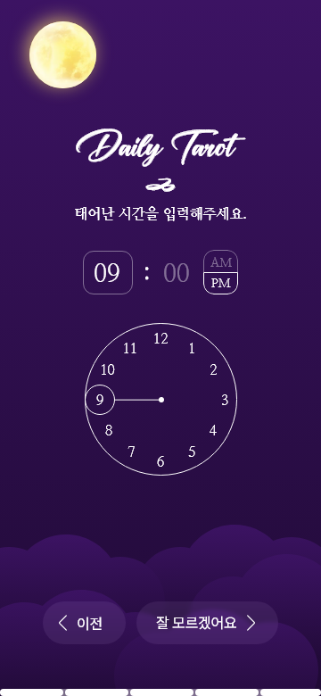
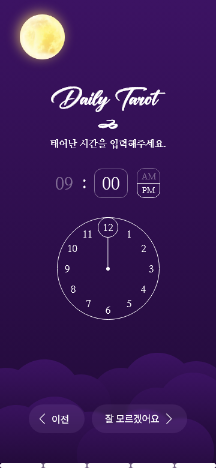
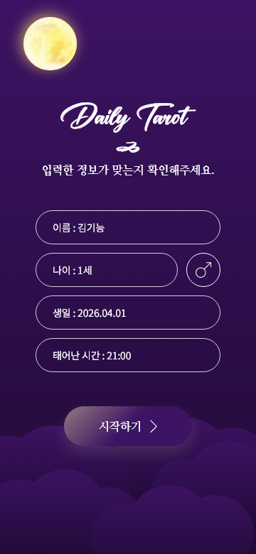

# A00. Module A 개요 · 채점 포인트

## 만들 화면 (8개)

| 온보딩 | 이름 | 나이 | 성별 |
|---|---|---|---|
|  |  |  |  |

| 태어난 날짜 | 태어난 시간 | 시간 – 분 | 정보 확인 |
|---|---|---|---|
|  |  |  |  |

흐름: 온보딩 → 이름 → 나이 → 성별 → 날짜 → 시간 → 정보 확인 → (시작하기) → **빈 홈 화면**

## 배점 (35점)

| 구분 | 항목 | 점수 |
|---|---|---|
| 주관 | 온보딩 / 정보 입력 / 정보 확인 화면이 프로토타입과 일치 | 1.0 × 3 |
| 주관 | 온보딩 애니메이션 완성도 | 1.5 |
| 주관 | **화면 전환 애니메이션** 완성도 | 1.5 |
| 주관 | 친절한 오류·안내 메시지 | 1.0 |
| 객관 | 앱 아이콘, 앱 이름 | 1.0 |
| 객관 | 제출 규칙 (USB, APK 이름, 제공 APK로 평가, 시간 내) | 2.0 |
| 객관 | 화면별 UI 요소 (각 0.2점) | 11.8 |
| 객관 | 화면별 요구사항 (각 0.3~0.4점) | 13.2 |

> 💡 **제출 규칙 2점 + 아이콘·이름 1점 = 3점**은 코드와 상관없이 받는 점수입니다. 절대 놓치지 마세요.

## 꼭 기억할 요구사항

- **모든 화면에 전환 애니메이션** (A04에서 한 번에 처리)
- 온보딩: 달·구름 / 로고·문구 / 시작하기 버튼이 **각각 다른 시간에, 2초 이내** 애니메이션
- 이름: **2~20자**, 키보드 **Enter**로 검사, 실패하면 오류 메시지
- 나이: **숫자만**, Enter로 검사, 실패하면 오류 메시지
- 날짜: `{년}.{월}` 글자를 누르면 연·월 선택, 그 달의 달력 표시, 날짜 누르면 다음
- 시간: AM/PM 토글, 시계에서 **시 → 분** 선택, 분 선택하면 정보 확인으로, "잘 모르겠어요"도 정보 확인으로
- 정보 확인: 입력값 표시, **각 영역 누르면 해당 입력 화면으로**, 시작하기 → **빈 홈 화면**

## 3시간 배분 예시

| 시간 | 할 일 |
|---|---|
| 0:00–0:30 | 프로젝트, 아이콘, 이름, 리소스 (A01–A02) |
| 0:30–1:10 | 공통 컴포넌트, 화면 이동 뼈대, 온보딩 (A03–A05) |
| 1:10–2:20 | 입력 5단계 (A06–A09) |
| 2:20–2:40 | 정보 확인 (A10) |
| 2:40–3:00 | **체크리스트 점검 + APK 빌드 + 제출** (A11) |

## 이 모듈에서 만드는 파일

```
app/src/main/java/com/example/dailytarot/
  MainActivity.kt
  Common.kt          ← 색, 폰트, 배경, 로고, 버튼, 진행바
  AppState.kt        ← 화면 목록, 화면 이동, 입력값
  App.kt             ← 화면 전환 애니메이션 + 화면 연결
  OnboardingScreen.kt
  InputScreens.kt    ← 입력 화면 틀, 이름, 나이, 성별
  WheelPicker.kt     ← 스크롤 휠 (A08 연·월, B05 생년월일에서 재사용)
  BirthDateScreen.kt
  BirthTimeScreen.kt
  ConfirmScreen.kt
```

👉 다음: [A01. 프로젝트 만들기](A01_프로젝트_만들기.md)
