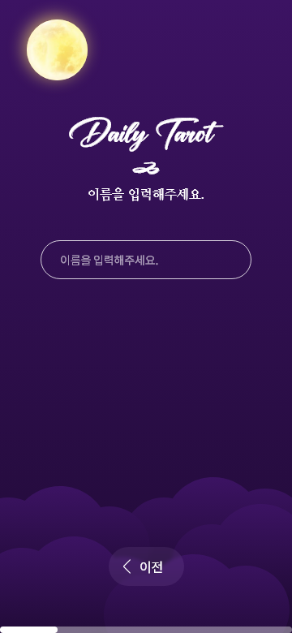

# A03. 공통 컴포넌트 (Common.kt)

## 목표
모든 화면에서 반복되는 요소를 **한 번만** 만들어 둡니다. 이 파일은 Module B·C에서도 그대로 씁니다.



| 요소 | 함수 |
|---|---|
| 보라 그라데이션 배경 + 달 + 구름 | `TarotBackground` |
| "Daily Tarot" 로고 + 작은 무늬 | `DailyTarotLogo`, `LogoMark` |
| "시작하기 >" 빛나는 버튼 | `GlowButton` |
| "< 이전", "셔플", "돌아가기" 반투명 버튼 | `SoftButton` |
| `<`, `>` 화살표 | `ArrowIcon` |
| 하단 진행 표시줄 | `StepProgress` |
| 나타나기 애니메이션 값 (0 → 1) | `rememberAppear` |
| 토스트 | `Context.toast` |

## 따라하기

`com.example.dailytarot` 패키지 오른쪽 클릭 → **New → Kotlin Class/File → File** → 이름 `Common`

```kotlin
package com.example.dailytarot

import android.content.Context
import android.widget.Toast
import androidx.compose.animation.core.FastOutSlowInEasing
import androidx.compose.animation.core.animateFloatAsState
import androidx.compose.animation.core.tween
import androidx.compose.foundation.Image
import androidx.compose.foundation.background
import androidx.compose.foundation.clickable
import androidx.compose.foundation.layout.Arrangement
import androidx.compose.foundation.layout.Box
import androidx.compose.foundation.layout.BoxScope
import androidx.compose.foundation.layout.Column
import androidx.compose.foundation.layout.Row
import androidx.compose.foundation.layout.Spacer
import androidx.compose.foundation.layout.fillMaxHeight
import androidx.compose.foundation.layout.fillMaxSize
import androidx.compose.foundation.layout.fillMaxWidth
import androidx.compose.foundation.layout.height
import androidx.compose.foundation.layout.padding
import androidx.compose.foundation.layout.size
import androidx.compose.foundation.layout.statusBarsPadding
import androidx.compose.foundation.layout.systemBarsPadding
import androidx.compose.foundation.layout.width
import androidx.compose.foundation.shape.RoundedCornerShape
import androidx.compose.material3.Icon
import androidx.compose.material3.Text
import androidx.compose.runtime.Composable
import androidx.compose.runtime.LaunchedEffect
import androidx.compose.runtime.getValue
import androidx.compose.runtime.mutableStateOf
import androidx.compose.runtime.remember
import androidx.compose.runtime.setValue
import androidx.compose.ui.Alignment
import androidx.compose.ui.Modifier
import androidx.compose.ui.draw.clip
import androidx.compose.ui.draw.rotate
import androidx.compose.ui.draw.shadow
import androidx.compose.ui.graphics.Brush
import androidx.compose.ui.graphics.Color
import androidx.compose.ui.layout.ContentScale
import androidx.compose.ui.res.painterResource
import androidx.compose.ui.text.font.Font
import androidx.compose.ui.text.font.FontFamily
import androidx.compose.ui.text.font.FontWeight
import androidx.compose.ui.unit.Dp
import androidx.compose.ui.unit.dp
import androidx.compose.ui.unit.sp

// ───────── 색 ─────────
val BgTop = Color(0xFF3D1466)      // 배경 위 (밝은 보라)
val BgBottom = Color(0xFF1F0B36)   // 배경 아래 (진한 보라)
val Gold = Color(0xFFFFD54F)       // 강조 글씨
val White70 = Color(0xB3FFFFFF)    // 테두리, 흐린 글씨
val White40 = Color(0x66FFFFFF)    // 더 흐린 글씨, 진행바 빈 칸
val White15 = Color(0x26FFFFFF)    // 반투명 버튼 배경

// ───────── 폰트 ─────────
val Myeongjo = FontFamily(
    Font(R.font.nanum_myeongjo, FontWeight.Normal),
    Font(R.font.nanum_myeongjo_bold, FontWeight.Bold)
)
val NotoSans = FontFamily(
    Font(R.font.noto_sans_kr_regular, FontWeight.Normal),
    Font(R.font.noto_sans_kr_medium, FontWeight.Medium),
    Font(R.font.noto_sans_kr_bold, FontWeight.Bold)
)

// ───────── 토스트 ─────────
fun Context.toast(message: String) =
    Toast.makeText(this, message, Toast.LENGTH_SHORT).show()

// ───────── 화면이 처음 보일 때 0 → 1 로 변하는 값 ─────────
// delayMillis 만큼 기다렸다가 durationMillis 동안 0에서 1로 변한다.
@Composable
fun rememberAppear(delayMillis: Int, durationMillis: Int = 700): Float {
    var started by remember { mutableStateOf(false) }
    LaunchedEffect(Unit) { started = true }
    val progress by animateFloatAsState(
        targetValue = if (started) 1f else 0f,
        animationSpec = tween(durationMillis, delayMillis, FastOutSlowInEasing),
        label = "appear"
    )
    return progress
}

// ───────── 배경: 그라데이션 + 달 + 구름 ─────────
@Composable
fun TarotBackground(
    showMoon: Boolean = true,
    topCloud: Boolean = false,
    bottomCloud: Boolean = true,
    moonModifier: Modifier = Modifier,   // 온보딩에서 애니메이션을 붙이기 위한 자리
    cloudModifier: Modifier = Modifier,
    content: @Composable BoxScope.() -> Unit
) {
    Box(
        Modifier
            .fillMaxSize()
            .background(Brush.verticalGradient(listOf(BgTop, BgBottom)))
    ) {
        if (topCloud) {
            // 아래 구름을 180도 돌려서 위에 매단다
            Image(
                painter = painterResource(R.drawable.cloud),
                contentDescription = null,
                contentScale = ContentScale.FillWidth,
                modifier = Modifier
                    .align(Alignment.TopCenter)
                    .fillMaxWidth()
                    .rotate(180f)
            )
        }
        if (bottomCloud) {
            Image(
                painter = painterResource(R.drawable.cloud),
                contentDescription = null,
                contentScale = ContentScale.FillWidth,
                modifier = cloudModifier
                    .align(Alignment.BottomCenter)
                    .fillMaxWidth()
            )
        }
        if (showMoon) {
            Image(
                painter = painterResource(R.drawable.moon),
                contentDescription = null,
                modifier = moonModifier
                    .statusBarsPadding()
                    .padding(start = 28.dp, top = 12.dp)
                    .size(84.dp)
            )
        }
        // 실제 내용 (상태바·내비게이션바에 가리지 않게)
        Box(Modifier.fillMaxSize().systemBarsPadding(), content = content)
    }
}

// ───────── 로고 ─────────
@Composable
fun LogoMark(modifier: Modifier = Modifier, size: Dp = 34.dp) {
    Image(painterResource(R.drawable.graphic), contentDescription = null, modifier = modifier.size(size))
}

@Composable
fun DailyTarotLogo(modifier: Modifier = Modifier, width: Dp = 190.dp) {
    Column(modifier, horizontalAlignment = Alignment.CenterHorizontally) {
        Image(
            painter = painterResource(R.drawable.daily_tarot),
            contentDescription = "Daily Tarot",
            modifier = Modifier.width(width)
        )
        LogoMark()
    }
}

// ───────── 화살표 (< 와 >) ─────────
@Composable
fun ArrowIcon(
    forward: Boolean,
    modifier: Modifier = Modifier,
    size: Dp = 20.dp,
    tint: Color = Color.White
) {
    Icon(
        painter = painterResource(R.drawable.ic_arrow_back),
        contentDescription = if (forward) "다음" else "이전",
        tint = tint,
        modifier = modifier
            .size(size)
            .rotate(if (forward) 180f else 0f)   // > 는 < 를 뒤집어서
    )
}

// ───────── "시작하기 >" 처럼 빛나는 큰 버튼 ─────────
@Composable
fun GlowButton(
    text: String,
    onClick: () -> Unit,
    modifier: Modifier = Modifier,
    showArrow: Boolean = true,
    leading: (@Composable () -> Unit)? = null
) {
    val shape = RoundedCornerShape(50)
    Row(
        modifier
            .shadow(18.dp, shape, ambientColor = Color(0xFFC9A3E8), spotColor = Color(0xFFC9A3E8))
            .clip(shape)
            .background(Brush.horizontalGradient(listOf(Color(0xFF8C6E9C), Color(0xFF4B1C7A))))
            .clickable(onClick = onClick)
            .padding(horizontal = 44.dp, vertical = 15.dp),
        verticalAlignment = Alignment.CenterVertically,
        horizontalArrangement = Arrangement.Center
    ) {
        if (leading != null) {
            leading()
            Spacer(Modifier.width(10.dp))
        }
        Text(text, color = Color.White, fontFamily = Myeongjo, fontSize = 17.sp)
        if (showArrow) {
            Spacer(Modifier.width(12.dp))
            ArrowIcon(forward = true, size = 18.dp)
        }
    }
}

// ───────── "< 이전", "셔플", "돌아가기" 같은 반투명 버튼 ─────────
@Composable
fun SoftButton(
    text: String,
    onClick: () -> Unit,
    modifier: Modifier = Modifier,
    leftArrow: Boolean = false,
    rightArrow: Boolean = false
) {
    Row(
        modifier
            .clip(RoundedCornerShape(50))
            .background(White15)
            .clickable(onClick = onClick)
            .padding(horizontal = 22.dp, vertical = 12.dp),
        verticalAlignment = Alignment.CenterVertically
    ) {
        if (leftArrow) {
            ArrowIcon(forward = false, size = 18.dp)
            Spacer(Modifier.width(8.dp))
        }
        Text(text, color = Color.White, fontFamily = NotoSans, fontWeight = FontWeight.Medium, fontSize = 15.sp)
        if (rightArrow) {
            Spacer(Modifier.width(8.dp))
            ArrowIcon(forward = true, size = 18.dp)
        }
    }
}

// ───────── 하단 진행 표시줄 (5칸) ─────────
@Composable
fun StepProgress(step: Int, total: Int = 5, modifier: Modifier = Modifier) {
    Row(
        modifier.fillMaxWidth().height(4.dp),
        horizontalArrangement = Arrangement.spacedBy(3.dp)
    ) {
        repeat(total) { i ->
            Box(
                Modifier
                    .weight(1f)
                    .fillMaxHeight()
                    .background(if (i < step) Color.White else White40)
            )
        }
    }
}
```

## 핵심 설명

- **`moonModifier`, `cloudModifier`**: 평소엔 빈 `Modifier`라 아무 일도 없고, 온보딩에서만 애니메이션용 `graphicsLayer`를 넘겨줍니다. 배경을 두 번 만들 필요가 없어집니다.
- **`rememberAppear(delay, duration)`**: 온보딩처럼 "몇 초 뒤에 나타나기"를 요소마다 다르게 줄 때 씁니다. 결과값(0~1)을 `alpha`, `translationY`에 곱하면 애니메이션이 됩니다.
- **`shadow`의 색 (`ambientColor`, `spotColor`)**: 프로토타입의 "시작하기" 버튼 주변의 은은한 빛입니다. API 28 이상에서 보입니다.

## ✅ 확인
- [ ] **Make Project** (Ctrl + F9) 성공
- `Unresolved reference: R.font...` → A02의 폰트 파일 이름 확인
- `Unresolved reference: daily_tarot` → `Daily Tarot.png` 이름 변경 확인

👉 다음: [A04. 화면 이동 뼈대](A04_화면이동_뼈대.md)
