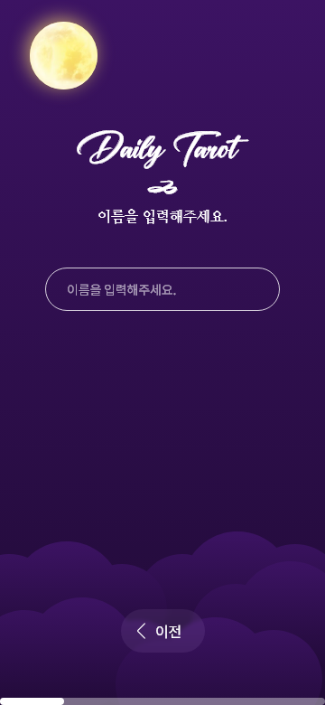
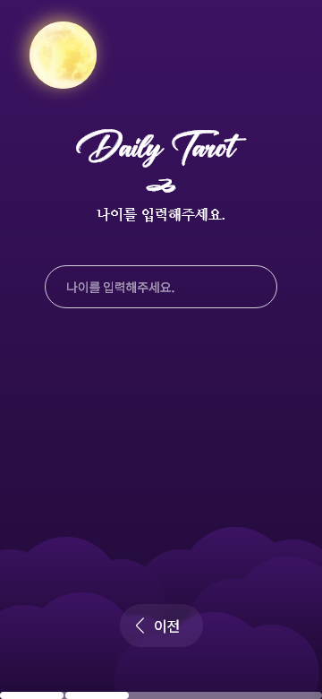

# A06. 이름 · 나이 입력

| 이름 | 나이 |
|---|---|
|  |  |

## 채점 포인트

| UI 요소 (각 0.2) | 이름 요구사항 (각 0.4) | 나이 요구사항 (각 0.4) |
|---|---|---|
| 달 그래픽 | 텍스트 입력 가능 | 텍스트 입력 가능 |
| 로고 (작은 그래픽 포함) | **최소 2자, 최대 20자** | **숫자만** 입력 |
| "○○을 입력해주세요." 텍스트 | **키보드 Enter** 시 유효성 검사 | 키보드 Enter 시 유효성 검사 |
| 입력 텍스트 필드 | 미입력/조건 불만족 → 오류 메시지 | 미입력/조건 불만족 → 오류 메시지 |
| Placeholder "○○을 입력해주세요." | 통과 → 나이 입력으로 | 통과 → 성별 선택으로 |
| 구름 그래픽 (아래) | 이전 → 온보딩으로 | 이전 → 이름 입력으로 |
| 이전 버튼 ("<" 포함) | | |
| 진행 표시줄 (하단) | | |

주관 "친절한 메시지" 1점: 채점표 예시 기준으로 **"이름값을 확인해주세요."(3점) 보다 "이름 항목에는 한글만 입력 가능합니다."(4점)** 처럼 **무엇이 왜 틀렸는지** 문장으로 알려 줘야 최고점입니다.

## 화면 구조 (입력 5단계 공통)

```
       (달)
    Daily Tarot        ← DailyTarotLogo
        ⌇
   이름을 입력해주세요.    ← title
 ┌───────────────────┐
 │ 이름을 입력해주세요.  │  ← content (화면마다 다름)
 └───────────────────┘
      오류 메시지
        ...
     [ < 이전 ]         ← bottomButtons
 ▬▬▬▬▬▬▬▬▬▬▬▬▬▬▬▬▬▬▬▬▬  ← StepProgress(step)
```

이 틀을 `InputScaffold`로 한 번 만들고, 이름·나이·성별·날짜·시간 화면이 모두 씁니다.

## 따라하기

새 파일 `InputScreens.kt` (A07의 성별 화면도 이 파일 아래에 붙입니다. import는 미리 다 넣어 두었습니다.)

```kotlin
package com.example.dailytarot

import androidx.compose.foundation.background
import androidx.compose.foundation.border
import androidx.compose.foundation.clickable
import androidx.compose.foundation.layout.Arrangement
import androidx.compose.foundation.layout.Box
import androidx.compose.foundation.layout.Column
import androidx.compose.foundation.layout.ColumnScope
import androidx.compose.foundation.layout.Row
import androidx.compose.foundation.layout.RowScope
import androidx.compose.foundation.layout.Spacer
import androidx.compose.foundation.layout.fillMaxSize
import androidx.compose.foundation.layout.fillMaxWidth
import androidx.compose.foundation.layout.height
import androidx.compose.foundation.layout.padding
import androidx.compose.foundation.layout.size
import androidx.compose.foundation.shape.CircleShape
import androidx.compose.foundation.shape.RoundedCornerShape
import androidx.compose.foundation.text.BasicTextField
import androidx.compose.foundation.text.KeyboardActions
import androidx.compose.foundation.text.KeyboardOptions
import androidx.compose.material3.Icon
import androidx.compose.material3.Text
import androidx.compose.runtime.Composable
import androidx.compose.runtime.getValue
import androidx.compose.runtime.mutableStateOf
import androidx.compose.runtime.remember
import androidx.compose.runtime.rememberCoroutineScope
import androidx.compose.runtime.setValue
import androidx.compose.ui.Alignment
import androidx.compose.ui.Modifier
import androidx.compose.ui.draw.clip
import androidx.compose.ui.graphics.Color
import androidx.compose.ui.graphics.SolidColor
import androidx.compose.ui.input.key.Key
import androidx.compose.ui.input.key.KeyEventType
import androidx.compose.ui.input.key.key
import androidx.compose.ui.input.key.onPreviewKeyEvent
import androidx.compose.ui.input.key.type
import androidx.compose.ui.platform.LocalFocusManager
import androidx.compose.ui.res.painterResource
import androidx.compose.ui.text.TextStyle
import androidx.compose.ui.text.font.FontWeight
import androidx.compose.ui.text.input.ImeAction
import androidx.compose.ui.text.input.KeyboardType
import androidx.compose.ui.text.style.TextAlign
import androidx.compose.ui.unit.Dp
import androidx.compose.ui.unit.dp
import androidx.compose.ui.unit.sp
import kotlinx.coroutines.delay
import kotlinx.coroutines.launch

// ───────── 입력 화면 공통 틀 ─────────
@Composable
fun InputScaffold(
    title: String,
    step: Int,                                   // 진행 표시줄 몇 칸 채울지 (1~5)
    bottomButtons: @Composable RowScope.() -> Unit,
    contentPadding: Dp = 50.dp,
    content: @Composable ColumnScope.() -> Unit
) {
    TarotBackground {
        Column(Modifier.fillMaxSize(), horizontalAlignment = Alignment.CenterHorizontally) {
            Spacer(Modifier.height(96.dp))
            DailyTarotLogo()
            Spacer(Modifier.height(10.dp))
            Text(
                title,
                color = Color.White,
                fontFamily = Myeongjo,
                fontWeight = FontWeight.Bold,
                fontSize = 16.sp
            )
            Spacer(Modifier.height(36.dp))
            Column(
                Modifier
                    .weight(1f)
                    .fillMaxWidth()
                    .padding(horizontal = contentPadding),
                horizontalAlignment = Alignment.CenterHorizontally,
                content = content
            )
            Row(
                Modifier.fillMaxWidth().padding(bottom = 20.dp),
                horizontalArrangement = Arrangement.spacedBy(12.dp, Alignment.CenterHorizontally),
                content = bottomButtons
            )
            StepProgress(step)
        }
    }
}

// ───────── 둥근 입력칸 ─────────
@Composable
fun RoundInput(
    value: String,
    onValueChange: (String) -> Unit,
    placeholder: String,
    keyboardType: KeyboardType,
    onDone: () -> Unit
) {
    BasicTextField(
        value = value,
        onValueChange = onValueChange,
        singleLine = true,
        textStyle = TextStyle(color = Color.White, fontFamily = NotoSans, fontSize = 15.sp),
        cursorBrush = SolidColor(Color.White),
        keyboardOptions = KeyboardOptions(keyboardType = keyboardType, imeAction = ImeAction.Done),
        keyboardActions = KeyboardActions(onDone = { onDone() }),   // 화면 키보드의 완료(Enter)
        modifier = Modifier
            .fillMaxWidth()
            .onPreviewKeyEvent { e ->                                 // 실제 키보드의 Enter
                if (e.key == Key.Enter || e.key == Key.NumPadEnter) {
                    if (e.type == KeyEventType.KeyUp) onDone()
                    true
                } else false
            },
        decorationBox = { innerTextField ->
            Box(
                Modifier
                    .fillMaxWidth()
                    .border(1.dp, White70, RoundedCornerShape(50))
                    .padding(horizontal = 24.dp, vertical = 14.dp)
            ) {
                if (value.isEmpty()) {
                    Text(placeholder, color = White40, fontFamily = NotoSans, fontSize = 15.sp)
                }
                innerTextField()
            }
        }
    )
}

// ───────── 오류 메시지 ─────────
@Composable
fun ErrorText(message: String?) {
    if (message != null) {
        Text(
            message,
            color = Color(0xFFFFB4C8),
            fontFamily = NotoSans,
            fontSize = 13.sp,
            textAlign = TextAlign.Center,
            modifier = Modifier.padding(top = 12.dp)
        )
    }
}

// ───────── 이름 입력 ─────────
@Composable
fun NameScreen(user: UserInfo, onNext: () -> Unit, onBack: () -> Unit) {
    var text by remember { mutableStateOf(user.name) }
    var error by remember { mutableStateOf<String?>(null) }
    val focus = LocalFocusManager.current

    fun submit() {
        val name = text.trim()
        error = when {
            name.isEmpty() -> "이름을 입력해주세요. 2자 이상 20자 이하로 적어주시면 돼요."
            name.length < 2 -> "이름이 너무 짧아요. 2자 이상 입력해주세요."
            name.length > 20 -> "이름이 너무 길어요. 20자 이하로 입력해주세요."
            else -> null
        }
        if (error == null) {
            user.name = name
            focus.clearFocus()
            onNext()
        }
    }

    InputScaffold(
        title = "이름을 입력해주세요.",
        step = 1,
        bottomButtons = { SoftButton("이전", onBack, leftArrow = true) }
    ) {
        RoundInput(
            value = text,
            onValueChange = {
                if (it.length <= 20) {
                    text = it
                    error = null
                } else {
                    error = "이름은 최대 20자까지 입력할 수 있어요."
                }
            },
            placeholder = "이름을 입력해주세요.",
            keyboardType = KeyboardType.Text,
            onDone = { submit() }
        )
        ErrorText(error)
    }
}

// ───────── 나이 입력 ─────────
@Composable
fun AgeScreen(user: UserInfo, onNext: () -> Unit, onBack: () -> Unit) {
    var text by remember { mutableStateOf(user.age) }
    var error by remember { mutableStateOf<String?>(null) }
    val focus = LocalFocusManager.current

    fun submit() {
        val age = text.toIntOrNull()
        error = when {
            text.isEmpty() -> "나이를 입력해주세요. 숫자로만 적어주시면 돼요."
            age == null -> "나이는 숫자로만 입력할 수 있어요."
            age !in 1..120 -> "나이는 1세부터 120세 사이로 입력해주세요."
            else -> null
        }
        if (error == null) {
            user.age = age.toString()
            focus.clearFocus()
            onNext()
        }
    }

    InputScaffold(
        title = "나이를 입력해주세요.",
        step = 2,
        bottomButtons = { SoftButton("이전", onBack, leftArrow = true) }
    ) {
        RoundInput(
            value = text,
            onValueChange = { v ->
                if (v.all { it.isDigit() }) {
                    if (v.length <= 3) {
                        text = v
                        error = null
                    }
                } else {
                    // 숫자가 아닌 글자는 입력되지 않고 안내만 보여 준다
                    error = "나이는 숫자로만 입력할 수 있어요."
                }
            },
            placeholder = "나이를 입력해주세요.",
            keyboardType = KeyboardType.Number,
            onDone = { submit() }
        )
        ErrorText(error)
    }
}
```

## App.kt 연결

```kotlin
Screen.Name -> NameScreen(user, onNext = { next(Screen.Age) }, onBack = { nav.back() })
Screen.Age -> AgeScreen(user, onNext = { next(Screen.Gender) }, onBack = { nav.back() })
```

## 핵심 설명

- **Enter가 두 종류**입니다.
  - 화면 키보드의 완료(↵) 버튼 → `keyboardActions.onDone`
  - 에뮬레이터에서 PC 키보드 Enter → `onPreviewKeyEvent`에서 `Key.Enter`를 잡음
  - 채점자는 둘 중 아무거나 누를 수 있으니 **둘 다** 처리합니다. KeyDown은 `true`로 먹어 버려서 두 번 실행되지 않게 했습니다.
- **20자 제한**: 21번째 글자는 아예 들어가지 않고 안내 문구만 나옵니다. Enter 때 다시 한 번 검사합니다.
- **나이 숫자만**: `KeyboardType.Number`는 숫자 키보드를 띄워 줄 뿐, PC 키보드로는 문자가 들어올 수 있습니다. 그래서 `onValueChange`에서 **숫자가 아니면 거부**합니다.
- **`trim()`**: 공백만 입력한 경우도 "입력 안 함"으로 처리됩니다.

## ✅ 실행해서 확인
- [ ] 이름 빈칸 Enter → 오류 / "가" Enter → 오류 / 21자째 입력 → 막힘 + 안내
- [ ] "김기능" Enter → 나이 화면, 진행바 2칸
- [ ] 나이에 PC 키보드로 "a" 입력 → 안 들어가고 안내 / 빈칸 Enter → 오류
- [ ] 나이 "0" Enter → 오류 / "1" Enter → 성별 화면(아직 임시)
- [ ] 이전 버튼: 나이 → 이름, 이름 → 온보딩
- [ ] 이름 화면으로 돌아왔을 때 입력했던 이름이 남아 있다

👉 다음: [A07. 성별 선택](A07_성별_선택.md)
