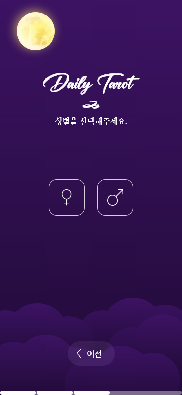

# A07. 성별 선택



## 채점 포인트

| UI 요소 (각 0.2) | 요구사항 (각 0.4) |
|---|---|
| 달, 로고, "성별을 선택해주세요." | 성별 선택이 가능하다 |
| **남성(남성 기호 아이콘)** 선택 버튼 | 선택하면 → 태어난 날짜 입력으로 |
| **여성(여성 기호 아이콘)** 선택 버튼 | 이전 → 나이 입력으로 |
| 구름, 이전 버튼, 진행 표시줄 | |

## 따라하기

`InputScreens.kt` **맨 아래에 이어서** 붙입니다.

```kotlin
// ───────── 성별 선택 ─────────
@Composable
fun GenderScreen(user: UserInfo, onNext: () -> Unit, onBack: () -> Unit) {
    var selected by remember { mutableStateOf(user.isMale) }
    val scope = rememberCoroutineScope()

    fun pick(isMale: Boolean) {
        selected = isMale
        user.isMale = isMale
        scope.launch {
            delay(250)      // 선택된 모습을 잠깐 보여 준 뒤 이동
            onNext()
        }
    }

    InputScaffold(
        title = "성별을 선택해주세요.",
        step = 3,
        bottomButtons = { SoftButton("이전", onBack, leftArrow = true) }
    ) {
        Row(horizontalArrangement = Arrangement.spacedBy(40.dp)) {
            GenderButton(R.drawable.ic_male, "남성", selected == true) { pick(true) }
            GenderButton(R.drawable.ic_female, "여성", selected == false) { pick(false) }
        }
    }
}

@Composable
fun GenderButton(icon: Int, label: String, selected: Boolean, onClick: () -> Unit) {
    Column(horizontalAlignment = Alignment.CenterHorizontally) {
        Box(
            Modifier
                .size(84.dp)
                .clip(CircleShape)
                .background(if (selected) White15 else Color.Transparent)
                .border(if (selected) 2.dp else 1.dp, if (selected) Color.White else White70, CircleShape)
                .clickable(onClick = onClick),
            contentAlignment = Alignment.Center
        ) {
            Icon(painterResource(icon), contentDescription = label, tint = Color.White, modifier = Modifier.size(44.dp))
        }
        Spacer(Modifier.height(10.dp))
        Text(label, color = Color.White, fontFamily = NotoSans, fontSize = 14.sp)
    }
}
```

필요한 import는 A06에서 파일 맨 위에 미리 넣어 두었습니다.

## App.kt 연결

```kotlin
Screen.Gender -> GenderScreen(user, onNext = { next(Screen.BirthDate) }, onBack = { nav.back() })
```

## 핵심 설명
- `selected`가 `Boolean?`인 이유: **아직 아무것도 고르지 않은 상태(null)** 가 있기 때문입니다.
- `delay(250)` 동안 테두리가 굵어져서 "눌렸다"는 느낌을 줍니다. 바로 넘어가면 사용자가 무엇을 골랐는지 모릅니다.

## ✅ 실행해서 확인
- [ ] ♂, ♀ 아이콘이 보이고 아래 "남성", "여성" 글자
- [ ] 누르면 테두리가 강조되고 → 날짜 화면(아직 임시)
- [ ] 이전 → 나이 화면, 진행바 3칸

👉 다음: [A08. 태어난 날짜 (달력)](A08_태어난_날짜_달력.md)
