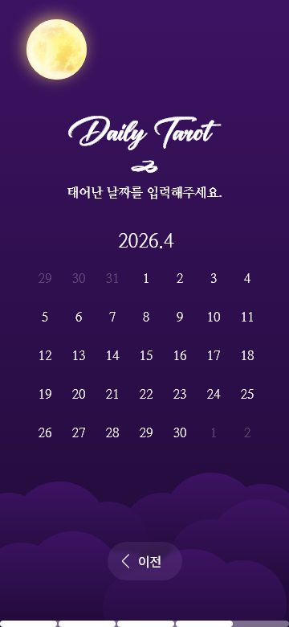

# A08. 태어난 날짜 입력 (달력)



## 채점 포인트

| UI 요소 (각 0.2) | 요구사항 (각 0.4) |
|---|---|
| 달, 로고, "태어난 날짜를 입력해주세요." | **{년}.{월} 글자 클릭** → 연도·월 선택 |
| **{년}.{월} 텍스트** | 선택한 연·월에 맞는 **달력 표시** |
| **날짜 달력** | 날짜 선택 → 태어난 시간 입력으로 |
| 구름, 이전 버튼, 진행 표시줄 | 이전 → 성별 선택으로 |

## 이번 단계에서 만드는 것

1. `WheelPicker.kt` — 위아래로 스크롤해서 고르는 **휠**과 그 휠을 담는 **다이얼로그**
   → Module B "생년월일 선택 다이얼로그"(스크롤로 변경)에서 **그대로 재사용**합니다.
2. `BirthDateScreen.kt` — 달력 + 연/월 선택

## 1) WheelPicker.kt

```kotlin
package com.example.dailytarot

import androidx.compose.foundation.ExperimentalFoundationApi
import androidx.compose.foundation.background
import androidx.compose.foundation.gestures.snapping.rememberSnapFlingBehavior
import androidx.compose.foundation.layout.Arrangement
import androidx.compose.foundation.layout.Box
import androidx.compose.foundation.layout.Column
import androidx.compose.foundation.layout.PaddingValues
import androidx.compose.foundation.layout.Row
import androidx.compose.foundation.layout.RowScope
import androidx.compose.foundation.layout.Spacer
import androidx.compose.foundation.layout.fillMaxSize
import androidx.compose.foundation.layout.fillMaxWidth
import androidx.compose.foundation.layout.height
import androidx.compose.foundation.layout.offset
import androidx.compose.foundation.layout.padding
import androidx.compose.foundation.layout.width
import androidx.compose.foundation.lazy.LazyColumn
import androidx.compose.foundation.lazy.rememberLazyListState
import androidx.compose.foundation.shape.RoundedCornerShape
import androidx.compose.material3.HorizontalDivider
import androidx.compose.material3.Text
import androidx.compose.material3.TextButton
import androidx.compose.runtime.Composable
import androidx.compose.runtime.LaunchedEffect
import androidx.compose.runtime.derivedStateOf
import androidx.compose.runtime.getValue
import androidx.compose.runtime.remember
import androidx.compose.runtime.rememberUpdatedState
import androidx.compose.ui.Alignment
import androidx.compose.ui.Modifier
import androidx.compose.ui.draw.clip
import androidx.compose.ui.graphics.Brush
import androidx.compose.ui.graphics.Color
import androidx.compose.ui.platform.LocalDensity
import androidx.compose.ui.text.font.FontWeight
import androidx.compose.ui.unit.Dp
import androidx.compose.ui.unit.dp
import androidx.compose.ui.unit.sp
import androidx.compose.ui.window.Dialog

// ───────── 스크롤 휠 (3줄 보이고 가운데가 선택) ─────────
@OptIn(ExperimentalFoundationApi::class)
@Composable
fun WheelPicker(
    options: List<String>,
    selectedIndex: Int,
    onSelectedChange: (Int) -> Unit,
    modifier: Modifier = Modifier,
    itemHeight: Dp = 44.dp
) {
    val last = (options.size - 1).coerceAtLeast(0)
    val state = rememberLazyListState(initialFirstVisibleItemIndex = selectedIndex.coerceIn(0, last))
    val fling = rememberSnapFlingBehavior(lazyListState = state)   // 손을 떼면 한 칸에 딱 맞춰 멈춤
    val itemPx = with(LocalDensity.current) { itemHeight.toPx() }

    // 위아래 여백을 한 칸씩 줬기 때문에 "맨 위에 보이는 항목" = "가운데 항목"
    val centerIndex by remember {
        derivedStateOf {
            state.firstVisibleItemIndex + if (state.firstVisibleItemScrollOffset > itemPx / 2) 1 else 0
        }
    }
    val currentSelected by rememberUpdatedState(selectedIndex)
    val currentOnChange by rememberUpdatedState(onSelectedChange)

    // 스크롤이 멈추면 가운데 항목을 선택으로 알려 준다
    LaunchedEffect(state.isScrollInProgress) {
        if (!state.isScrollInProgress) {
            val index = centerIndex.coerceIn(0, last)
            if (index != currentSelected) currentOnChange(index)
        }
    }
    // 바깥에서 선택이 바뀌면(예: 31일 → 30일로 줄어듦) 그 위치로 이동
    LaunchedEffect(selectedIndex, options.size) {
        val target = selectedIndex.coerceIn(0, last)
        if (!state.isScrollInProgress && centerIndex != target) state.scrollToItem(target)
    }

    Box(modifier.height(itemHeight * 3), contentAlignment = Alignment.Center) {
        LazyColumn(
            state = state,
            flingBehavior = fling,
            contentPadding = PaddingValues(vertical = itemHeight),
            horizontalAlignment = Alignment.CenterHorizontally,
            modifier = Modifier.fillMaxSize()
        ) {
            items(options.size) { i ->
                val isCenter = i == centerIndex
                Box(Modifier.height(itemHeight).fillMaxWidth(), contentAlignment = Alignment.Center) {
                    Text(
                        options[i],
                        color = if (isCenter) Color.White else White40,
                        fontFamily = NotoSans,
                        fontWeight = if (isCenter) FontWeight.Medium else FontWeight.Normal,
                        fontSize = if (isCenter) 20.sp else 18.sp
                    )
                }
            }
        }
        // 가운데 줄 위·아래 짧은 선
        Box(Modifier.offset(y = -itemHeight / 2).width(22.dp).height(1.dp).background(White70))
        Box(Modifier.offset(y = itemHeight / 2).width(22.dp).height(1.dp).background(White70))
    }
}

// ───────── 휠을 담는 다이얼로그 (제목 + 휠들 + 취소/선택) ─────────
@Composable
fun WheelDialog(
    title: String,
    onDismiss: () -> Unit,
    onConfirm: () -> Unit,
    wheels: @Composable RowScope.() -> Unit
) {
    Dialog(onDismissRequest = onDismiss) {
        Column(
            Modifier
                .fillMaxWidth()
                .clip(RoundedCornerShape(16.dp))
                .background(Brush.verticalGradient(listOf(Color(0xFF4A1A78), Color(0xFF2A0F4A))))
                .padding(horizontal = 24.dp, vertical = 20.dp)
        ) {
            Text(title, color = Color.White, fontFamily = NotoSans, fontWeight = FontWeight.Medium, fontSize = 18.sp)
            Spacer(Modifier.height(12.dp))
            HorizontalDivider(color = White40)
            Row(Modifier.fillMaxWidth().padding(vertical = 12.dp), content = wheels)
            HorizontalDivider(color = White40)
            Row(Modifier.fillMaxWidth().padding(top = 8.dp), horizontalArrangement = Arrangement.End) {
                TextButton(onClick = onDismiss) {
                    Text("취소", color = Color.White, fontFamily = NotoSans, fontSize = 16.sp)
                }
                TextButton(onClick = onConfirm) {
                    Text("선택", color = Color.White, fontFamily = NotoSans, fontSize = 16.sp)
                }
            }
        }
    }
}
```

## 2) BirthDateScreen.kt

```kotlin
package com.example.dailytarot

import androidx.compose.foundation.background
import androidx.compose.foundation.clickable
import androidx.compose.foundation.layout.Arrangement
import androidx.compose.foundation.layout.Box
import androidx.compose.foundation.layout.Column
import androidx.compose.foundation.layout.Row
import androidx.compose.foundation.layout.Spacer
import androidx.compose.foundation.layout.aspectRatio
import androidx.compose.foundation.layout.fillMaxWidth
import androidx.compose.foundation.layout.height
import androidx.compose.foundation.layout.padding
import androidx.compose.foundation.shape.CircleShape
import androidx.compose.foundation.shape.RoundedCornerShape
import androidx.compose.material3.Text
import androidx.compose.runtime.Composable
import androidx.compose.runtime.getValue
import androidx.compose.runtime.mutableIntStateOf
import androidx.compose.runtime.mutableStateOf
import androidx.compose.runtime.remember
import androidx.compose.runtime.setValue
import androidx.compose.ui.Alignment
import androidx.compose.ui.Modifier
import androidx.compose.ui.draw.clip
import androidx.compose.ui.graphics.Color
import androidx.compose.ui.unit.dp
import androidx.compose.ui.unit.sp
import java.time.LocalDate
import java.time.YearMonth

@Composable
fun BirthDateScreen(user: UserInfo, onNext: () -> Unit, onBack: () -> Unit) {
    val today = remember { LocalDate.now() }
    var month by remember { mutableStateOf(YearMonth.from(user.birthDate ?: today)) }
    var showPicker by remember { mutableStateOf(false) }

    InputScaffold(
        title = "태어난 날짜를 입력해주세요.",
        step = 4,
        contentPadding = 36.dp,
        bottomButtons = { SoftButton("이전", onBack, leftArrow = true) }
    ) {
        // {년}.{월} — 누르면 연·월 선택
        Text(
            "${month.year}.${month.monthValue}",
            color = Color.White,
            fontFamily = Myeongjo,
            fontSize = 22.sp,
            modifier = Modifier
                .clip(RoundedCornerShape(8.dp))
                .clickable { showPicker = true }
                .padding(horizontal = 14.dp, vertical = 4.dp)
        )
        Spacer(Modifier.height(16.dp))
        MonthCalendar(
            month = month,
            today = today,
            selected = user.birthDate,
            onPick = { day ->
                user.birthDate = day
                onNext()
            }
        )
    }

    if (showPicker) {
        YearMonthDialog(
            initial = month,
            max = YearMonth.from(today),
            onDismiss = { showPicker = false },
            onConfirm = {
                month = it
                showPicker = false
            }
        )
    }
}

// ───────── 달력 (일요일 시작, 앞뒤 달 날짜는 흐리게) ─────────
@Composable
fun MonthCalendar(month: YearMonth, today: LocalDate, selected: LocalDate?, onPick: (LocalDate) -> Unit) {
    val first = month.atDay(1)
    val lead = first.dayOfWeek.value % 7          // 월=1 … 일=7 → 일요일을 0으로
    val start = first.minusDays(lead.toLong())     // 달력 첫 칸의 날짜
    val rows = (lead + month.lengthOfMonth() + 6) / 7

    Column(verticalArrangement = Arrangement.spacedBy(6.dp)) {
        for (r in 0 until rows) {
            Row(Modifier.fillMaxWidth()) {
                for (c in 0 until 7) {
                    val day = start.plusDays((r * 7 + c).toLong())
                    val inMonth = YearMonth.from(day) == month
                    val enabled = inMonth && !day.isAfter(today)   // 미래 날짜는 선택 불가
                    Box(
                        Modifier
                            .weight(1f)
                            .aspectRatio(1f)
                            .clip(CircleShape)
                            .background(if (day == selected) White15 else Color.Transparent)
                            .clickable(enabled = enabled) { onPick(day) },
                        contentAlignment = Alignment.Center
                    ) {
                        Text(
                            "${day.dayOfMonth}",
                            color = when {
                                !inMonth -> Color.White.copy(alpha = 0.25f)
                                !enabled -> White40
                                else -> Color.White
                            },
                            fontFamily = Myeongjo,
                            fontSize = 15.sp
                        )
                    }
                }
            }
        }
    }
}

// ───────── 연·월 선택 다이얼로그 ─────────
@Composable
fun YearMonthDialog(initial: YearMonth, max: YearMonth, onDismiss: () -> Unit, onConfirm: (YearMonth) -> Unit) {
    val years = remember { (1900..max.year).map { "$it" } }
    var year by remember { mutableIntStateOf(initial.year) }
    var month by remember { mutableIntStateOf(initial.monthValue) }
    val maxMonth = if (year == max.year) max.monthValue else 12   // 올해는 이번 달까지만
    val shownMonth = month.coerceAtMost(maxMonth)

    WheelDialog(
        title = "연도와 월 선택",
        onDismiss = onDismiss,
        onConfirm = { onConfirm(YearMonth.of(year, shownMonth)) }
    ) {
        WheelPicker(years, year - 1900, { year = 1900 + it }, Modifier.weight(1f))
        WheelPicker((1..maxMonth).map { "%02d".format(it) }, shownMonth - 1, { month = it + 1 }, Modifier.weight(1f))
    }
}
```

## App.kt 연결

```kotlin
Screen.BirthDate -> BirthDateScreen(user, onNext = { next(Screen.BirthTime) }, onBack = { nav.back() })
```

## 핵심 설명

**달력 계산 3줄이 핵심입니다.**

| 코드 | 2026년 4월 예시 |
|---|---|
| `first.dayOfWeek.value % 7` | 4/1은 수요일(3) → 앞에 빈칸 3개 |
| `first.minusDays(lead)` | 첫 칸 = 3/29(일) |
| `(lead + 30 + 6) / 7` | 5줄 |

그리고 첫 칸부터 `plusDays(0, 1, 2, …)`로 채우면 3/29, 3/30, 3/31, 4/1 … 5/2 가 나옵니다. 프로토타입과 똑같습니다.

**WheelPicker 원리**
- `LazyColumn` 위아래에 **한 칸 높이 여백**을 주면, 맨 위에 보이는 항목이 정확히 가운데에 옵니다.
- `rememberSnapFlingBehavior`: 손을 떼면 항목 경계에 딱 맞춰 멈춥니다.
- 스크롤이 멈추는 순간(`isScrollInProgress`가 false) 가운데 항목을 선택값으로 알려 줍니다.

## ✅ 실행해서 확인
- [ ] 오늘 기준 달이 나오고, 앞뒤 달 날짜는 흐리게
- [ ] `2026.4` 글자 클릭 → 휠 다이얼로그 → 1995년 3월 선택 → 그 달 달력으로 바뀜
- [ ] 1995년 3월 1일은 **수요일 칸**에 있다 (실제 달력과 비교)
- [ ] 취소 → 아무것도 안 바뀜
- [ ] 미래 날짜는 눌러도 반응 없음
- [ ] 날짜 클릭 → 시간 화면(아직 임시), 이전 → 성별 화면

👉 다음: [A09. 태어난 시간 (시계)](A09_태어난_시간_시계.md)
