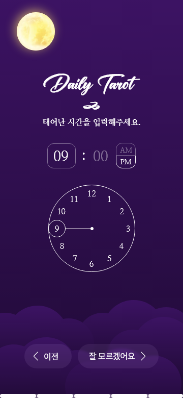
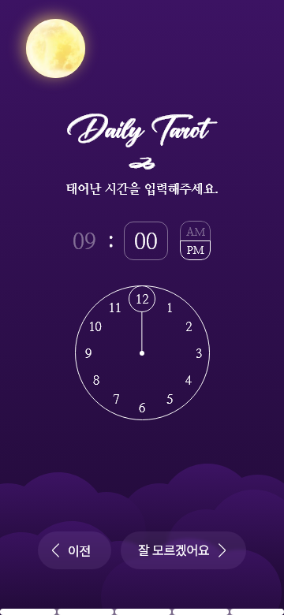

# A09. 태어난 시간 입력 (시계)

| 시 선택 | 분 선택 |
|---|---|
|  |  |

## 채점 포인트

| UI 요소 (각 0.2) | 요구사항 (각 0.4) |
|---|---|
| 달, 로고, "태어난 시간을 입력해주세요." | **AM, PM 토글** 클릭으로 변경 |
| **{시간} : {분} 텍스트** | 시계에서 **시 선택** → {시간}에 입력 + **분 선택 활성화** |
| **AM, PM 선택 토글** | 시계에서 **분 선택** → 정보 확인으로 |
| **시계 그래픽** | **잘 모르겠어요** → 정보 확인으로 |
| 구름, 이전 버튼, **잘 모르겠어요 버튼 (">")**, 진행 표시줄 | 이전 → **성별 선택**으로 (PDF 문구 그대로) |

> ⚠️ PDF와 채점표 모두 "이전 → **성별 선택** 화면"이라고 적혀 있습니다. 흐름상 날짜 화면이 자연스럽지만 채점표 문구에 맞춰 성별 선택으로 보냅니다. (대회 당일 문구가 바뀌면 그에 따르세요.)

## 시계 탭 → 숫자 계산

```
        12 (0도)
   9 ──── ● ──── 3 (90도)
        6 (180도)
```

1. 탭한 위치와 시계 가운데의 차이 `dx`, `dy`
2. `atan2(dx, -dy)` → 12시 방향을 0도로, 시계 방향으로 커지는 각도
3. 각도 ÷ 30도 → 반올림 → 0~11 (0은 12시)

분 모드에서는 같은 12칸을 `00, 05, 10, … 55`로 씁니다.

## 따라하기

새 파일 `BirthTimeScreen.kt`

```kotlin
package com.example.dailytarot

import androidx.compose.foundation.Canvas
import androidx.compose.foundation.border
import androidx.compose.foundation.clickable
import androidx.compose.foundation.gestures.detectTapGestures
import androidx.compose.foundation.layout.Box
import androidx.compose.foundation.layout.Column
import androidx.compose.foundation.layout.Row
import androidx.compose.foundation.layout.Spacer
import androidx.compose.foundation.layout.fillMaxSize
import androidx.compose.foundation.layout.height
import androidx.compose.foundation.layout.offset
import androidx.compose.foundation.layout.padding
import androidx.compose.foundation.layout.size
import androidx.compose.foundation.layout.width
import androidx.compose.foundation.shape.RoundedCornerShape
import androidx.compose.material3.HorizontalDivider
import androidx.compose.material3.Text
import androidx.compose.runtime.Composable
import androidx.compose.runtime.getValue
import androidx.compose.runtime.mutableStateOf
import androidx.compose.runtime.remember
import androidx.compose.runtime.rememberCoroutineScope
import androidx.compose.runtime.rememberUpdatedState
import androidx.compose.runtime.setValue
import androidx.compose.ui.Alignment
import androidx.compose.ui.Modifier
import androidx.compose.ui.draw.clip
import androidx.compose.ui.geometry.Offset
import androidx.compose.ui.graphics.Color
import androidx.compose.ui.graphics.drawscope.Stroke
import androidx.compose.ui.input.pointer.pointerInput
import androidx.compose.ui.unit.Dp
import androidx.compose.ui.unit.dp
import androidx.compose.ui.unit.sp
import kotlinx.coroutines.delay
import kotlinx.coroutines.launch
import kotlin.math.atan2
import kotlin.math.cos
import kotlin.math.roundToInt
import kotlin.math.sin

@Composable
fun BirthTimeScreen(user: UserInfo, onNext: () -> Unit, onBack: () -> Unit) {
    var isPm by remember { mutableStateOf((user.birthHour ?: 0) >= 12) }
    var hour12 by remember { mutableStateOf<Int?>(null) }    // 1 ~ 12
    var minute by remember { mutableStateOf<Int?>(null) }
    var pickingMinute by remember { mutableStateOf(false) }  // false = 시 고르는 중
    val scope = rememberCoroutineScope()

    fun finish(h12: Int, m: Int) {
        user.birthHour = (h12 % 12) + if (isPm) 12 else 0      // 12AM → 0시, 12PM → 12시
        user.birthMinute = m
        user.timeUnknown = false
        scope.launch {
            delay(300)      // 바늘이 움직인 걸 잠깐 보여 주고 이동
            onNext()
        }
    }

    InputScaffold(
        title = "태어난 시간을 입력해주세요.",
        step = 5,
        bottomButtons = {
            SoftButton("이전", onBack, leftArrow = true)
            SoftButton("잘 모르겠어요", onClick = {
                user.timeUnknown = true
                user.birthHour = null
                user.birthMinute = null
                onNext()
            }, rightArrow = true)
        }
    ) {
        // {시간} : {분}  [AM/PM]
        Row(verticalAlignment = Alignment.CenterVertically) {
            TimeBox(
                text = hour12?.let { "%02d".format(it) } ?: "--",
                active = !pickingMinute,
                onClick = { pickingMinute = false }
            )
            Text(" : ", color = Color.White, fontFamily = Myeongjo, fontSize = 26.sp)
            TimeBox(
                text = minute?.let { "%02d".format(it) } ?: "00",
                active = pickingMinute,
                onClick = { if (hour12 != null) pickingMinute = true }
            )
            Spacer(Modifier.width(14.dp))
            AmPmToggle(isPm = isPm, onChange = { isPm = it })
        }

        Spacer(Modifier.height(28.dp))

        ClockFace(
            labels = if (pickingMinute) List(12) { "%02d".format(it * 5) }
                     else List(12) { if (it == 0) "12" else "$it" },
            selected = if (pickingMinute) minute?.div(5) else hour12?.rem(12),
            onPick = { index ->
                if (!pickingMinute) {
                    hour12 = if (index == 0) 12 else index
                    pickingMinute = true                 // 시를 고르면 분 선택 활성화
                } else {
                    minute = index * 5
                    finish(hour12 ?: 12, index * 5)
                }
            }
        )
    }
}

// ───────── 시/분 숫자 칸 (고르는 중인 칸에 테두리) ─────────
@Composable
fun TimeBox(text: String, active: Boolean, onClick: () -> Unit) {
    Box(
        Modifier
            .size(width = 56.dp, height = 48.dp)
            .clip(RoundedCornerShape(10.dp))
            .border(1.dp, if (active) White70 else Color.Transparent, RoundedCornerShape(10.dp))
            .clickable(onClick = onClick),
        contentAlignment = Alignment.Center
    ) {
        Text(text, color = if (active) Color.White else White40, fontFamily = Myeongjo, fontSize = 26.sp)
    }
}

// ───────── AM / PM 위아래 토글 ─────────
@Composable
fun AmPmToggle(isPm: Boolean, onChange: (Boolean) -> Unit) {
    Column(
        Modifier
            .width(38.dp)
            .clip(RoundedCornerShape(8.dp))
            .border(1.dp, White70, RoundedCornerShape(8.dp)),
        horizontalAlignment = Alignment.CenterHorizontally
    ) {
        Text(
            "AM",
            color = if (!isPm) Color.White else White40,
            fontFamily = Myeongjo,
            fontSize = 13.sp,
            modifier = Modifier.clickable { onChange(false) }.padding(vertical = 3.dp, horizontal = 6.dp)
        )
        HorizontalDivider(color = White70)
        Text(
            "PM",
            color = if (isPm) Color.White else White40,
            fontFamily = Myeongjo,
            fontSize = 13.sp,
            modifier = Modifier.clickable { onChange(true) }.padding(vertical = 3.dp, horizontal = 6.dp)
        )
    }
}

// ───────── 시계 ─────────
@Composable
fun ClockFace(labels: List<String>, selected: Int?, onPick: (Int) -> Unit, clockSize: Dp = 180.dp) {
    val currentOnPick by rememberUpdatedState(onPick)

    Box(
        Modifier
            .size(clockSize)
            .pointerInput(Unit) {
                detectTapGestures { pos ->
                    val dx = pos.x - size.width / 2f
                    val dy = pos.y - size.height / 2f
                    val deg = Math.toDegrees(atan2(dx.toDouble(), (-dy).toDouble()))  // 12시 = 0도
                    val index = (((deg + 360) % 360) / 30.0).roundToInt() % 12
                    currentOnPick(index)
                }
            }
    ) {
        Canvas(Modifier.fillMaxSize()) {
            val r = size.minDimension / 2
            drawCircle(Color.White, radius = r - 1.dp.toPx(), style = Stroke(1.dp.toPx()))
            drawCircle(Color.White, radius = 3.dp.toPx())                         // 가운데 점
            if (selected != null) {
                val a = Math.toRadians(selected * 30.0)
                val labelR = r * 0.78f
                val knob = 14.dp.toPx()
                val tip = Offset(center.x + (labelR * sin(a)).toFloat(), center.y - (labelR * cos(a)).toFloat())
                val lineEnd = Offset(
                    center.x + ((labelR - knob) * sin(a)).toFloat(),
                    center.y - ((labelR - knob) * cos(a)).toFloat()
                )
                drawLine(Color.White, center, lineEnd, strokeWidth = 1.dp.toPx())    // 바늘
                drawCircle(Color.White, radius = knob, center = tip, style = Stroke(1.dp.toPx()))  // 선택 동그라미
            }
        }
        // 숫자 12개를 원 둘레에 배치
        labels.forEachIndexed { i, label ->
            val a = Math.toRadians(i * 30.0)
            val labelR = clockSize / 2 * 0.78f
            Text(
                label,
                color = Color.White,
                fontFamily = Myeongjo,
                fontSize = 15.sp,
                modifier = Modifier
                    .align(Alignment.Center)
                    .offset(x = labelR * sin(a).toFloat(), y = -labelR * cos(a).toFloat())
            )
        }
    }
}
```

## App.kt 연결

```kotlin
Screen.BirthTime -> BirthTimeScreen(user, onNext = { next(Screen.Confirm) }, onBack = { nav.backTo(Screen.Gender) })
```

`nav.back()`이 아니라 `nav.backTo(Screen.Gender)`인 것에 주의하세요. (채점표: 이전 → 성별 선택)

## 핵심 설명

- **`pointerInput(Unit)` + `rememberUpdatedState`**: `pointerInput`은 한 번만 만들어집니다. 그 안에서 `onPick`을 그냥 쓰면 **처음 값(시 모드)** 이 계속 쓰이는 버그가 생깁니다. `rememberUpdatedState`로 항상 최신 함수를 부릅니다.
- **24시간 변환**: `(h12 % 12) + (PM이면 12)` → 12AM = 0시, 12PM = 12시, 9PM = 21시. 정보 확인 화면에 `21:00`처럼 보여 줍니다(프로토타입).
- **숫자 배치**: `Alignment.Center`에 놓고 `offset(x = r·sin, y = -r·cos)` 만큼 옮기면 원 위에 놓입니다.

## ✅ 실행해서 확인
- [ ] AM/PM 각각 눌러서 바뀐다
- [ ] 시계의 9 근처 탭 → 시 칸에 `09`, 바늘이 9를 가리키고, 숫자가 `00 05 … 55`로 바뀜 (분 선택 활성화)
- [ ] 분 탭 → 정보 확인(아직 임시)
- [ ] 다시 들어와서 "잘 모르겠어요 >" → 정보 확인
- [ ] 이전 → **성별 선택** 화면, 진행바 5칸 모두 채움

👉 다음: [A10. 정보 확인 · 빈 홈](A10_정보확인_홈.md)
