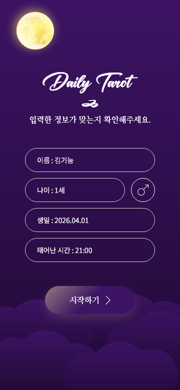

# A10. 정보 확인 · 빈 홈 화면



## 채점 포인트

| UI 요소 (각 0.2) | 요구사항 (각 0.3) |
|---|---|
| 달, 로고, "입력한 정보가 맞는지 확인해주세요." | 각 영역에 **입력한 값이 올바르게** |
| 이름 / 나이 / 성별 / 생일 / 태어난 시간 **확인 영역** | **각 영역 클릭 → 해당 입력 화면으로** |
| 시작하기 버튼 (">" 포함) | 시작하기 → 홈 화면 |
| 구름 (아래) | 홈 화면은 **빈 화면** |

## 따라하기

새 파일 `ConfirmScreen.kt`

```kotlin
package com.example.dailytarot

import androidx.compose.foundation.border
import androidx.compose.foundation.clickable
import androidx.compose.foundation.layout.Box
import androidx.compose.foundation.layout.Column
import androidx.compose.foundation.layout.Row
import androidx.compose.foundation.layout.Spacer
import androidx.compose.foundation.layout.fillMaxSize
import androidx.compose.foundation.layout.fillMaxWidth
import androidx.compose.foundation.layout.height
import androidx.compose.foundation.layout.padding
import androidx.compose.foundation.layout.size
import androidx.compose.foundation.layout.width
import androidx.compose.foundation.shape.CircleShape
import androidx.compose.foundation.shape.RoundedCornerShape
import androidx.compose.material3.Icon
import androidx.compose.material3.Text
import androidx.compose.runtime.Composable
import androidx.compose.ui.Alignment
import androidx.compose.ui.Modifier
import androidx.compose.ui.draw.clip
import androidx.compose.ui.graphics.Color
import androidx.compose.ui.res.painterResource
import androidx.compose.ui.text.font.FontWeight
import androidx.compose.ui.unit.dp
import androidx.compose.ui.unit.sp
import java.time.format.DateTimeFormatter

@Composable
fun ConfirmScreen(user: UserInfo, onEdit: (Screen) -> Unit, onStart: () -> Unit) {
    val birth = user.birthDate?.format(DateTimeFormatter.ofPattern("yyyy.MM.dd")) ?: "-"
    val time = if (user.timeUnknown || user.birthHour == null) "모름"
               else "%02d:%02d".format(user.birthHour, user.birthMinute ?: 0)

    TarotBackground {
        Column(
            Modifier.fillMaxSize().padding(horizontal = 50.dp),
            horizontalAlignment = Alignment.CenterHorizontally
        ) {
            Spacer(Modifier.height(96.dp))
            DailyTarotLogo()
            Spacer(Modifier.height(10.dp))
            Text(
                "입력한 정보가 맞는지 확인해주세요.",
                color = Color.White,
                fontFamily = Myeongjo,
                fontWeight = FontWeight.Bold,
                fontSize = 16.sp
            )
            Spacer(Modifier.height(36.dp))

            InfoRow("이름 : ${user.name}") { onEdit(Screen.Name) }
            Spacer(Modifier.height(12.dp))
            Row(verticalAlignment = Alignment.CenterVertically) {
                InfoRow("나이 : ${user.age}세", Modifier.weight(1f)) { onEdit(Screen.Age) }
                Spacer(Modifier.width(12.dp))
                // 성별 확인 영역 (아이콘)
                Box(
                    Modifier
                        .size(48.dp)
                        .clip(CircleShape)
                        .border(1.dp, White70, CircleShape)
                        .clickable { onEdit(Screen.Gender) },
                    contentAlignment = Alignment.Center
                ) {
                    Icon(
                        painterResource(if (user.isMale == false) R.drawable.ic_female else R.drawable.ic_male),
                        contentDescription = if (user.isMale == false) "여성" else "남성",
                        tint = Color.White,
                        modifier = Modifier.size(28.dp)
                    )
                }
            }
            Spacer(Modifier.height(12.dp))
            InfoRow("생일 : $birth") { onEdit(Screen.BirthDate) }
            Spacer(Modifier.height(12.dp))
            InfoRow("태어난 시간 : $time") { onEdit(Screen.BirthTime) }

            Spacer(Modifier.height(48.dp))
            GlowButton("시작하기", onStart)
        }
    }
}

// ───────── 둥근 테두리 정보 한 줄 ─────────
@Composable
fun InfoRow(text: String, modifier: Modifier = Modifier, onClick: () -> Unit) {
    Box(
        modifier
            .fillMaxWidth()
            .clip(RoundedCornerShape(50))
            .border(1.dp, White70, RoundedCornerShape(50))
            .clickable(onClick = onClick)
            .padding(horizontal = 24.dp, vertical = 13.dp)
    ) {
        Text(text, color = Color.White, fontFamily = NotoSans, fontWeight = FontWeight.Medium, fontSize = 14.sp)
    }
}
```

## App.kt 완성본 (Module A)

`App.kt`의 `DailyTarotApp`을 아래처럼 맞춥니다. (`Placeholder` 함수는 Module B·C에서 새 화면을 등록할 때 다시 쓰니 **지우지 말고 남겨 두세요.**)

```kotlin
@Composable
fun DailyTarotApp() {
    val nav = remember { Navigator(Screen.Onboarding) }
    val user = remember { UserInfo() }

    fun next(after: Screen) {
        if (user.editing) {
            user.editing = false
            nav.backTo(Screen.Confirm)
        } else {
            nav.go(after)
        }
    }

    BackHandler(enabled = nav.canGoBack) { nav.back() }

    Box(Modifier.fillMaxSize().background(BgBottom)) {
        AnimatedContent(
            targetState = nav.current,
            transitionSpec = {
                val dir = if (nav.isForward) 1 else -1
                (slideInHorizontally(tween(450)) { w -> dir * w / 3 } + fadeIn(tween(450)))
                    .togetherWith(slideOutHorizontally(tween(450)) { w -> -dir * w / 3 } + fadeOut(tween(300)))
            },
            label = "screen"
        ) { screen ->
            when (screen) {
                Screen.Onboarding -> OnboardingScreen(onStart = { nav.go(Screen.Name) })
                Screen.Name -> NameScreen(user, onNext = { next(Screen.Age) }, onBack = { nav.back() })
                Screen.Age -> AgeScreen(user, onNext = { next(Screen.Gender) }, onBack = { nav.back() })
                Screen.Gender -> GenderScreen(user, onNext = { next(Screen.BirthDate) }, onBack = { nav.back() })
                Screen.BirthDate -> BirthDateScreen(user, onNext = { next(Screen.BirthTime) }, onBack = { nav.back() })
                Screen.BirthTime -> BirthTimeScreen(user, onNext = { next(Screen.Confirm) }, onBack = { nav.backTo(Screen.Gender) })
                Screen.Confirm -> ConfirmScreen(
                    user,
                    onEdit = { target ->
                        user.editing = true
                        nav.go(target)
                    },
                    onStart = { nav.reset(Screen.Home) }
                )
                Screen.Home -> EmptyHomeScreen()
            }
        }
    }
}
```

## 핵심 설명

- **영역 클릭 → 수정 → 돌아오기**: `onEdit`에서 `user.editing = true`로 표시하고 입력 화면으로 갑니다. 입력을 마치면 A04의 `next()`가 이 표시를 보고 **정보 확인으로 바로 돌아옵니다.**
- **빈 홈 화면**: 요구사항이 "빈 화면 표시"이므로 아무것도 넣지 않습니다. Module B에서 진짜 홈으로 바꿉니다.
- **`reset(Screen.Home)`**: 홈에서 뒤로가기를 눌러도 입력 화면으로 돌아가지 않게 기록을 지웁니다.

## ✅ 실행해서 확인 (Module A 전체 흐름)
- [ ] 온보딩 → 김기능 → 1 → 남성 → 2026.4.1 → 오후 9시 0분 → 정보 확인
- [ ] 정보 확인: `이름 : 김기능`, `나이 : 1세`, ♂, `생일 : 2026.04.01`, `태어난 시간 : 21:00`
- [ ] "나이" 영역 클릭 → 나이 화면 → 25 Enter → **바로 정보 확인**으로 돌아오고 `25세`
- [ ] 성별 아이콘 클릭 → 성별 화면 → 여성 → 정보 확인에 ♀
- [ ] 시간 영역 → "잘 모르겠어요" → `태어난 시간 : 모름`
- [ ] 시작하기 → 빈 보라 화면

👉 다음: [A11. 제출 연습 · 체크리스트](A11_제출연습_체크리스트.md)
