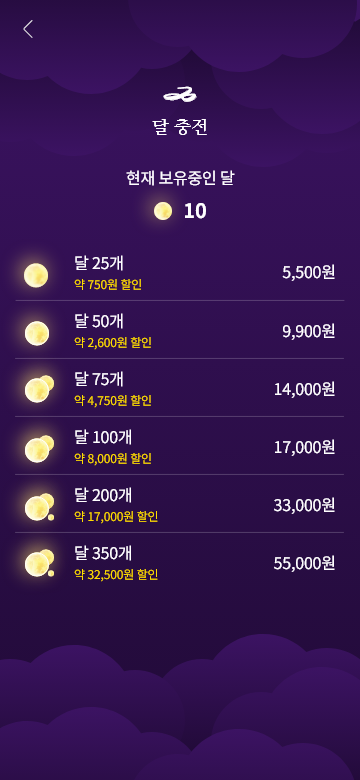
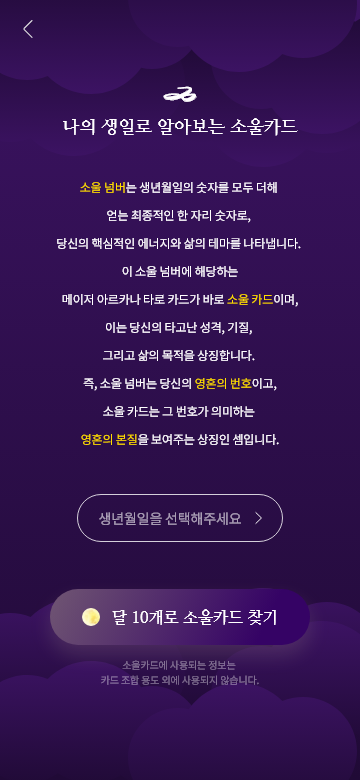
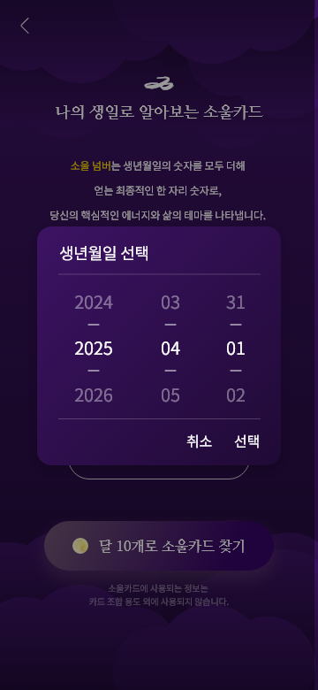
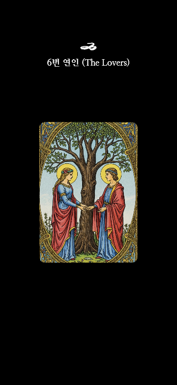
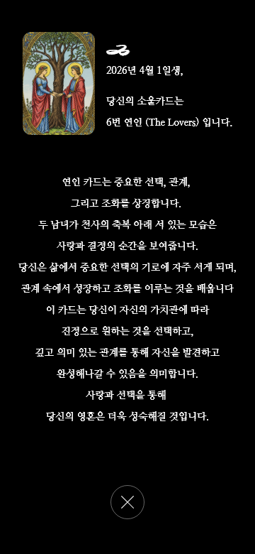

# B00. Module B 개요 · 채점 포인트

## 만들 화면

| 홈 | 달 충전 | 소울카드 |
|---|---|---|
|  |  |  |

| 생년월일 선택 | 나의 소울카드 (애니메이션 전) | 나의 소울카드 (애니메이션 후) |
|---|---|---|
|  |  |  |

흐름: (Module A 흐름) → **홈** → 달 충전 / 소울카드 → 나의 소울카드 → (닫기) → 홈

## 배점 (35점)

| 구분 | 항목 | 점수 |
|---|---|---|
| 주관 | 홈 2.0 / 달 충전 1.0 / 소울카드 1.5 / 나의 소울카드 1.0 프로토타입 일치 | 5.5 |
| 주관 | **나의 소울카드 애니메이션이 영상과 일치** | 1.5 |
| 객관 | 아이콘, 이름, 제출 규칙 | 3.0 |
| 객관 | 홈 UI 6.4 + 요구사항 3.0 (각 0.5!) | 9.4 |
| 객관 | 달 충전 UI 2.2 + 요구사항 2.0 | 4.2 |
| 객관 | 소울카드 UI 1.6 + 요구사항 2.5 + 다이얼로그 2.0 | 6.1 |
| 객관 | 나의 소울카드 UI 2.7 + 요구사항 2.6 | 5.3 |

> 💡 **홈 화면이 객관 9.4점으로 가장 큽니다.** 홈부터 빠짐없이 만드세요.
> 소울카드 요구사항은 **각 0.5점**, 나의 소울카드의 "공식에 맞는 카드"는 **0.7점**입니다.

## 꼭 기억할 요구사항

- 달 개수는 **앱을 껐다 켜도 유지** (SharedPreferences)
- 홈: 달 개수 클릭 → 달 충전 / Soul Card → 소울카드 / Tarot List → **"준비 중" 토스트** / Daily Master → **웹 브라우저로 `https://ko.wikipedia.org/wiki/타로`**
- 달 충전: 항목 클릭 → 개수만큼 충전 + **구매 완료 토스트** + 보유 개수 즉시 갱신
- 소울카드: 생년월일 **스크롤 휠 다이얼로그(취소/선택)**, **오늘 이전 날짜만**, 달 부족 시 **안내 메시지**, 성공 시 **달 10개 차감**
- 나의 소울카드: `soul_cards_data.json` 사용, **공식**(연+월+일 → 각 자리 합 → 한 자리) 계산, "나의 소울카드.mp4" 같은 애니메이션, 닫기 → 홈

## 시작: A 프로젝트 복사

다음 모듈은 앞 모듈 프로젝트를 **복사해서** 이어 만듭니다. A 제출본은 그대로 둡니다.

1. Android Studio를 닫습니다.
2. 탐색기에서 `C:\contest\DailyTarot_A` 폴더를 복사 → 이름 `DailyTarot_B`
3. 복사본에서 지울 것: `Module_A_XXX.apk`, `build`, `app\build`, `.gradle`, `.idea`
4. Android Studio → **Open** → `DailyTarot_B` → Gradle 동기화

> Module A가 완벽하지 않아도 괜찮습니다. 과제 PDF: "Module A 기능이 정상적이지 않더라도 하드 코딩하는 방법 등으로 제작한다. (각 모듈별 채점 분리)"
> 시간이 급하면 `Navigator(Screen.Onboarding)`을 `Navigator(Screen.Home)`으로 바꿔 **홈에서 바로 시작**해도 됩니다.

## 3시간 배분 예시

| 시간 | 할 일 |
|---|---|
| 0:00–0:30 | 프로젝트 복사, 데이터·달 저장소 (B01–B02) |
| 0:30–1:10 | 홈 (B03) |
| 1:10–1:30 | 달 충전 (B04) |
| 1:30–2:05 | 소울카드 + 다이얼로그 (B05) |
| 2:05–2:40 | 나의 소울카드 + 애니메이션 (B06) |
| 2:40–3:00 | **체크리스트 + APK + 제출** (B07) |

## 이 모듈에서 추가·수정하는 파일

```
app/src/main/assets/          ← 새로 만듦
  soul_cards_data.json
  soul_card_preview.txt
  tarot_cards/1_magician.png … 9_hermit.png
java/com/example/dailytarot/
  AppState.kt        (수정) 화면 3개 + MoonStore 추가
  App.kt             (수정) 홈·충전·소울카드 연결
  TarotData.kt       (새로) JSON 읽기, 소울 넘버, 카드 이미지
  HomeScreen.kt      (새로)
  ChargeScreen.kt    (새로)
  SoulCardScreen.kt  (새로)
  MySoulCardScreen.kt(새로)
```

👉 다음: [B01. 데이터 준비](B01_데이터_준비.md)
