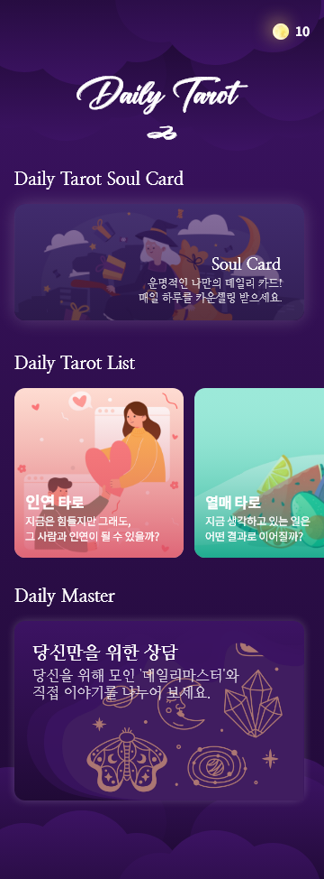

# B03. 홈



## 채점 포인트 (객관 9.4점 — 이 모듈에서 가장 큼)

| 영역 | UI 요소 (각 0.4) |
|---|---|
| 공통 | 달 그래픽 + 보유 개수 / 구름 (위·아래) / Daily Tarot 로고 (작은 그래픽 포함) |
| Soul Card | "Daily Tarot Soul Card" 타이틀 / Soul Card 이미지 / "Soul Card" 텍스트 / "운명적인 나만의 데일리 카드! 매일 하루를 카운셀링 받으세요." |
| Tarot List | "Daily Tarot List" 타이틀 / 인연 타로 이미지 / "인연 타로", "지금은 힘들지만 그래도, 그 사람과 인연이 될 수 있을까?" / 열매 타로 이미지 / "열매 타로", "지금 생각하고 있는 일은 어떤 결과로 이어질까?" |
| Daily Master | Daily Master 이미지 / "Daily Master" 타이틀 / "당신만을 위한 상담" / "당신을 위해 모인 '데일리마스터'와 직접 이야기를 나누어 보세요." |

| 요구사항 (각 0.5) |
|---|
| 달 보유 개수 = 현재 보유한 달 개수 |
| 앱 종료 후 다시 켜도 유지 |
| 달 보유 개수 클릭 → 달 충전 |
| Soul Card 클릭 → 소울카드 |
| Tarot List 아이템 클릭 → **"준비 중" 토스트** |
| Daily Master 클릭 → **웹 브라우저로** `https://ko.wikipedia.org/wiki/타로` |

> ⚠️ 문구는 **PDF와 글자 하나까지 똑같이** 씁니다. 특히 따옴표 `'데일리마스터'`, 물음표, 느낌표.

## 레이아웃

```
                         (🌙 10)   ← 오른쪽 위, 누르면 달 충전
           Daily Tarot
               ⌇
Daily Tarot Soul Card              ← 섹션 타이틀 (왼쪽)
┌──────────────────────────────┐
│ (그림)              Soul Card │   ← 글씨는 오른쪽 아래
│        운명적인 나만의 데일리 카드!│
│        매일 하루를 카운셀링 받으세요.│
└──────────────────────────────┘
Daily Tarot List
┌─────────────┐ ┌─────────────┐┄   ← 가로 스크롤
│  인연 타로   │ │  열매 타로   │
└─────────────┘ └─────────────┘
Daily Master
┌──────────────────────────────┐
│ 당신만을 위한 상담              │   ← 글씨는 왼쪽 위
│ 당신을 위해 모인 '데일리마스터'와 │
└──────────────────────────────┘
```

전체를 `verticalScroll`로 감싸서 작은 화면에서도 끝까지 보이게 합니다.

## 따라하기

새 파일 `HomeScreen.kt`

```kotlin
package com.example.dailytarot

import androidx.compose.foundation.Image
import androidx.compose.foundation.background
import androidx.compose.foundation.clickable
import androidx.compose.foundation.horizontalScroll
import androidx.compose.foundation.layout.Arrangement
import androidx.compose.foundation.layout.Box
import androidx.compose.foundation.layout.BoxScope
import androidx.compose.foundation.layout.Column
import androidx.compose.foundation.layout.Row
import androidx.compose.foundation.layout.Spacer
import androidx.compose.foundation.layout.aspectRatio
import androidx.compose.foundation.layout.fillMaxSize
import androidx.compose.foundation.layout.fillMaxWidth
import androidx.compose.foundation.layout.height
import androidx.compose.foundation.layout.padding
import androidx.compose.foundation.layout.size
import androidx.compose.foundation.layout.width
import androidx.compose.foundation.rememberScrollState
import androidx.compose.foundation.shape.RoundedCornerShape
import androidx.compose.foundation.verticalScroll
import androidx.compose.material3.Text
import androidx.compose.runtime.Composable
import androidx.compose.ui.Alignment
import androidx.compose.ui.Modifier
import androidx.compose.ui.draw.clip
import androidx.compose.ui.draw.shadow
import androidx.compose.ui.graphics.Brush
import androidx.compose.ui.graphics.Color
import androidx.compose.ui.layout.ContentScale
import androidx.compose.ui.res.painterResource
import androidx.compose.ui.text.font.FontWeight
import androidx.compose.ui.text.style.TextAlign
import androidx.compose.ui.unit.dp
import androidx.compose.ui.unit.sp

@Composable
fun HomeScreen(
    moonCount: Int,
    onMoonClick: () -> Unit,
    onSoulCard: () -> Unit,
    onLoveTarot: () -> Unit,
    onFruitTarot: () -> Unit,
    onMaster: () -> Unit
) {
    TarotBackground(showMoon = false, topCloud = true) {
        Column(
            Modifier
                .fillMaxSize()
                .verticalScroll(rememberScrollState())
        ) {
            // 달 보유 개수 (오른쪽 위)
            Row(Modifier.fillMaxWidth().padding(top = 12.dp, end = 12.dp), horizontalArrangement = Arrangement.End) {
                MoonCount(moonCount, onMoonClick)
            }

            DailyTarotLogo(Modifier.align(Alignment.CenterHorizontally).padding(top = 20.dp))

            // ── Daily Tarot Soul Card ──
            SectionTitle("Daily Tarot Soul Card")
            ImageCard(
                image = R.drawable.daily_tarot_soul_card,
                ratio = 644f / 258f,
                onClick = onSoulCard,
                modifier = Modifier.padding(horizontal = 16.dp)
            ) {
                Column(
                    Modifier.align(Alignment.BottomEnd).padding(14.dp),
                    horizontalAlignment = Alignment.End
                ) {
                    Text("Soul Card", color = Color.White, fontFamily = Myeongjo, fontSize = 18.sp)
                    Text(
                        "운명적인 나만의 데일리 카드!\n매일 하루를 카운셀링 받으세요.",
                        color = Color.White,
                        fontFamily = NotoSans,
                        fontSize = 11.sp,
                        lineHeight = 16.sp,
                        textAlign = TextAlign.End
                    )
                }
            }

            // ── Daily Tarot List (가로 스크롤) ──
            SectionTitle("Daily Tarot List")
            Row(
                Modifier
                    .horizontalScroll(rememberScrollState())
                    .padding(horizontal = 16.dp),
                horizontalArrangement = Arrangement.spacedBy(12.dp)
            ) {
                TarotListItem(
                    image = R.drawable.love_tarot,
                    title = "인연 타로",
                    desc = "지금은 힘들지만 그래도,\n그 사람과 인연이 될 수 있을까?",
                    onClick = onLoveTarot
                )
                TarotListItem(
                    image = R.drawable.fruit_tarot,
                    title = "열매 타로",
                    desc = "지금 생각하고 있는 일은\n어떤 결과로 이어질까?",
                    onClick = onFruitTarot
                )
            }

            // ── Daily Master ──
            SectionTitle("Daily Master")
            ImageCard(
                image = R.drawable.daily_master,
                ratio = 322f / 200f,
                onClick = onMaster,
                modifier = Modifier.padding(horizontal = 16.dp)
            ) {
                Column(Modifier.align(Alignment.TopStart).padding(20.dp)) {
                    Text("당신만을 위한 상담", color = Color.White, fontFamily = NotoSans, fontWeight = FontWeight.Bold, fontSize = 18.sp)
                    Text(
                        "당신을 위해 모인 '데일리마스터'와\n직접 이야기를 나누어 보세요.",
                        color = Color.White,
                        fontFamily = Myeongjo,
                        fontSize = 14.sp,
                        lineHeight = 20.sp
                    )
                }
            }

            Spacer(Modifier.height(120.dp))   // 아래 구름에 가리지 않게
        }
    }
}

// ───────── 달 보유 개수 ─────────
@Composable
fun MoonCount(count: Int, onClick: () -> Unit) {
    Row(
        Modifier
            .clip(RoundedCornerShape(50))
            .clickable(onClick = onClick)
            .padding(horizontal = 8.dp, vertical = 4.dp),
        verticalAlignment = Alignment.CenterVertically
    ) {
        Image(painterResource(R.drawable.moon), contentDescription = "달", modifier = Modifier.size(20.dp))
        Spacer(Modifier.width(6.dp))
        Text("$count", color = Color.White, fontFamily = NotoSans, fontWeight = FontWeight.Bold, fontSize = 15.sp)
    }
}

// ───────── 섹션 타이틀 ─────────
@Composable
fun SectionTitle(text: String) {
    Text(
        text,
        color = Color.White,
        fontFamily = Myeongjo,
        fontSize = 20.sp,
        modifier = Modifier.padding(start = 16.dp, top = 28.dp, bottom = 12.dp)
    )
}

// ───────── 이미지 위에 글씨를 얹은 카드 ─────────
@Composable
fun ImageCard(
    image: Int,
    ratio: Float,
    onClick: () -> Unit,
    modifier: Modifier = Modifier,
    overlay: @Composable BoxScope.() -> Unit
) {
    val shape = RoundedCornerShape(12.dp)
    Box(
        modifier
            .fillMaxWidth()
            .aspectRatio(ratio)
            .shadow(10.dp, shape)
            .clip(shape)
            .clickable(onClick = onClick)
    ) {
        Image(
            painterResource(image),
            contentDescription = null,
            contentScale = ContentScale.Crop,
            modifier = Modifier.fillMaxSize()
        )
        overlay()
    }
}

// ───────── 인연 타로 / 열매 타로 정사각 카드 ─────────
@Composable
fun TarotListItem(image: Int, title: String, desc: String, onClick: () -> Unit, textOnTop: Boolean = false) {
    val shape = RoundedCornerShape(12.dp)
    Box(
        Modifier
            .size(190.dp)
            .clip(shape)
            .clickable(onClick = onClick)
    ) {
        Image(painterResource(image), contentDescription = title, contentScale = ContentScale.Crop, modifier = Modifier.fillMaxSize())
        // 글씨가 잘 보이게 아래쪽을 살짝 어둡게
        Box(
            Modifier
                .fillMaxSize()
                .background(Brush.verticalGradient(listOf(Color.Transparent, Color(0x55000000))))
        )
        Column(
            Modifier
                .align(if (textOnTop) Alignment.TopStart else Alignment.BottomStart)
                .padding(12.dp)
        ) {
            Text(title, color = Color.White, fontFamily = NotoSans, fontWeight = FontWeight.Bold, fontSize = 17.sp)
            Text(desc, color = Color.White, fontFamily = NotoSans, fontSize = 11.sp, lineHeight = 16.sp)
        }
    }
}
```

> 💡 PDF에는 열매 타로 글씨가 "왼쪽 위"라고 되어 있고 프로토타입은 아래쪽입니다. 위로 올리려면 열매 타로에 `textOnTop = true`만 추가하면 됩니다.

## App.kt 연결

```kotlin
Screen.Home -> HomeScreen(
    moonCount = moons.count,
    onMoonClick = { nav.go(Screen.Charge) },
    onSoulCard = { nav.go(Screen.SoulCard) },
    onLoveTarot = { context.toast("인연 타로는 지금 준비 중이에요. 조금만 기다려주세요!") },
    onFruitTarot = { context.toast("열매 타로는 지금 준비 중이에요. 조금만 기다려주세요!") },
    onMaster = {
        context.startActivity(Intent(Intent.ACTION_VIEW, Uri.parse("https://ko.wikipedia.org/wiki/타로")))
    }
)
```

import:

```kotlin
import android.content.Intent
import android.net.Uri
```

`EmptyHomeScreen`은 이제 쓰지 않습니다.

## 핵심 설명

- **웹 브라우저 열기**: `Intent.ACTION_VIEW` + 주소. 에뮬레이터의 Chrome이 열립니다. 한글 주소도 그대로 넣으면 브라우저가 처리합니다.
- **`ImageCard`의 `overlay`**: 같은 "이미지 + 글씨" 모양을 Soul Card와 Daily Master가 같이 씁니다. 글씨 위치만 `Alignment.BottomEnd` / `TopStart`로 다르게.
- **`.shadow(...).clip(...)` 순서**: 그림자를 먼저 그리고 모서리를 자릅니다. 반대로 하면 그림자도 잘려서 안 보입니다.

## ✅ 실행해서 확인
- [ ] 오른쪽 위 🌙 0 → 누르면 달 충전(임시) → 다음 버튼 누르면 25 충전 → 뒤로 → 홈에 `25`
- [ ] **앱을 완전히 종료**(최근 앱 목록에서 위로 밀기) 후 다시 실행 → 홈까지 가면 여전히 `25`
- [ ] Soul Card 영역 → 소울카드(임시)
- [ ] 인연 타로, 열매 타로 → 각각 "준비 중" 토스트
- [ ] 인연·열매 영역을 **옆으로 밀면** 스크롤된다
- [ ] Daily Master → Chrome에서 위키백과 "타로" 문서
- [ ] 화면 전체를 위로 밀어 맨 아래까지 보인다

👉 다음: [B04. 달 충전](B04_달_충전.md)
