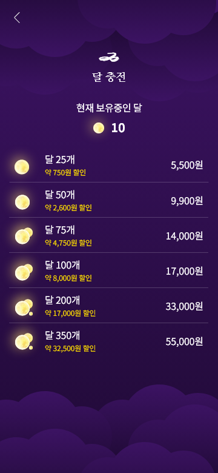

# B04. 달 충전



## 채점 포인트

| UI 요소 (각 0.2) | 요구사항 (각 0.5) |
|---|---|
| 뒤로가기 아이콘 버튼 ("<") | 뒤로가기 → 홈 |
| 타이틀: 로고 그래픽 / "달 충전" | 보유 중인 달 개수 표시 |
| 보유 영역: 달 그래픽 / 보유 개수 | 항목 클릭 → **개수만큼 충전 + 구매 완료 토스트** |
| 상품 6개 (각각 달 그래픽 + "달 N개" + "약 N원 할인" + "N원") | 충전 완료 시 보유 개수 **갱신** |

## 상품표 (채점표 문구 그대로)

| 달 | 할인 | 가격 |
|---|---|---|
| 달 25개 | 약 750원 할인 | 5,500원 |
| 달 50개 | 약 2,600원 할인 | 9,900원 |
| 달 75개 | 약 4,750원 할인 | 14,000원 |
| 달 100개 | 약 8,000원 할인 | 17,000원 |
| 달 200개 | 약 17,000원 할인 | 33,000원 |
| 달 300개 | 약 32,000원 할인 | 55,000원 |

> ⚠️ 프로토타입 이미지에는 마지막이 "달 350개 / 약 32,500원 할인"으로 그려져 있지만, **과제 PDF와 채점표는 300개 / 32,000원**입니다. 채점은 채점표 문구로 하므로 300개로 만듭니다.

## 따라하기

새 파일 `ChargeScreen.kt`

```kotlin
package com.example.dailytarot

import androidx.compose.foundation.Image
import androidx.compose.foundation.background
import androidx.compose.foundation.clickable
import androidx.compose.foundation.layout.Box
import androidx.compose.foundation.layout.Column
import androidx.compose.foundation.layout.Row
import androidx.compose.foundation.layout.Spacer
import androidx.compose.foundation.layout.fillMaxSize
import androidx.compose.foundation.layout.fillMaxWidth
import androidx.compose.foundation.layout.height
import androidx.compose.foundation.layout.offset
import androidx.compose.foundation.layout.padding
import androidx.compose.foundation.layout.size
import androidx.compose.foundation.layout.width
import androidx.compose.foundation.rememberScrollState
import androidx.compose.foundation.shape.CircleShape
import androidx.compose.foundation.verticalScroll
import androidx.compose.material3.HorizontalDivider
import androidx.compose.material3.IconButton
import androidx.compose.material3.Text
import androidx.compose.runtime.Composable
import androidx.compose.ui.Alignment
import androidx.compose.ui.Modifier
import androidx.compose.ui.draw.clip
import androidx.compose.ui.graphics.Color
import androidx.compose.ui.res.painterResource
import androidx.compose.ui.text.font.FontWeight
import androidx.compose.ui.unit.dp
import androidx.compose.ui.unit.sp

data class MoonPack(val amount: Int, val discount: String, val price: String, val moonIcons: Int)

val MoonPacks = listOf(
    MoonPack(25, "약 750원 할인", "5,500원", 1),
    MoonPack(50, "약 2,600원 할인", "9,900원", 1),
    MoonPack(75, "약 4,750원 할인", "14,000원", 2),
    MoonPack(100, "약 8,000원 할인", "17,000원", 2),
    MoonPack(200, "약 17,000원 할인", "33,000원", 3),
    MoonPack(300, "약 32,000원 할인", "55,000원", 3),
)

@Composable
fun ChargeScreen(moonCount: Int, onBack: () -> Unit, onBuy: (MoonPack) -> Unit) {
    TarotBackground(showMoon = false, topCloud = true) {
        Column(Modifier.fillMaxSize().verticalScroll(rememberScrollState())) {
            IconButton(onClick = onBack, modifier = Modifier.padding(start = 4.dp, top = 4.dp)) {
                ArrowIcon(forward = false, size = 24.dp)
            }

            // 타이틀 + 현재 보유
            Column(Modifier.fillMaxWidth(), horizontalAlignment = Alignment.CenterHorizontally) {
                LogoMark()
                Spacer(Modifier.height(4.dp))
                Text("달 충전", color = Color.White, fontFamily = Myeongjo, fontSize = 18.sp)
                Spacer(Modifier.height(28.dp))
                Text("현재 보유중인 달", color = Color.White, fontFamily = NotoSans, fontSize = 15.sp)
                Spacer(Modifier.height(8.dp))
                Row(verticalAlignment = Alignment.CenterVertically) {
                    Image(painterResource(R.drawable.moon), contentDescription = "달", modifier = Modifier.size(22.dp))
                    Spacer(Modifier.width(10.dp))
                    Text("$moonCount", color = Color.White, fontFamily = NotoSans, fontWeight = FontWeight.Bold, fontSize = 20.sp)
                }
            }

            Spacer(Modifier.height(20.dp))

            // 상품 목록
            MoonPacks.forEachIndexed { i, pack ->
                if (i > 0) HorizontalDivider(Modifier.padding(horizontal = 16.dp), color = White15)
                Row(
                    Modifier
                        .fillMaxWidth()
                        .clickable { onBuy(pack) }
                        .padding(horizontal = 24.dp, vertical = 12.dp),
                    verticalAlignment = Alignment.CenterVertically
                ) {
                    MoonCluster(pack.moonIcons)
                    Spacer(Modifier.width(20.dp))
                    Column(Modifier.weight(1f)) {
                        Text("달 ${pack.amount}개", color = Color.White, fontFamily = NotoSans, fontSize = 16.sp)
                        Text(pack.discount, color = Gold, fontFamily = NotoSans, fontSize = 12.sp)
                    }
                    Text(pack.price, color = Color.White, fontFamily = NotoSans, fontSize = 16.sp)
                }
            }

            Spacer(Modifier.height(140.dp))
        }
    }
}

// ───────── 상품마다 다른 달 그림 (1개 / 2개 / 2개 + 점) ─────────
@Composable
fun MoonCluster(level: Int) {
    Box(Modifier.size(36.dp)) {
        Image(
            painterResource(R.drawable.moon),
            contentDescription = null,
            modifier = Modifier
                .size(if (level == 1) 26.dp else 24.dp)
                .align(if (level == 1) Alignment.Center else Alignment.BottomStart)
        )
        if (level >= 2) {
            Image(
                painterResource(R.drawable.moon),
                contentDescription = null,
                modifier = Modifier.size(17.dp).align(Alignment.TopEnd)
            )
        }
        if (level >= 3) {
            Box(
                Modifier
                    .size(6.dp)
                    .align(Alignment.BottomEnd)
                    .offset(x = (-4).dp)
                    .clip(CircleShape)
                    .background(Gold)
            )
        }
    }
}
```

## App.kt 연결

```kotlin
Screen.Charge -> ChargeScreen(
    moonCount = moons.count,
    onBack = { nav.back() },
    onBuy = { pack ->
        moons.add(pack.amount)
        context.toast("달 ${pack.amount}개 구매가 완료되었어요! 지금 바로 사용해보세요.")
    }
)
```

## 핵심 설명

- **상품을 `List`로**: 6개를 복사-붙여넣기 하지 않고 데이터 목록 + `forEachIndexed` 한 번으로 그립니다. 문구 오타를 고칠 때도 표 한 곳만 보면 됩니다.
- **보유 개수 즉시 갱신**: `moons.count`가 상태값이라 `add()`하는 순간 이 화면과 홈이 같이 바뀝니다.
- 실제 결제는 하지 않습니다. (프로토타입 앱)

## ✅ 실행해서 확인
- [ ] 홈 🌙 → 달 충전 화면, 보유 개수가 홈과 같다
- [ ] "달 25개" 클릭 → 토스트 + 보유 개수 즉시 +25
- [ ] 6개 상품 문구가 위 표와 **글자까지** 같다
- [ ] "<" → 홈, 홈의 개수도 바뀌어 있다

👉 다음: [B05. 소울카드](B05_소울카드.md)
