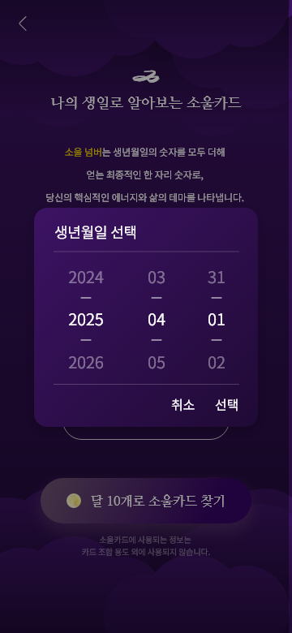

# B05. 소울카드 (생년월일 선택 다이얼로그)

| 소울카드 | 생년월일 선택 |
|---|---|
|  |  |

## 채점 포인트

| UI 요소 (각 0.2) | 요구사항 (각 0.5) |
|---|---|
| 뒤로가기 아이콘 버튼 | 뒤로가기 → 홈 |
| 구름 (위·아래) | 달 10개로 소울찾기 버튼 클릭 |
| "나의 생일로 알아보는 소울카드" | **달이 부족하면 안내 메시지** |
| 본문 텍스트 (soul_card_preview.txt) | **달 10개 차감** + 나의 소울카드로 이동 |
| 생년월일 선택 박스 | 취소 → 다이얼로그 닫힘 |
| (선택 시) 다이얼로그 팝업 | |
| "달 10개로 소울카드 찾기" 버튼 (달 이미지 포함) | |
| "소울카드에 사용되는 정보는 카드 조합 용도 외에 사용되지 않습니다." | |

| 다이얼로그 요구사항 (각 0.5) |
|---|
| 선택 박스 클릭 → 생년월일 다이얼로그 (취소, 선택) |
| 각 항목(년·월·일)을 **스크롤**해서 변경 |
| **오늘 이전 날짜만** 선택 가능 |
| 선택 → 선택 박스에 올바르게 입력 |

## 이전 날짜만 고르게 하는 방법

다이얼로그에 **아예 오늘 이후 날짜가 나오지 않게** 휠 목록을 줄입니다. (오늘이 2026-11-20 이라면)

| 고른 연도 | 월 목록 | 일 목록 |
|---|---|---|
| 2025 이하 | 01~12 | 그 달의 마지막 날까지 |
| 2026 | 01~11 | 11월이면 01~**19** (어제까지) |

## 따라하기

새 파일 `SoulCardScreen.kt`

```kotlin
package com.example.dailytarot

import androidx.compose.foundation.Image
import androidx.compose.foundation.border
import androidx.compose.foundation.clickable
import androidx.compose.foundation.layout.Box
import androidx.compose.foundation.layout.Column
import androidx.compose.foundation.layout.Row
import androidx.compose.foundation.layout.Spacer
import androidx.compose.foundation.layout.fillMaxSize
import androidx.compose.foundation.layout.fillMaxWidth
import androidx.compose.foundation.layout.height
import androidx.compose.foundation.layout.padding
import androidx.compose.foundation.layout.size
import androidx.compose.foundation.layout.width
import androidx.compose.foundation.rememberScrollState
import androidx.compose.foundation.shape.RoundedCornerShape
import androidx.compose.foundation.verticalScroll
import androidx.compose.material3.IconButton
import androidx.compose.material3.Text
import androidx.compose.runtime.Composable
import androidx.compose.runtime.getValue
import androidx.compose.runtime.mutableIntStateOf
import androidx.compose.runtime.mutableStateOf
import androidx.compose.runtime.remember
import androidx.compose.runtime.setValue
import androidx.compose.ui.Alignment
import androidx.compose.ui.Modifier
import androidx.compose.ui.draw.clip
import androidx.compose.ui.graphics.Color
import androidx.compose.ui.platform.LocalContext
import androidx.compose.ui.res.painterResource
import androidx.compose.ui.text.AnnotatedString
import androidx.compose.ui.text.SpanStyle
import androidx.compose.ui.text.buildAnnotatedString
import androidx.compose.ui.text.font.FontWeight
import androidx.compose.ui.text.style.TextAlign
import androidx.compose.ui.text.withStyle
import androidx.compose.ui.unit.dp
import androidx.compose.ui.unit.sp
import java.time.LocalDate
import java.time.YearMonth

@Composable
fun SoulCardScreen(onBack: () -> Unit, onFind: (LocalDate?) -> Unit) {
    val context = LocalContext.current
    val preview = remember {
        context.assets.open("soul_card_preview.txt").bufferedReader().use { it.readText() }.trim()
    }
    var birth by remember { mutableStateOf<LocalDate?>(null) }
    var showDialog by remember { mutableStateOf(false) }

    TarotBackground(showMoon = false, topCloud = true) {
        Column(
            Modifier.fillMaxSize().verticalScroll(rememberScrollState()),
            horizontalAlignment = Alignment.CenterHorizontally
        ) {
            Box(Modifier.fillMaxWidth()) {
                IconButton(onClick = onBack, modifier = Modifier.padding(start = 4.dp, top = 4.dp)) {
                    ArrowIcon(forward = false, size = 24.dp)
                }
            }
            LogoMark()
            Spacer(Modifier.height(6.dp))
            Text(
                "나의 생일로 알아보는 소울카드",
                color = Color.White,
                fontFamily = Myeongjo,
                fontWeight = FontWeight.Bold,
                fontSize = 19.sp
            )
            Spacer(Modifier.height(28.dp))

            // 본문: [ ] 안의 글자는 노란색
            Text(
                highlighted(preview),
                color = Color.White,
                fontFamily = NotoSans,
                fontSize = 13.sp,
                lineHeight = 28.sp,
                textAlign = TextAlign.Center,
                modifier = Modifier.padding(horizontal = 20.dp)
            )
            Spacer(Modifier.height(36.dp))

            // 생년월일 선택 박스
            Row(
                Modifier
                    .width(220.dp)
                    .clip(RoundedCornerShape(50))
                    .border(1.dp, White70, RoundedCornerShape(50))
                    .clickable { showDialog = true }
                    .padding(horizontal = 22.dp, vertical = 12.dp),
                verticalAlignment = Alignment.CenterVertically
            ) {
                Text(
                    birth?.let { "${it.year}년 ${it.monthValue}월 ${it.dayOfMonth}일" } ?: "생년월일을 선택해주세요",
                    color = if (birth == null) White70 else Color.White,
                    fontFamily = NotoSans,
                    fontSize = 15.sp,
                    modifier = Modifier.weight(1f)
                )
                ArrowIcon(forward = true, size = 16.dp, tint = White70)
            }
            Spacer(Modifier.height(40.dp))

            GlowButton(
                text = "달 10개로 소울카드 찾기",
                onClick = { onFind(birth) },
                showArrow = false,
                leading = {
                    Image(painterResource(R.drawable.moon), contentDescription = null, modifier = Modifier.size(22.dp))
                }
            )
            Spacer(Modifier.height(16.dp))
            Text(
                "소울카드에 사용되는 정보는\n카드 조합 용도 외에 사용되지 않습니다.",
                color = White70,
                fontFamily = NotoSans,
                fontSize = 11.sp,
                lineHeight = 16.sp,
                textAlign = TextAlign.Center
            )
            Spacer(Modifier.height(48.dp))
        }
    }

    if (showDialog) {
        BirthDateDialog(
            initial = birth,
            onDismiss = { showDialog = false },
            onConfirm = {
                birth = it
                showDialog = false
            }
        )
    }
}

// "[소울 넘버]는 …" → 소울 넘버만 노란색
fun highlighted(text: String): AnnotatedString = buildAnnotatedString {
    var last = 0
    Regex("\\[(.+?)]").findAll(text).forEach { m ->
        append(text.substring(last, m.range.first))
        withStyle(SpanStyle(color = Gold)) { append(m.groupValues[1]) }
        last = m.range.last + 1
    }
    append(text.substring(last))
}

// ───────── 생년월일 선택 다이얼로그 (년·월·일 휠, 오늘 이전만) ─────────
@Composable
fun BirthDateDialog(initial: LocalDate?, onDismiss: () -> Unit, onConfirm: (LocalDate) -> Unit) {
    val maxDate = remember { LocalDate.now().minusDays(1) }       // 어제까지
    val start = initial ?: maxDate.minusYears(1)
    var year by remember { mutableIntStateOf(start.year) }
    var month by remember { mutableIntStateOf(start.monthValue) }
    var day by remember { mutableIntStateOf(start.dayOfMonth) }

    val years = remember { (1900..maxDate.year).map { "$it" } }
    val maxMonth = if (year == maxDate.year) maxDate.monthValue else 12
    val m = month.coerceAtMost(maxMonth)
    val maxDay = if (year == maxDate.year && m == maxDate.monthValue) maxDate.dayOfMonth
                 else YearMonth.of(year, m).lengthOfMonth()
    val d = day.coerceAtMost(maxDay)

    WheelDialog(
        title = "생년월일 선택",
        onDismiss = onDismiss,
        onConfirm = { onConfirm(LocalDate.of(year, m, d)) }
    ) {
        WheelPicker(years, year - 1900, { year = 1900 + it }, Modifier.weight(1.4f))
        WheelPicker((1..maxMonth).map { "%02d".format(it) }, m - 1, { month = it + 1 }, Modifier.weight(1f))
        WheelPicker((1..maxDay).map { "%02d".format(it) }, d - 1, { day = it + 1 }, Modifier.weight(1f))
    }
}
```

## App.kt 연결

```kotlin
Screen.SoulCard -> SoulCardScreen(
    onBack = { nav.back() },
    onFind = { birth ->
        when {
            birth == null ->
                context.toast("생년월일을 먼저 선택해주세요.")
            moons.count < 10 ->
                context.toast("달이 부족해요. 지금 ${moons.count}개가 있어요. 달 충전 후 다시 시도해주세요.")
            else -> {
                moons.use(10)
                nav.go(Screen.MySoulCard(birth))
            }
        }
    }
)
```

## 핵심 설명

- **A08의 `WheelPicker`, `WheelDialog`를 그대로 재사용**합니다. 휠 3개만 넣으면 끝.
- **2월 30일 같은 날짜가 안 생기는 이유**: 월을 바꾸면 `maxDay`가 바뀌고, 고른 일(`day`)이 더 크면 `coerceAtMost`로 마지막 날로 맞춥니다. 휠도 그 위치로 자동 이동합니다.
- **`highlighted()`**: 정규식 `\[(.+?)]`로 `[ ]` 부분을 찾아 노란색으로 붙이고, 나머지는 그대로 붙입니다.

## ✅ 실행해서 확인
- [ ] 노란 글씨가 프로토타입처럼 4군데 (소울 넘버, 소울 카드, 영혼의 번호, 영혼의 본질)
- [ ] 선택 박스 → 다이얼로그, 년·월·일 각각 **위아래로 밀어서** 바뀐다
- [ ] 올해·이번 달로 가면 **어제 날짜까지만** 나온다
- [ ] 2024년 2월 → 일이 29까지 / 2025년 2월 → 28까지
- [ ] 취소 → 닫히고 박스 그대로 / 선택 → 박스에 "2025년 4월 1일"
- [ ] 날짜 없이 버튼 → 안내 토스트
- [ ] 달 0개로 버튼 → "달이 부족해요…" 토스트, 이동 안 함
- [ ] 달 충전 후 버튼 → 나의 소울카드(임시)로 이동, 홈의 달이 **10 줄어 있음**
- [ ] 뒤로가기 → 홈

👉 다음: [B06. 나의 소울카드](B06_나의_소울카드.md)
