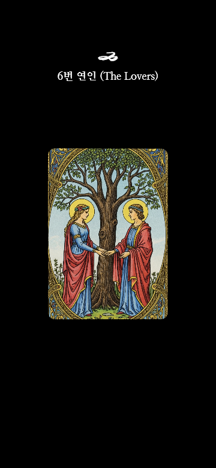
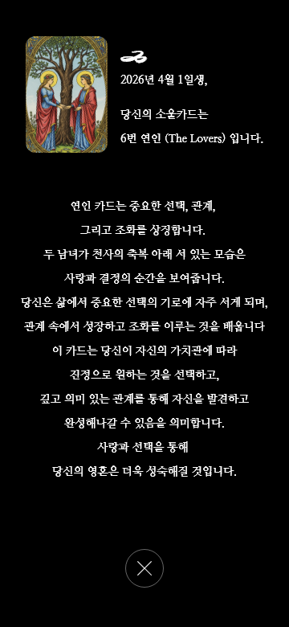

# B06. 나의 소울카드 (애니메이션)

| 애니메이션 전 | 애니메이션 후 |
|---|---|
|  |  |

## 채점 포인트

| UI 요소 (각 0.3) | 요구사항 |
|---|---|
| [전] 로고 그래픽 / "{number}번 {name}" / 카드 이미지 | "나의 소울카드.mp4"와 **동일한 애니메이션** (0.7) |
| [후] 카드 이미지 / 로고 그래픽 / 생년월일 "2026년 4월 1일생" | 선택한 생년월일이 올바르게 표시 (0.4) |
| [후] "당신의 소울카드는 {number}번 {name}입니다." | `soul_cards_data.json` 데이터 사용 (0.4) |
| [후] 본문 텍스트 / 닫기 버튼 | **공식에 맞는** 카드·내용 (0.7) |
| | 닫기 → 홈 (0.4) |

주관 "애니메이션이 영상과 일치" 1.5점까지 합치면 **애니메이션 하나에 2.2점**입니다.

## 영상 먼저 보기 (중요)

`ModuleB/videos/나의 소울카드.mp4`를 **여러 번** 보면서 아래를 메모하세요.

| 볼 것 | 메모 |
|---|---|
| 카드와 제목이 어떻게 나타나나 (페이드? 확대?) | |
| 가운데에 몇 초 머무나 | |
| 카드가 왼쪽 위로 가는 데 몇 초 | |
| 오른쪽 글자, 아래 본문, 닫기 버튼이 나타나는 순서·방식 | |

이 가이드의 기본값은 프로토타입 두 장면을 잇는 흐름입니다.

```
0.0s  검은 화면 → 로고·"6번 연인 (The Lovers)"·큰 카드가 서서히 나타남 (0.8s)
0.8s  가운데에서 잠깐 멈춤 (1.0s)
1.8s  카드가 작아지며 왼쪽 위로 이동, 제목은 사라짐 (0.9s)
2.7s  오른쪽 정보 + 본문 + 닫기 버튼이 나타남 (0.7s)
```

영상과 다르면 **시간 숫자(tween, delay)와 움직임 방향만** 바꾸면 됩니다. 구조는 같습니다.

## 원리: 진행값 3개 + 두 위치 사이 보간

```
intro  : 0 → 1   (나타나기)
move   : 0 → 1   (큰 카드 위치 → 작은 카드 위치)
detail : 0 → 1   (설명 나타나기)

지금 카드 폭 = lerp(200dp, 100dp, move)     ← move=0 이면 200, move=1 이면 100
지금 카드 x  = lerp(가운데 x, 32dp, move)
```

`lerp(a, b, t)` = a에서 b까지 t만큼 간 값. 애니메이션의 기본 도구입니다.

## 따라하기

새 파일 `MySoulCardScreen.kt`

```kotlin
package com.example.dailytarot

import androidx.compose.animation.core.Animatable
import androidx.compose.animation.core.FastOutSlowInEasing
import androidx.compose.animation.core.tween
import androidx.compose.foundation.Image
import androidx.compose.foundation.background
import androidx.compose.foundation.border
import androidx.compose.foundation.clickable
import androidx.compose.foundation.layout.Box
import androidx.compose.foundation.layout.BoxWithConstraints
import androidx.compose.foundation.layout.Column
import androidx.compose.foundation.layout.Spacer
import androidx.compose.foundation.layout.fillMaxSize
import androidx.compose.foundation.layout.fillMaxWidth
import androidx.compose.foundation.layout.height
import androidx.compose.foundation.layout.offset
import androidx.compose.foundation.layout.padding
import androidx.compose.foundation.layout.size
import androidx.compose.foundation.layout.systemBarsPadding
import androidx.compose.foundation.rememberScrollState
import androidx.compose.foundation.shape.CircleShape
import androidx.compose.foundation.shape.RoundedCornerShape
import androidx.compose.foundation.verticalScroll
import androidx.compose.material3.Text
import androidx.compose.runtime.Composable
import androidx.compose.runtime.LaunchedEffect
import androidx.compose.runtime.remember
import androidx.compose.ui.Alignment
import androidx.compose.ui.Modifier
import androidx.compose.ui.draw.clip
import androidx.compose.ui.graphics.Color
import androidx.compose.ui.graphics.graphicsLayer
import androidx.compose.ui.layout.ContentScale
import androidx.compose.ui.platform.LocalContext
import androidx.compose.ui.text.style.TextAlign
import androidx.compose.ui.unit.dp
import androidx.compose.ui.unit.lerp
import androidx.compose.ui.unit.sp
import kotlinx.coroutines.delay
import java.time.LocalDate

@Composable
fun MySoulCardScreen(birth: LocalDate, onClose: () -> Unit) {
    val context = LocalContext.current
    // 공식으로 번호를 구하고, JSON에서 그 번호의 카드를 찾는다
    val card = remember(birth) {
        val number = soulNumber(birth)
        TarotData.load(context, "soul_cards_data.json").first { it.number == number }
    }
    val image = rememberCardImage(card.image)

    val intro = remember { Animatable(0f) }
    val move = remember { Animatable(0f) }
    val detail = remember { Animatable(0f) }
    LaunchedEffect(Unit) {
        intro.animateTo(1f, tween(800))
        delay(1000)
        move.animateTo(1f, tween(900, easing = FastOutSlowInEasing))
        detail.animateTo(1f, tween(700))
    }

    BoxWithConstraints(
        Modifier
            .fillMaxSize()
            .background(Color.Black)
            .systemBarsPadding()
    ) {
        val ratio = 430f / 303f                 // 카드 세로/가로
        val bigW = 200.dp
        val smallW = 100.dp
        val smallX = 32.dp
        val smallY = 40.dp
        val bigX = (maxWidth - bigW) / 2
        val bigY = (maxHeight - bigW * ratio) / 2

        val t = move.value
        val cardW = lerp(bigW, smallW, t)
        val cardX = lerp(bigX, smallX, t)
        val cardY = lerp(bigY, smallY, t)

        // ── [전] 위쪽 로고 + "6번 연인 (The Lovers)" ── (나타났다가 이동하면서 사라짐)
        Column(
            Modifier
                .fillMaxWidth()
                .padding(top = 72.dp)
                .graphicsLayer { alpha = intro.value * (1f - t) },
            horizontalAlignment = Alignment.CenterHorizontally
        ) {
            LogoMark(size = 30.dp)
            Spacer(Modifier.height(8.dp))
            Text("${card.number}번 ${card.name}", color = Color.White, fontFamily = Myeongjo, fontSize = 18.sp)
        }

        // ── 카드 (가운데 큰 카드 → 왼쪽 위 작은 카드) ──
        Image(
            bitmap = image,
            contentDescription = card.name,
            contentScale = ContentScale.Crop,
            modifier = Modifier
                .offset(x = cardX, y = cardY)
                .size(width = cardW, height = cardW * ratio)
                .graphicsLayer { alpha = intro.value }
                .clip(RoundedCornerShape(10.dp))
        )

        // ── [후] 카드 오른쪽 정보 ──
        Column(
            Modifier
                .padding(start = smallX + smallW + 16.dp, top = smallY, end = 16.dp)
                .graphicsLayer {
                    alpha = detail.value
                    translationX = (1 - detail.value) * 30.dp.toPx()
                }
        ) {
            LogoMark(size = 26.dp)
            Spacer(Modifier.height(6.dp))
            Text(
                "${birth.year}년 ${birth.monthValue}월 ${birth.dayOfMonth}일생,",
                color = Color.White, fontFamily = Myeongjo, fontSize = 14.sp
            )
            Spacer(Modifier.height(16.dp))
            Text(
                "당신의 소울카드는\n${card.number}번 ${card.name}입니다.",
                color = Color.White, fontFamily = Myeongjo, fontSize = 14.sp, lineHeight = 24.sp
            )
        }

        // ── [후] 본문 + 닫기 ──
        Column(
            Modifier
                .fillMaxSize()
                .padding(top = smallY + smallW * ratio + 36.dp, start = 24.dp, end = 24.dp, bottom = 24.dp)
                .graphicsLayer {
                    alpha = detail.value
                    translationY = (1 - detail.value) * 30.dp.toPx()
                },
            horizontalAlignment = Alignment.CenterHorizontally
        ) {
            Text(
                card.storytelling,
                color = Color.White,
                fontFamily = Myeongjo,
                fontSize = 14.sp,
                lineHeight = 28.sp,
                textAlign = TextAlign.Center,
                modifier = Modifier
                    .weight(1f)
                    .verticalScroll(rememberScrollState())
            )
            Spacer(Modifier.height(16.dp))
            Box(
                Modifier
                    .size(48.dp)
                    .clip(CircleShape)
                    .border(1.dp, White40, CircleShape)
                    .clickable(enabled = detail.value > 0.5f, onClick = onClose),
                contentAlignment = Alignment.Center
            ) {
                Text("✕", color = Color.White, fontSize = 22.sp)
            }
        }
    }
}
```

## App.kt 완성본 (Module B)

```kotlin
@Composable
fun DailyTarotApp() {
    val context = LocalContext.current
    val nav = remember { Navigator(Screen.Onboarding) }
    val user = remember { UserInfo() }
    val moons = remember { MoonStore(context.applicationContext) }

    fun next(after: Screen) {
        if (user.editing) {
            user.editing = false
            nav.backTo(Screen.Confirm)
        } else {
            nav.go(after)
        }
    }

    BackHandler(enabled = nav.canGoBack) {
        // 나의 소울카드에서 뒤로가기 = 닫기 (달을 쓴 화면으로 되돌아가지 않게)
        if (nav.current is Screen.MySoulCard) nav.reset(Screen.Home) else nav.back()
    }

    Box(Modifier.fillMaxSize().background(BgBottom)) {
        AnimatedContent(
            targetState = nav.current,
            transitionSpec = {
                val dir = if (nav.isForward) 1 else -1
                (slideInHorizontally(tween(450)) { w -> dir * w / 3 } + fadeIn(tween(450)))
                    .togetherWith(slideOutHorizontally(tween(450)) { w -> -dir * w / 3 } + fadeOut(tween(300)))
            },
            label = "screen"
        ) { screen ->
            when (screen) {
                // ── Module A ──
                Screen.Onboarding -> OnboardingScreen(onStart = { nav.go(Screen.Name) })
                Screen.Name -> NameScreen(user, onNext = { next(Screen.Age) }, onBack = { nav.back() })
                Screen.Age -> AgeScreen(user, onNext = { next(Screen.Gender) }, onBack = { nav.back() })
                Screen.Gender -> GenderScreen(user, onNext = { next(Screen.BirthDate) }, onBack = { nav.back() })
                Screen.BirthDate -> BirthDateScreen(user, onNext = { next(Screen.BirthTime) }, onBack = { nav.back() })
                Screen.BirthTime -> BirthTimeScreen(user, onNext = { next(Screen.Confirm) }, onBack = { nav.backTo(Screen.Gender) })
                Screen.Confirm -> ConfirmScreen(
                    user,
                    onEdit = { target ->
                        user.editing = true
                        nav.go(target)
                    },
                    onStart = { nav.reset(Screen.Home) }
                )

                // ── Module B ──
                Screen.Home -> HomeScreen(
                    moonCount = moons.count,
                    onMoonClick = { nav.go(Screen.Charge) },
                    onSoulCard = { nav.go(Screen.SoulCard) },
                    onLoveTarot = { context.toast("인연 타로는 지금 준비 중이에요. 조금만 기다려주세요!") },
                    onFruitTarot = { context.toast("열매 타로는 지금 준비 중이에요. 조금만 기다려주세요!") },
                    onMaster = {
                        context.startActivity(Intent(Intent.ACTION_VIEW, Uri.parse("https://ko.wikipedia.org/wiki/타로")))
                    }
                )
                Screen.Charge -> ChargeScreen(
                    moonCount = moons.count,
                    onBack = { nav.back() },
                    onBuy = { pack ->
                        moons.add(pack.amount)
                        context.toast("달 ${pack.amount}개 구매가 완료되었어요! 지금 바로 사용해보세요.")
                    }
                )
                Screen.SoulCard -> SoulCardScreen(
                    onBack = { nav.back() },
                    onFind = { birth ->
                        when {
                            birth == null ->
                                context.toast("생년월일을 먼저 선택해주세요.")
                            moons.count < 10 ->
                                context.toast("달이 부족해요. 지금 ${moons.count}개가 있어요. 달 충전 후 다시 시도해주세요.")
                            else -> {
                                moons.use(10)
                                nav.go(Screen.MySoulCard(birth))
                            }
                        }
                    }
                )
                is Screen.MySoulCard -> MySoulCardScreen(screen.birth, onClose = { nav.reset(Screen.Home) })
            }
        }
    }
}
```

## 핵심 설명

- **`BoxWithConstraints`**: 화면 폭·높이(`maxWidth`, `maxHeight`)를 알 수 있어서 "가운데" 위치를 계산할 수 있습니다.
- **`offset` + `size`를 매 프레임 바꾸기**: `move.value`가 바뀔 때마다 다시 그려지면서 카드가 이동·축소합니다.
- **`clickable(enabled = detail.value > 0.5f)`**: 애니메이션 중에는 닫기가 눌리지 않게 합니다.
- **`first { it.number == number }`**: JSON 목록에서 번호가 같은 카드를 찾습니다. → 카드 이미지·번호·이름·본문이 모두 JSON에서 나옵니다.

## ✅ 실행해서 확인
- [ ] 2026년 4월 1일 → **6번 연인 (The Lovers)**, 오른쪽 "2026년 4월 1일생,"
- [ ] 1993년 7월 29일 → **4번 황제 (The Emperor)**
- [ ] 애니메이션: 나타남 → 멈춤 → 작아지며 왼쪽 위 → 글자 나타남 (영상과 나란히 틀어 놓고 비교)
- [ ] 본문이 길면 본문 영역만 스크롤
- [ ] ✕ → 홈, 홈의 달이 10 줄어 있다
- [ ] 휴대폰 뒤로가기 → 홈

👉 다음: [B07. 제출 연습 · 체크리스트](B07_제출연습_체크리스트.md)
