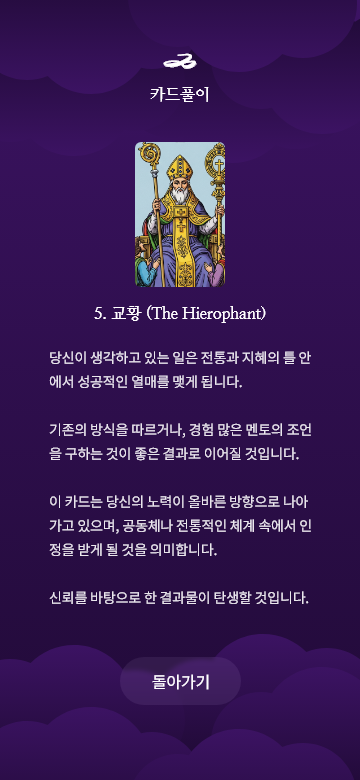

# C00. Module C 개요 · 채점 포인트

## 만들 화면

| 열매 타로 | 결과 (확인 전) | 결과 (확인 후) |
|---|---|---|
|  |  |  |

| 인연 타로 | 결과 (확인 전) | 결과 (확인 후) |
|---|---|---|
|  |  |  |

흐름: 홈 → 열매 타로 / 인연 타로 → 카드 선택 → 결과 (결과 확인) → 돌아가기 → 홈

## 배점 (30점)

| 구분 | 항목 | 점수 |
|---|---|---|
| 주관 | 열매 1.5 / 열매 결과 1.0 / 인연 1.5 / 인연 결과 1.0 프로토타입 일치 | 5.0 |
| 객관 | 아이콘, 이름, 제출 규칙 | 3.0 |
| 객관 | 열매 타로 UI 2.4 + 요구사항 2.0 + **셔플 애니메이션 0.4** | 4.8 |
| 객관 | 열매 결과 UI 1.8 + 2.1 + 요구사항 1.6 | 5.5 |
| 객관 | 인연 타로 UI 2.4 + 요구사항 2.5 | 4.9 |
| 객관 | 인연 결과 UI 2.4 + 2.8 + 요구사항 1.6 | 6.8 |

> 💡 **결과 화면 하나를 잘 만들면 열매·인연 둘 다 씁니다.** (UI 9.1점 + 요구사항 3.2점)
> 이 가이드는 결과 화면을 하나로 만들고, 어떤 JSON을 쓸지만 바꿉니다.

## 꼭 기억할 요구사항

- 열매 타로: `fruit_tarot_cards_data.json`, 카드 **9장 랜덤 배치 (3열 3행)**, 카드 선택 → 결과, **셔플 버튼 → "카드 셔플.mp4" 같은 애니메이션**
- 인연 타로: `loves_tarot_cards_data.json`, 9장 랜덤, **보이는 카드 6장**, **좌우 스크롤**로 9장 모두 확인
- 결과: 카드 이미지·번호·이름·본문은 JSON에서, **결과 확인 → "결과 확인.mp4" 같은 애니메이션**, 돌아가기 → 홈

## 시작: B 프로젝트 복사

1. Android Studio 닫기
2. `DailyTarot_B` 복사 → `DailyTarot_C`
3. 복사본에서 `Module_B_XXX.apk`, `build`, `app\build`, `.gradle`, `.idea` 삭제
4. Android Studio → Open → `DailyTarot_C`

> 시간이 급하면 `Navigator(Screen.Home)`으로 바꿔 홈에서 바로 시작해도 됩니다. (모듈별 채점 분리)

## 3시간 배분 예시

| 시간 | 할 일 |
|---|---|
| 0:00–0:20 | 복사, JSON, 화면 등록, 홈 연결 (C01) |
| 0:20–1:10 | 열매 타로 + 셔플 (C02) |
| 1:10–1:55 | 결과 화면 + 결과 확인 애니메이션 (C03) |
| 1:55–2:40 | 인연 타로 (C04) |
| 2:40–3:00 | **체크리스트 + APK + 제출** (C05) |

## 영상 2개를 먼저 보세요

`ModuleC/videos/카드 셔플.mp4`, `결과 확인.mp4`를 **0.5배속으로** 보고 메모해 두면 C02, C03에서 시간·방향만 맞추면 됩니다.

👉 다음: [C01. 준비 · 화면 등록](C01_준비_화면등록.md)
