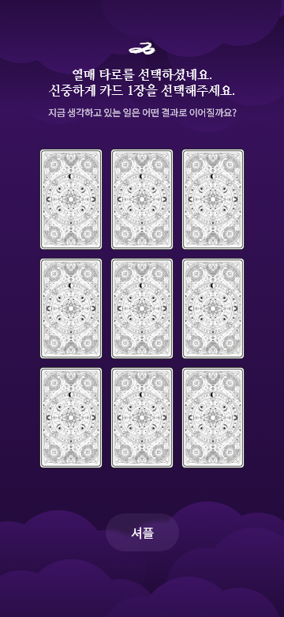

# C02. 열매 타로 · 셔플 애니메이션



## 채점 포인트

| UI 요소 (각 0.4) | 요구사항 (각 0.5) |
|---|---|
| 구름 (위·아래) | 홈의 열매 타로 클릭 → 이 화면 |
| 로고 그래픽 | `fruit_tarot_cards_data.json` 활용 |
| "열매 타로를 선택하셨네요. 신중하게 카드 1장을 선택해주세요." | 9장 **랜덤** 배치 (3열, 3행) |
| "지금 생각하고 있는 일은 어떤 결과로 이어질까요?" | 카드 선택 → 결과 화면 |
| 카드 이미지 9장 (3열, 3행) | **셔플 → "카드 셔플.mp4" 같은 애니메이션** (0.4) |
| 셔플 버튼 | |

## 셔플 애니메이션 설계

영상을 보고 아래 기본값을 조정하세요. 기본 흐름은 **"모였다가 → 섞이고 → 다시 펼쳐짐"** 입니다.

```
gather 0 → 1 (0.5s)  9장이 가운데 카드 자리로 모이며 살짝 회전
         (덱 순서를 다시 섞음)
gather 1 → 0 (0.5s)  다시 3×3 자리로 펼쳐짐
```

각 카드는 "자기 자리 → 가운데(1행 1열)" 까지의 거리에 `gather`를 곱한 만큼 이동합니다.

| 카드 위치 (열, 행) | 가운데까지 x | 가운데까지 y |
|---|---|---|
| (0, 0) 왼쪽 위 | +1칸 | +1칸 |
| (2, 0) 오른쪽 위 | -1칸 | +1칸 |
| (1, 1) 가운데 | 0 | 0 |

→ 공식: `x = (1 - col) × 칸 폭 × gather`, `y = (1 - row) × 칸 높이 × gather`

## 따라하기

새 파일 `FruitTarotScreen.kt`

```kotlin
package com.example.dailytarot

import androidx.compose.animation.core.Animatable
import androidx.compose.animation.core.FastOutSlowInEasing
import androidx.compose.animation.core.tween
import androidx.compose.foundation.Image
import androidx.compose.foundation.clickable
import androidx.compose.foundation.layout.Box
import androidx.compose.foundation.layout.Column
import androidx.compose.foundation.layout.Spacer
import androidx.compose.foundation.layout.fillMaxSize
import androidx.compose.foundation.layout.height
import androidx.compose.foundation.layout.offset
import androidx.compose.foundation.layout.size
import androidx.compose.foundation.shape.RoundedCornerShape
import androidx.compose.material3.Text
import androidx.compose.runtime.Composable
import androidx.compose.runtime.getValue
import androidx.compose.runtime.mutableStateOf
import androidx.compose.runtime.remember
import androidx.compose.runtime.rememberCoroutineScope
import androidx.compose.runtime.setValue
import androidx.compose.ui.Alignment
import androidx.compose.ui.Modifier
import androidx.compose.ui.draw.clip
import androidx.compose.ui.draw.shadow
import androidx.compose.ui.graphics.Color
import androidx.compose.ui.graphics.graphicsLayer
import androidx.compose.ui.layout.ContentScale
import androidx.compose.ui.platform.LocalContext
import androidx.compose.ui.res.painterResource
import androidx.compose.ui.text.font.FontWeight
import androidx.compose.ui.text.style.TextAlign
import androidx.compose.ui.unit.dp
import androidx.compose.ui.unit.sp
import kotlinx.coroutines.delay
import kotlinx.coroutines.launch

@Composable
fun FruitTarotScreen(onPick: (TarotCard) -> Unit) {
    val context = LocalContext.current
    // JSON의 9장을 랜덤 순서로
    var deck by remember { mutableStateOf(TarotData.load(context, TarotKind.Fruit.file).shuffled()) }
    val gather = remember { Animatable(0f) }
    var shuffling by remember { mutableStateOf(false) }
    val scope = rememberCoroutineScope()

    fun shuffle() {
        if (shuffling) return
        shuffling = true
        scope.launch {
            gather.animateTo(1f, tween(500, easing = FastOutSlowInEasing))   // 모이기
            deck = deck.shuffled()                                            // 섞기
            delay(150)
            gather.animateTo(0f, tween(500, easing = FastOutSlowInEasing))   // 펼치기
            shuffling = false
        }
    }

    TarotBackground(showMoon = false, topCloud = true) {
        Column(Modifier.fillMaxSize(), horizontalAlignment = Alignment.CenterHorizontally) {
            Spacer(Modifier.height(40.dp))
            LogoMark()
            Spacer(Modifier.height(8.dp))
            Text(
                "열매 타로를 선택하셨네요.\n신중하게 카드 1장을 선택해주세요.",
                color = Color.White,
                fontFamily = Myeongjo,
                fontWeight = FontWeight.Bold,
                fontSize = 17.sp,
                lineHeight = 24.sp,
                textAlign = TextAlign.Center
            )
            Spacer(Modifier.height(10.dp))
            Text(
                "지금 생각하고 있는 일은 어떤 결과로 이어질까요?",
                color = White70,
                fontFamily = NotoSans,
                fontSize = 12.sp
            )

            Spacer(Modifier.weight(1f))
            CardGrid(cards = deck, gather = gather.value, enabled = !shuffling, onPick = onPick)
            Spacer(Modifier.weight(1f))

            SoftButton("셔플", onClick = { shuffle() })
            Spacer(Modifier.height(40.dp))
        }
    }
}

// ───────── 3×3 카드 뒷면 ─────────
@Composable
fun CardGrid(cards: List<TarotCard>, gather: Float, enabled: Boolean, onPick: (TarotCard) -> Unit) {
    val cardW = 76.dp
    val cardH = 122.dp                // 뒷면 이미지 400×640 비율
    val gapX = 14.dp
    val gapY = 12.dp

    Box(Modifier.size(width = cardW * 3 + gapX * 2, height = cardH * 3 + gapY * 2)) {
        cards.take(9).forEachIndexed { i, card ->
            val col = i % 3
            val row = i / 3
            Image(
                painter = painterResource(R.drawable.tarot_card_back),
                contentDescription = "카드 ${i + 1}",
                contentScale = ContentScale.FillBounds,
                modifier = Modifier
                    .offset(x = (cardW + gapX) * col, y = (cardH + gapY) * row)
                    .size(cardW, cardH)
                    .graphicsLayer {
                        translationX = (1 - col) * (cardW + gapX).toPx() * gather
                        translationY = (1 - row) * (cardH + gapY).toPx() * gather
                        rotationZ = (i - 4) * 6f * gather
                    }
                    .shadow(4.dp, RoundedCornerShape(6.dp))
                    .clip(RoundedCornerShape(6.dp))
                    .clickable(enabled = enabled) { onPick(card) }
            )
        }
    }
}
```

## App.kt 연결

```kotlin
Screen.FruitTarot -> FruitTarotScreen(onPick = { card -> nav.go(Screen.TarotResult(TarotKind.Fruit, card)) })
```

## 핵심 설명

- **"랜덤 배치"를 증명하는 법**: 뒷면만 보이니 랜덤인지 눈으로 알 수 없습니다. 채점자는 같은 자리 카드를 여러 번 골라 **결과가 바뀌는지** 확인합니다. `shuffled()`로 화면에 들어올 때마다, 셔플할 때마다 순서가 바뀝니다.
- **셔플 중에는 클릭 금지** (`enabled = !shuffling`): 애니메이션 중 눌리면 엉뚱한 카드가 선택됩니다.
- **`graphicsLayer`는 레이아웃을 안 바꿈**: 카드가 가운데로 모여도 다른 요소가 움직이지 않습니다.

## 영상과 다를 때 바꿀 곳

| 영상에서 본 것 | 바꿀 곳 |
|---|---|
| 모이지 않고 **좌우로 흔들림** | `translationX = sin(...)` 형태로, `gather` 대신 `Animatable`을 여러 번 왕복 |
| 카드가 **뒤집힘** | `rotationY = 180f * gather` |
| 한 장씩 **순서대로** 모임 | 카드마다 `delay(i * 40)`을 준 별도 `Animatable` |
| 더 느림/빠름 | `tween(500)` 숫자 |

## ✅ 실행해서 확인
- [ ] 홈 → 열매 타로, 문구 두 줄 + 작은 안내 + 3×3 카드 + 셔플 버튼
- [ ] 셔플 → 9장이 모였다가 다시 펼쳐짐 (약 1.2초), 그동안 카드 클릭 안 됨
- [ ] 아무 카드 클릭 → 결과(임시)에 카드 이름. 뒤로 와서 **같은 자리**를 셔플 후 다시 → 다른 카드가 나올 수 있다
- [ ] 홈에서 다시 들어오면 배치가 바뀐다

👉 다음: [C03. 결과 화면](C03_결과화면.md)
