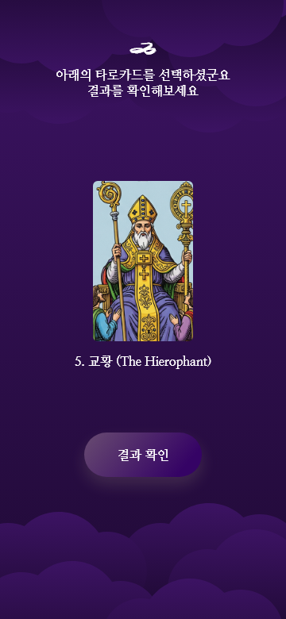
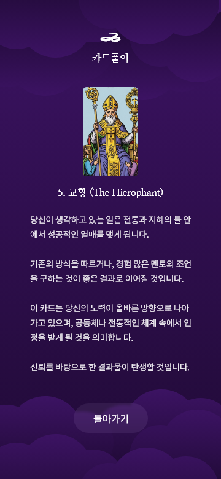

# C03. 결과 화면 (열매 · 인연 공용)

| 결과 확인 전 | 결과 확인 후 |
|---|---|
|  |  |

## 채점 포인트 (열매·인연 각각)

| 결과 확인 전 UI | 결과 확인 후 UI | 요구사항 |
|---|---|---|
| 구름 (위·아래) | 구름 (위·아래) | 카드 데이터(이미지·번호·이름·본문)는 **해당 JSON** 사용 |
| 로고 그래픽 | 로고 그래픽 | **결과 확인 → "결과 확인.mp4" 같은 애니메이션** |
| "아래의 타로카드를 선택하셨군요 결과를 확인해보세요" | **"카드풀이"** | 결과 확인 → 결과 표시 |
| 카드 이미지 | 카드 이미지 | 돌아가기 → 홈 |
| 카드 이름 (번호 포함) "5. 교황 (The Hierophant)" | 카드 이름 (번호 포함) | |
| 결과 확인 버튼 | **카드 본문** / **돌아가기 버튼** | |

## 결과 확인 애니메이션 설계

두 프로토타입을 비교하면 **바뀌는 것**이 보입니다.

| 요소 | 전 | 후 |
|---|---|---|
| 제목 | "아래의 타로카드를…" | "카드풀이" |
| 카드 | 크고 아래쪽 | 작고 위쪽 |
| 결과 확인 버튼 | 있음 | 없음 |
| 본문, 돌아가기 | 없음 | 있음 |

진행값 `p` 하나(0 → 1)로 전부 움직입니다.

```
제목      : 옛 제목 alpha = 1-p,  새 제목 alpha = p     (겹쳐서 바뀜)
카드 위 여백: lerp(70dp, 20dp, p)                       (위로 올라감)
카드 폭    : lerp(126dp, 90dp, p)                      (작아짐)
본문      : alpha = p, 아래에서 60dp 올라옴
```

영상에서 **카드가 뒤집히거나(flip) 빛나는** 효과가 있다면 아래 "영상과 다를 때"를 보세요.

## 따라하기

새 파일 `TarotResultScreen.kt`

```kotlin
package com.example.dailytarot

import androidx.compose.animation.core.Animatable
import androidx.compose.animation.core.FastOutSlowInEasing
import androidx.compose.animation.core.tween
import androidx.compose.foundation.Image
import androidx.compose.foundation.layout.Box
import androidx.compose.foundation.layout.Column
import androidx.compose.foundation.layout.Spacer
import androidx.compose.foundation.layout.aspectRatio
import androidx.compose.foundation.layout.fillMaxSize
import androidx.compose.foundation.layout.fillMaxWidth
import androidx.compose.foundation.layout.height
import androidx.compose.foundation.layout.padding
import androidx.compose.foundation.layout.width
import androidx.compose.foundation.rememberScrollState
import androidx.compose.foundation.shape.RoundedCornerShape
import androidx.compose.foundation.verticalScroll
import androidx.compose.material3.Text
import androidx.compose.runtime.Composable
import androidx.compose.runtime.getValue
import androidx.compose.runtime.mutableStateOf
import androidx.compose.runtime.remember
import androidx.compose.runtime.rememberCoroutineScope
import androidx.compose.runtime.setValue
import androidx.compose.ui.Alignment
import androidx.compose.ui.Modifier
import androidx.compose.ui.draw.clip
import androidx.compose.ui.graphics.Color
import androidx.compose.ui.graphics.graphicsLayer
import androidx.compose.ui.layout.ContentScale
import androidx.compose.ui.text.font.FontWeight
import androidx.compose.ui.text.style.TextAlign
import androidx.compose.ui.unit.dp
import androidx.compose.ui.unit.lerp
import androidx.compose.ui.unit.sp
import kotlinx.coroutines.launch

@Composable
fun TarotResultScreen(card: TarotCard, onHome: () -> Unit) {
    val image = rememberCardImage(card.image)
    val reveal = remember { Animatable(0f) }
    var revealed by remember { mutableStateOf(false) }
    val scope = rememberCoroutineScope()
    val p = reveal.value

    // 프로토타입처럼 문장마다 한 줄 띄우기
    val body = remember(card) { card.storytelling.replace(". ", ".\n\n") }

    TarotBackground(showMoon = false, topCloud = true) {
        Column(
            Modifier.fillMaxSize().padding(horizontal = 32.dp),
            horizontalAlignment = Alignment.CenterHorizontally
        ) {
            Spacer(Modifier.height(40.dp))
            LogoMark()
            Spacer(Modifier.height(10.dp))

            // 제목 두 개를 겹쳐 놓고 투명도로 바꾼다
            Box(contentAlignment = Alignment.Center) {
                Text(
                    "아래의 타로카드를 선택하셨군요\n결과를 확인해보세요",
                    color = Color.White,
                    fontFamily = Myeongjo,
                    fontWeight = FontWeight.Bold,
                    fontSize = 16.sp,
                    lineHeight = 22.sp,
                    textAlign = TextAlign.Center,
                    modifier = Modifier.graphicsLayer { alpha = 1f - p }
                )
                Text(
                    "카드풀이",
                    color = Color.White,
                    fontFamily = Myeongjo,
                    fontWeight = FontWeight.Bold,
                    fontSize = 16.sp,
                    modifier = Modifier.graphicsLayer { alpha = p }
                )
            }

            Spacer(Modifier.height(lerp(70.dp, 20.dp, p)))

            Image(
                bitmap = image,
                contentDescription = card.name,
                contentScale = ContentScale.Crop,
                modifier = Modifier
                    .width(lerp(126.dp, 90.dp, p))
                    .aspectRatio(303f / 430f)
                    .clip(RoundedCornerShape(8.dp))
            )
            Spacer(Modifier.height(16.dp))
            Text(
                "${card.number}. ${card.name}",
                color = Color.White,
                fontFamily = Myeongjo,
                fontSize = 16.sp
            )

            // 아래 영역: 확인 전 = 결과 확인 버튼 / 확인 후 = 본문
            Box(Modifier.weight(1f).fillMaxWidth()) {
                if (!revealed) {
                    GlowButton(
                        text = "결과 확인",
                        showArrow = false,
                        modifier = Modifier.align(Alignment.Center),
                        onClick = {
                            revealed = true
                            scope.launch { reveal.animateTo(1f, tween(900, easing = FastOutSlowInEasing)) }
                        }
                    )
                } else {
                    Text(
                        body,
                        color = Color.White,
                        fontFamily = NotoSans,
                        fontSize = 14.sp,
                        lineHeight = 24.sp,
                        modifier = Modifier
                            .fillMaxSize()
                            .verticalScroll(rememberScrollState())
                            .padding(top = 20.dp)
                            .graphicsLayer {
                                alpha = p
                                translationY = (1 - p) * 60.dp.toPx()
                            }
                    )
                }
            }

            if (revealed) {
                Spacer(Modifier.height(12.dp))
                SoftButton("돌아가기", onClick = onHome, modifier = Modifier.graphicsLayer { alpha = p })
            }
            Spacer(Modifier.height(28.dp))
        }
    }
}
```

## App.kt 연결

```kotlin
is Screen.TarotResult -> TarotResultScreen(screen.card, onHome = { nav.reset(Screen.Home) })
```

`TarotResult`에 이미 `card`(열매 JSON에서 고른 카드 또는 인연 JSON에서 고른 카드)가 들어 있으므로 화면은 하나로 충분합니다.

## 영상과 다를 때 바꿀 곳

| 영상에서 본 것 | 바꿀 곳 |
|---|---|
| 카드가 **Y축으로 한 바퀴** 돌며 작아짐 | 카드 `Image`에 `.graphicsLayer { rotationY = 360f * p; cameraDistance = 12 * density }` |
| 카드가 **뒷면 → 앞면**으로 뒤집힘 | `rotationY = 180f * p` 이고, `p < 0.5`일 때는 `tarot_card_back`을 그림 |
| 본문이 **한 줄씩** 나타남 | 문단마다 `Text`를 나누고 각자 `delay`를 준 `Animatable` |
| 버튼이 **작아지며** 사라짐 | 버튼을 바로 지우지 않고 `scaleX/scaleY = 1 - p` 후 제거 |

## ✅ 실행해서 확인
- [ ] 열매 타로에서 카드 선택 → "아래의 타로카드를…" + 큰 카드 + "5. 교황 (The Hierophant)" 형식 + 결과 확인
- [ ] 결과 확인 → 제목이 "카드풀이"로 바뀌고 카드가 위로 작아지며 본문이 올라온다
- [ ] 본문이 **열매 JSON의 storytelling**과 같다 ("당신이 생각하고 있는 일은…")
- [ ] 돌아가기 → 홈 / 휴대폰 뒤로가기 → 열매 타로

👉 다음: [C04. 인연 타로](C04_인연타로.md)
