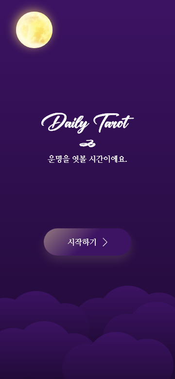
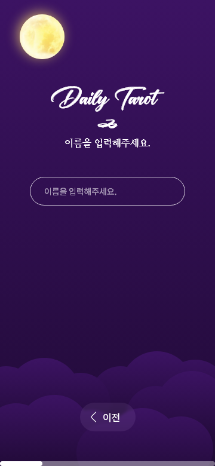
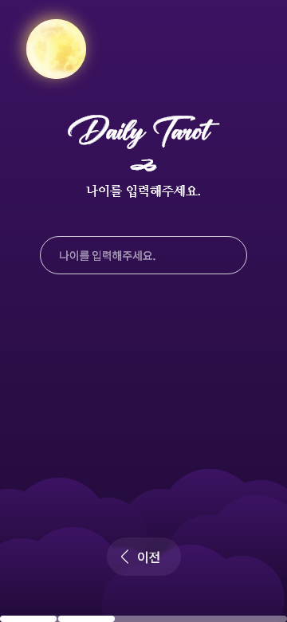
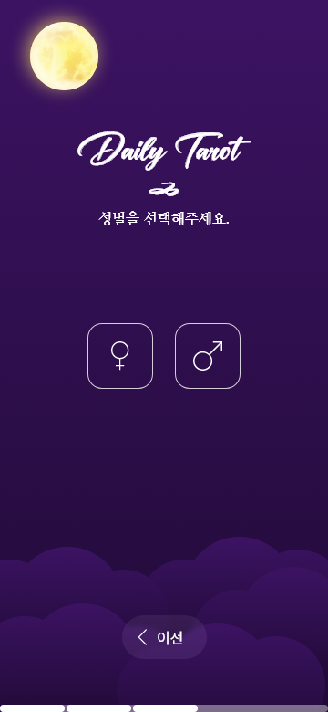
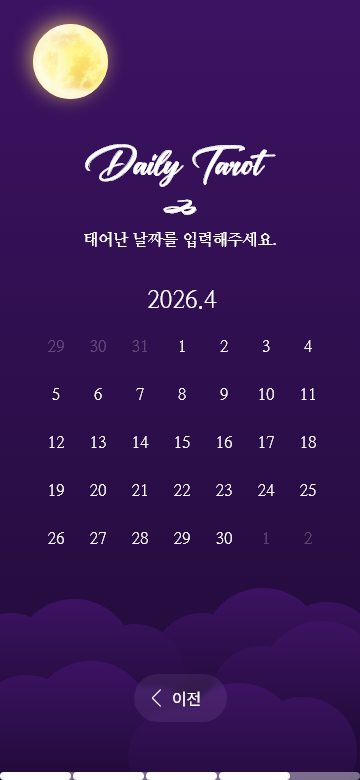
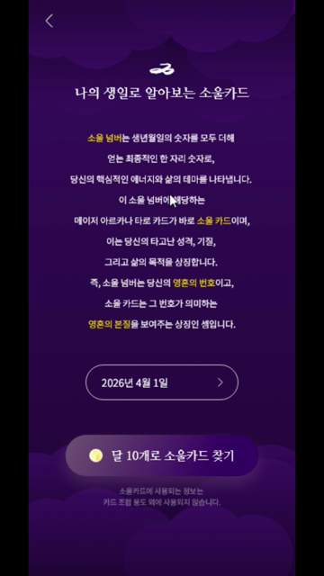
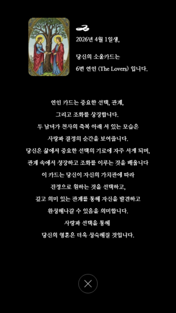

# Daily Tarot 따라 만들기 (모바일 앱 개발 실습)

2026 지방기능경기대회 **모바일 앱 개발** 공개과제 "Daily Tarot"을
**Kotlin + Jetpack Compose**로 처음부터 끝까지 따라 만드는 실습 가이드입니다.

> 이 가이드는 **위에서 아래로, 번호 순서대로** 진행하도록 만들었습니다.
> 각 단계 끝에 **"✅ 실행해서 확인"** 이 있습니다. 확인이 안 되면 다음 단계로 넘어가지 마세요.

## 완성하면 이런 앱이 됩니다

| 시작 | 이름 | 나이 | 성별 | 생년월일 |
|---|---|---|---|---|
|  |  |  |  |  |

| 소울카드 소개 | 카드 등장 | 결과 |
|---|---|---|
|  |  |  |

## 진행 순서

| 단계 | 내용 | 예상 시간 |
|---|---|---|
| [00. 시작하기 전에](00_시작하기_전에.md) | 무엇을 만드는지, 진행 규칙 | 10분 |
| [01. 프로젝트 만들기](01_프로젝트_만들기.md) | Android Studio 새 프로젝트 | 15분 |
| [02. 제공 파일 넣기](02_제공파일_넣기.md) | SVG 아이콘, JSON, 카드 이미지 | 15분 |
| [03. 배경 · 달 · 구름](03_배경_달_구름.md) | 모든 화면이 같이 쓰는 배경 | 30분 |
| [04. 시작 화면](04_시작화면.md) | "시작하기" 버튼 | 20분 |
| [05. 화면 전환 뼈대](05_화면전환_뼈대.md) | 화면 이동, 뒤로가기 | 30분 |
| [06. 이름 · 나이 입력](06_이름_나이_입력.md) | 입력칸, 진행바, 이전 버튼 | 40분 |
| [07. 성별 선택](07_성별_선택.md) | ♀ ♂ 버튼 | 15분 |
| [08. 달력](08_달력.md) | 직접 만드는 달력 | 50분 |
| [09. 카드 데이터 · 소울 넘버](09_카드데이터_소울넘버.md) | JSON 읽기, 숫자 계산 | 30분 |
| [10. 소울카드 소개 화면](10_소울카드_소개화면.md) | 노란 강조 글씨, 달 버튼 | 40분 |
| [11. 결과 화면 · 애니메이션](11_결과화면_애니메이션.md) | 카드 이동 연출 | 60분 |
| [12. 마무리 점검](12_마무리_점검.md) | 체크리스트 | 20분 |
| [13. 변형 문제 연습](13_변형문제_연습.md) | 대회 때 바뀔 만한 부분 | 자유 |
| [99. 완성 코드](99_완성코드.md) | 막혔을 때 비교용 | - |

## 폴더 안내

- `images/` : 완성 화면 캡처 (참고용)
- `제공파일/` : 대회 선수 제공 파일 중 JSON과 SVG 아이콘

> ⚠️ **카드 그림 9장(1_magician.png ~ 9_hermit.png)은 이 저장소에 없습니다.**
> 대회 선수 제공 파일(zip)에 들어 있으니 그 안의 이미지를 사용하세요. 없어도 앱은 실행되고, 그림 자리에 회색 상자가 나옵니다.
